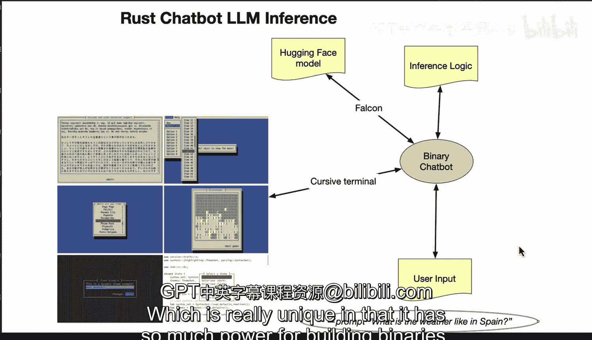

# 大型语言模型实践（高级数据工程、AWS、Databricks和本地LLM）：P172：71_04_04_Rust聊天推理系统


在本节课中，我们将学习如何使用Rust生态系统中一些即插即用的组件，来构建一个用于大型语言模型推理的Rust聊天机器人。

## 🦅 选择并加载模型

首先，我们可以考虑使用Falcon模型，这是一个很好的入门选择。该模型擅长处理自然语言对话。

我们可以使用像`candle`这样的Rust库将模型加载到Rust程序中。`candle`是一个Rust机器学习框架，可以访问Hugging Face上的模型。

以下是加载模型的核心代码概念：
```rust
// 伪代码示例：使用candle加载Hugging Face模型
let model = candle::hf::load_model("tiiuae/falcon-7b")?;
```

## 💬 构建聊天机器人界面

上一节我们介绍了如何加载模型，本节中我们来看看如何构建用户界面。我们可以使用`cursive`这样的库来构建一个基于终端的聊天机器人界面。这个界面可以接收用户输入并打印机器人的回复。

以下是构建界面的核心步骤：

1.  初始化`cursive`终端界面。
2.  创建输入框和输出显示区域。
3.  设置事件循环以处理用户输入。

## 🔁 实现核心聊天逻辑

在构建好界面之后，我们需要实现核心的聊天逻辑循环。这个循环会持续提示用户输入，接收他们的输入文本，将其传递给之前加载的Hugging Face模型，然后打印模型的回复。

以下是实现聊天逻辑的关键点：

1.  **处理输入**：从界面获取用户输入的文本。
2.  **调用模型**：将文本传递给加载的模型进行推理。
3.  **生成回复**：模型会处理所有自然语言处理任务，包括分析用户输入、生成连贯的回复，甚至考虑对话的上下文。
4.  **输出结果**：将模型生成的回复显示在界面上。

Rust代码在这里的作用是促进这种交互。我们还可以添加额外的逻辑，例如情感分析，以使回复显得更自然。

## 🚀 扩展与展望

在完成这个原型之后，界面甚至可以适配成一个Web应用程序。

总而言之，我们想要做的事情可以概括为以下几个步骤：

1.  从Hugging Face选择合适的模型（例如最新的Falcon模型）。
2.  将其加载到Rust环境中。
3.  构建聊天机器人用户界面。
4.  结合Hugging Face模型实现聊天逻辑。
5.  实现持续提示和生成回复的循环。

现在对开发者来说是一个激动人心的时代，因为我们可以将所有工具直接集成到像Rust这样对命令行友好的语言中。Rust的独特之处在于它在构建二进制程序方面拥有强大的能力。



## 📝 总结


本节课中我们一起学习了构建一个Rust聊天推理系统的完整流程。我们从选择并加载Hugging Face上的Falcon模型开始，然后使用`cursive`库构建了终端用户界面，最后实现了连接模型与界面的核心聊天逻辑循环。这个过程展示了如何利用Rust生态的高性能组件快速搭建一个可工作的LLM应用原型。