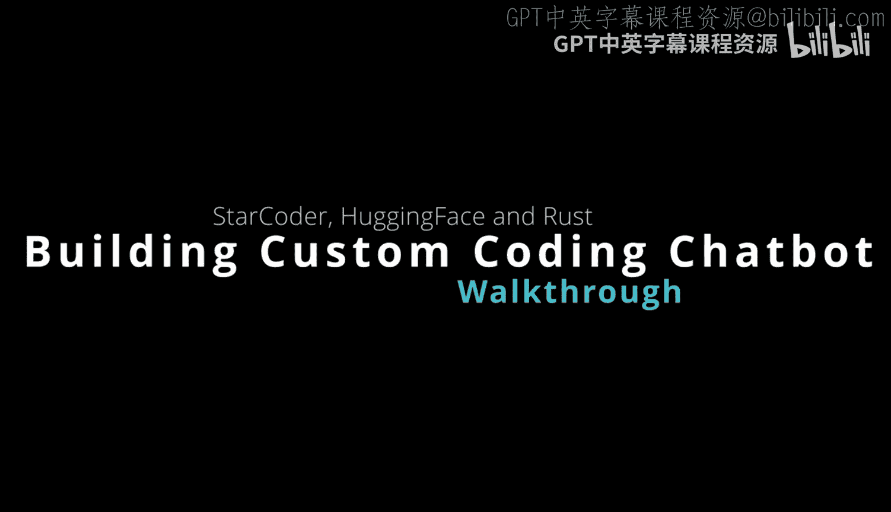
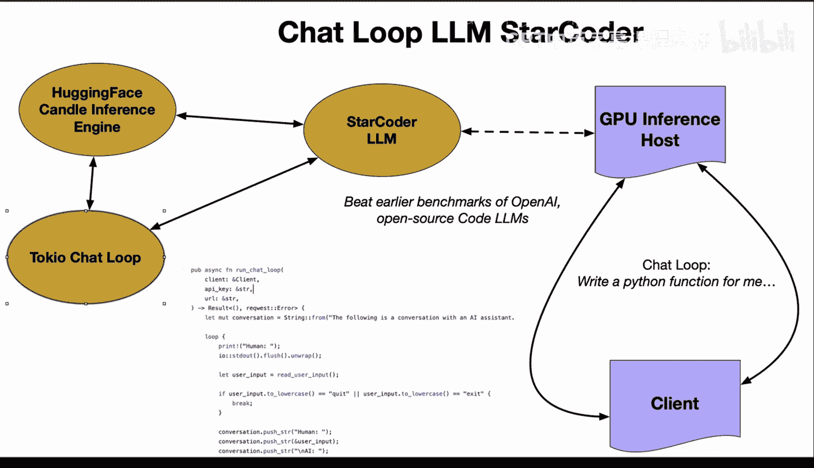

# 大型语言模型实践：P173：使用StarCoder构建自定义聊天循环



## 概述
在本节课中，我们将学习如何利用Hugging Face的StarCoder大型语言模型，结合Rust编程语言和Tokio异步运行时，构建一个属于你自己的、功能强大的代码助手聊天循环。整个过程无需支付任何费用，完全基于开源工具。

## 构建自定义代码助手聊天循环

使用大型语言模型构建聊天循环，最令人兴奋的应用之一就是创建你自己的代码助手。Hugging Face的StarCoder模型在此类任务中表现卓越，其性能甚至超越了OpenAI早期的模型或其他竞争解决方案。

下面，让我们通过一个具体示例，深入探讨如何构建一个自定义的对话式AI。

## 核心组件与工作流程

观察这个提示示例，我们的目标是让模型生成经过深思熟虑的响应。以下是实现这一目标的关键步骤和组件。

上一节我们介绍了构建代码助手的整体概念，本节中我们来看看实现它的具体技术栈和流程。

以下是构建聊天循环的核心步骤：

1.  **模型调用**：向StarCoder模型发送请求。该模型可以部署在GPU实例上，例如AWS的G5实例。
2.  **异步请求**：利用`async`请求实现非阻塞的异步通信。这使得聊天机器人能够轻松、快速地响应用户输入。
3.  **对话历史管理**：将每一组用户消息和AI回复追加到对话历史记录中。这为AI提供了持续的上下文，使其能进行连贯的对话。
4.  **数据序列化**：使用`JSON`格式进行简便的数据序列化与反序列化，便于在客户端和服务器之间传递消息。
5.  **Rust语言优势**：借助Rust强大的类型系统和内存安全性，我们可以确保构建出的聊天机器人既健壮又安全。
6.  **模型集成**：利用Hugging Face的`Candle`推理引擎，轻松集成StarCoder大型语言模型。
7.  **聊天循环实现**：基于Tokio异步运行时构建自定义的聊天循环。你可以看到，我们定义了一个`pub async fn`函数来实现聊天循环，它能够遍历并响应用户输入的消息。

## 代码结构示例

以下是一个简化的代码结构示意，展示了异步聊天循环的核心部分：

```rust
pub async fn chat_loop(mut conversation_history: Vec<Message>) -> Result<(), Error> {
    let model = load_starcoder_model()?; // 加载StarCoder模型
    let inference_engine = CandleInferenceEngine::new(model);

    loop {
        // 1. 接收用户输入
        let user_input = receive_user_input().await?;

        // 2. 将用户消息加入历史
        conversation_history.push(Message::User(user_input));

        // 3. 准备包含历史的提示
        let prompt = format_conversation_history(&conversation_history);

        // 4. 异步调用模型生成回复
        let ai_response = inference_engine.generate_async(prompt).await?;

        // 5. 将AI回复加入历史
        conversation_history.push(Message::Assistant(ai_response.clone()));

        // 6. 将回复返回给用户
        send_response_to_user(ai_response).await?;
    }
}
```



## 总结
本节课中，我们一起学习了如何整合多个强大的开源工具来构建自定义的代码助手聊天循环。我们从StarCoder模型出发，通过Hugging Face的推理引擎进行集成，并利用Rust和Tokio构建了高效、安全的异步聊天循环。最终，你无需依赖任何付费服务，就能拥有一个功能完整的编程辅助工具。这套方案清晰、直接，为开发者提供了强大的自主控制能力。