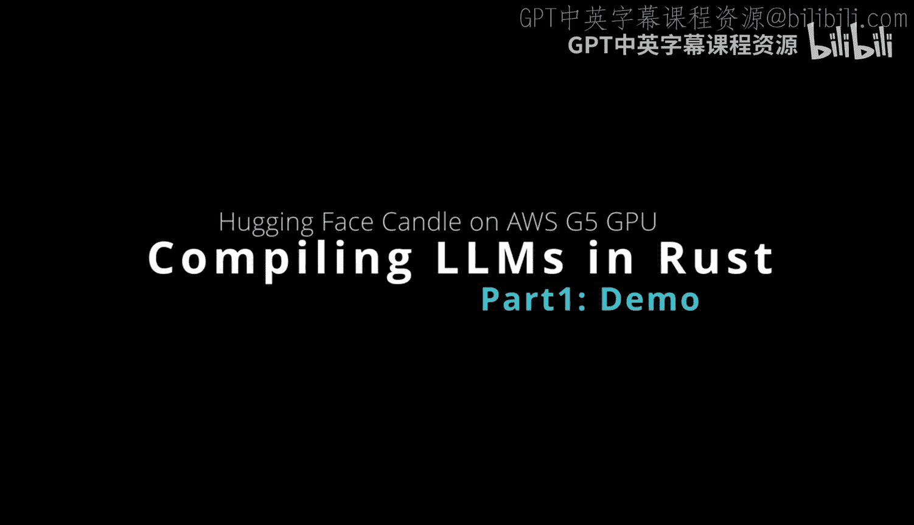
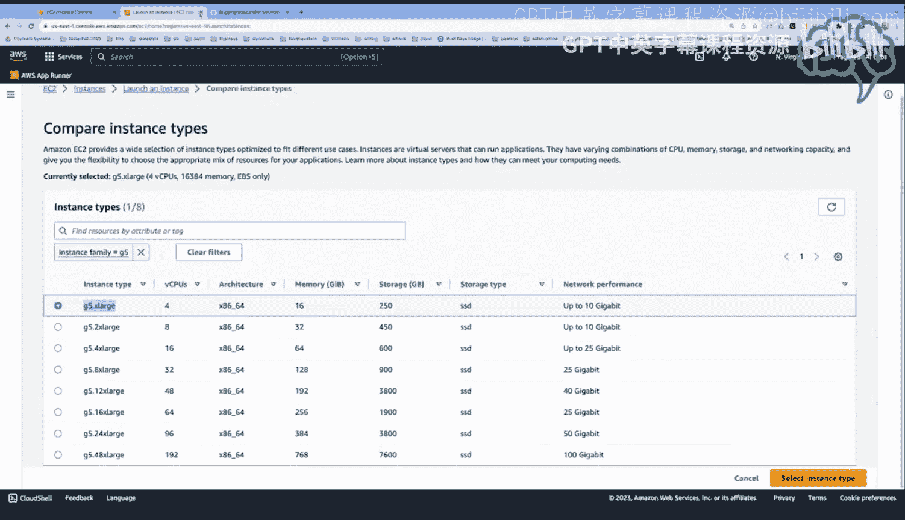
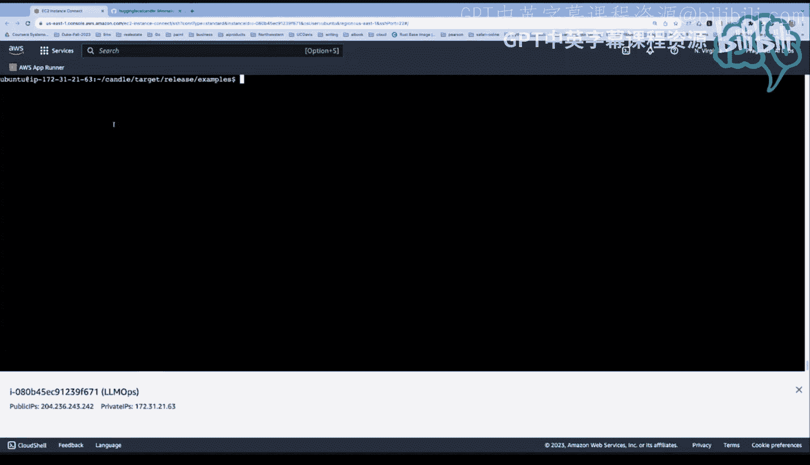
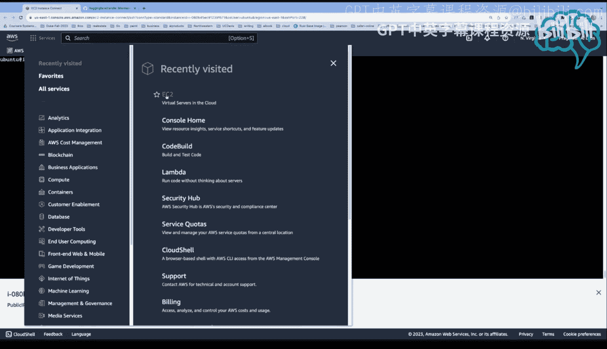
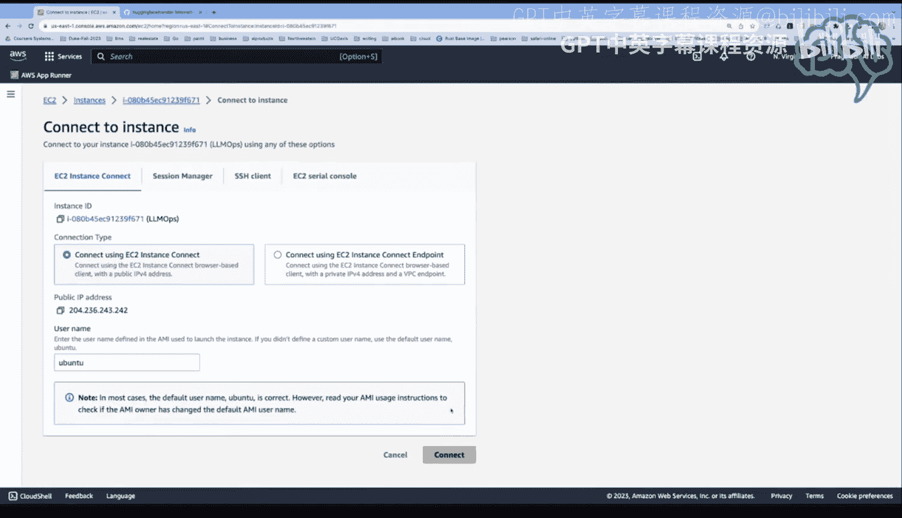
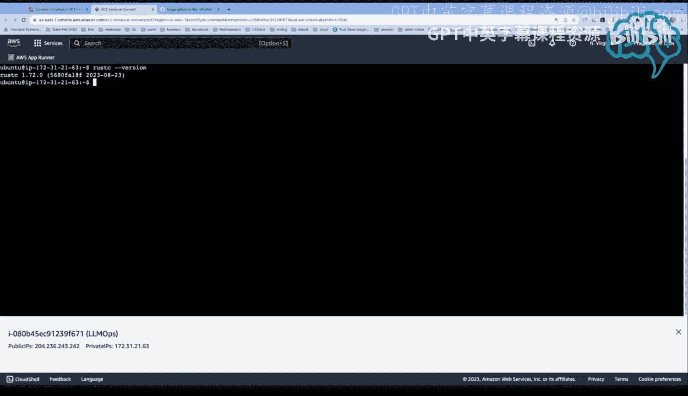
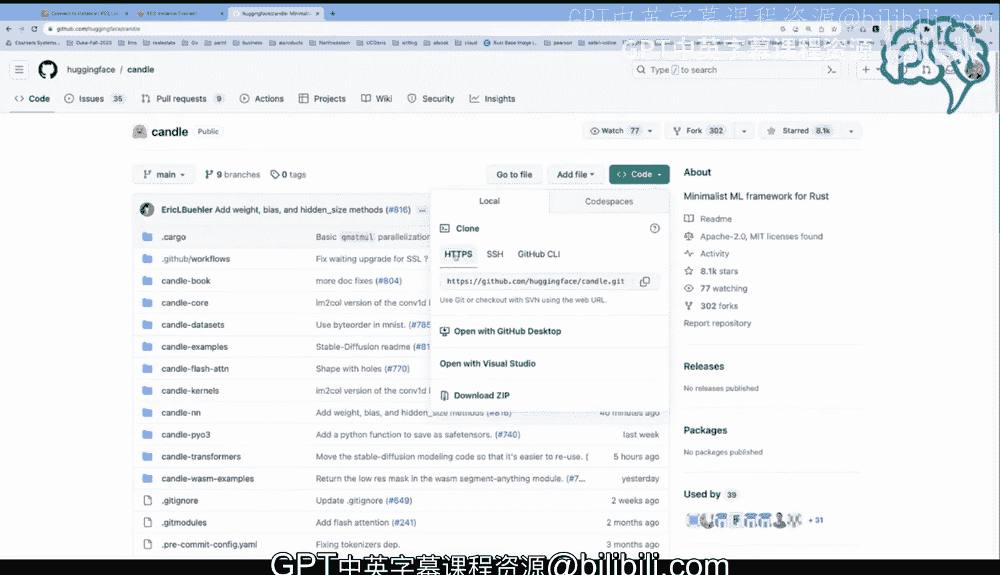

# 大型语言模型实践（高级数据工程、AWS、Databricks和本地LLM）：P174：73_04_06_AWS GPU上调用Rust Candle框架（上）🚀

在本节课中，我们将学习一个有趣的场景：如何使用Rust的包管理系统来调用大型语言模型。许多人都在讨论大型语言模型及其强大功能。你会看到人们构建复杂的应用和工作流，运行大型语言模型通常伴随着许多复杂性。然而，得益于Rust语言和Cargo包管理系统的优势，你无需进行复杂操作，可以直接使用Cargo系统来调用模型。我们将结合Hugging Face的Candle框架，并在AWS的GPU实例上完成这一操作。这是一个非常强大的GPU环境，让我们开始探索具体步骤。

## 概述：Rust Candle框架与AWS GPU的优势

上一节我们提到了使用Rust和Cargo调用LLM的便捷性。本节中，我们来看看如何具体实施。首先，让我们了解一下Hugging Face Candle。这是一个为Rust设计的极简机器学习框架。它的代码非常简单。最令人兴奋的一点，也是LLM Ops领域最激动人心的特性之一，就是你可以通过运行一行命令来运行所有这些大型语言模型。我不明白为什么没有更多人使用它，这确实非常令人兴奋。接下来，我们将学习如何自己运行它，这样你就不必付费让他人运行大型语言模型，也无需注册某些API服务。一切已准备就绪，你可以直接开始。

## 第一步：在AWS控制台配置GPU实例

那么，我们具体该如何操作呢？第一步，让我们查看AWS控制台。根据我的建议，你需要进入“实例”页面，然后选择“启动实例”。

此时，你需要选择一个基础AMI。例如，“Deep Learning Base AMI”是一个很好的起点，因为它没有预装你不需要的额外软件。很多时候，人们会查看“Deep Learning AMI”，但它预装了许多你不需要的“垃圾”软件。例如，如果我们使用Rust，就不需要像Hugging Face Hub这样的Python包管理工具。我只需要CUDA驱动程序和cuDNN（一个为神经网络优化的CUDA库）被安装。

因此，我真正需要做的就是选择“Ubuntu Deep Learning Base AMI”。选择之后，实例类型就变得至关重要。

以下是选择实例类型的关键步骤：

*   在这个场景中，你需要选择基于NVIDIA的选项。
*   我们可以查看“NVIDIA”或“加速计算”家族。
*   例如，`g5`系列是我推荐的家族类型，它们已经预配置了NVIDIA环境。

现在我们已经了解了选择标准。我转到EC2控制台，可以看到一台正在运行的机器。这台机器已经包含了我们所需的一切。让我快速展示如何连接它。我进入“实例”页面，看到一台名为“LLM Ops”的机器正在运行。它是一台`g5.16xlarge`实例。我只需要点击“连接”，然后选择“使用EC2 Instance Connect连接”。这样，我甚至无需设置SSH密钥或任何其他配置，就可以直接访问它。

## 第二步：在实例上安装必要软件

连接成功后，你唯一需要做的另一件事就是安装Rust。实际上，这只需要一个命令：`rustup`。

我已经安装了Rust，我们可以用 `rustc --version` 命令来验证。另一件需要做的事是克隆Hugging Face的Candle代码仓库。你需要进入代码页面，选择本地克隆，并通过HTTPS进行克隆。

## 总结

本节课中，我们一起学习了在AWS GPU实例上配置环境以运行Rust Candle框架的基础步骤。我们了解了选择合适的基础AMI和GPU实例类型的重要性，并演示了如何轻松连接到EC2实例以及安装Rust开发环境。这为下一节课实际使用Cargo调用大型语言模型打下了坚实基础。