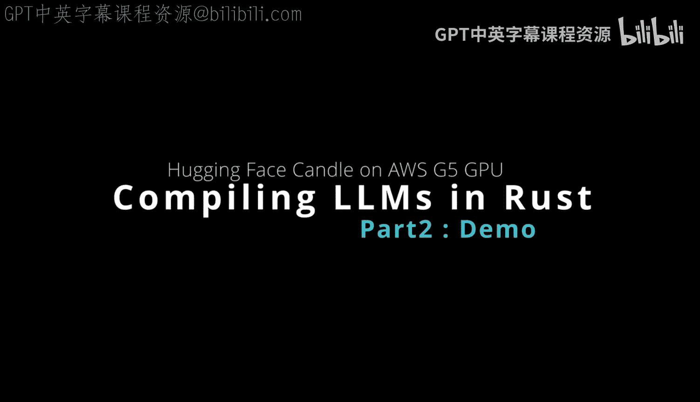
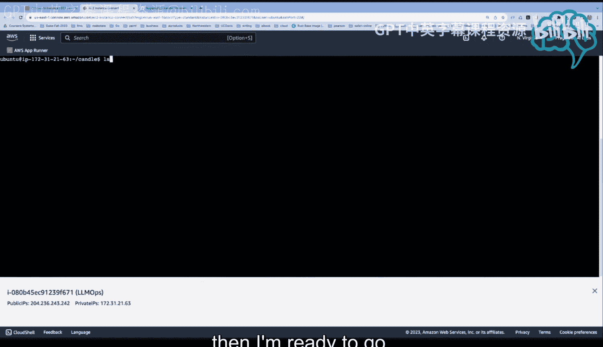
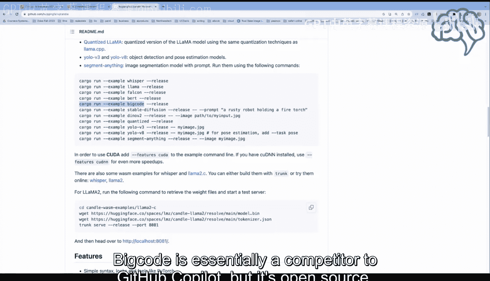
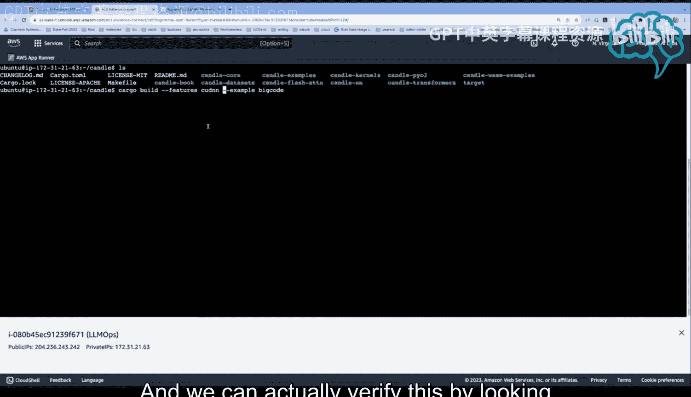
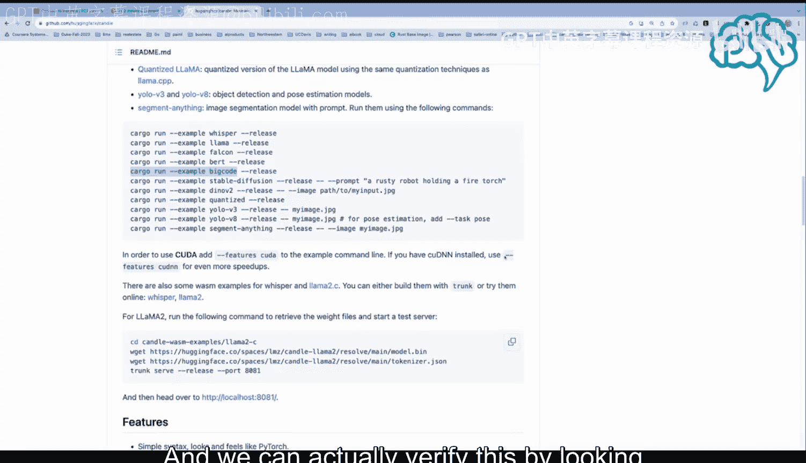
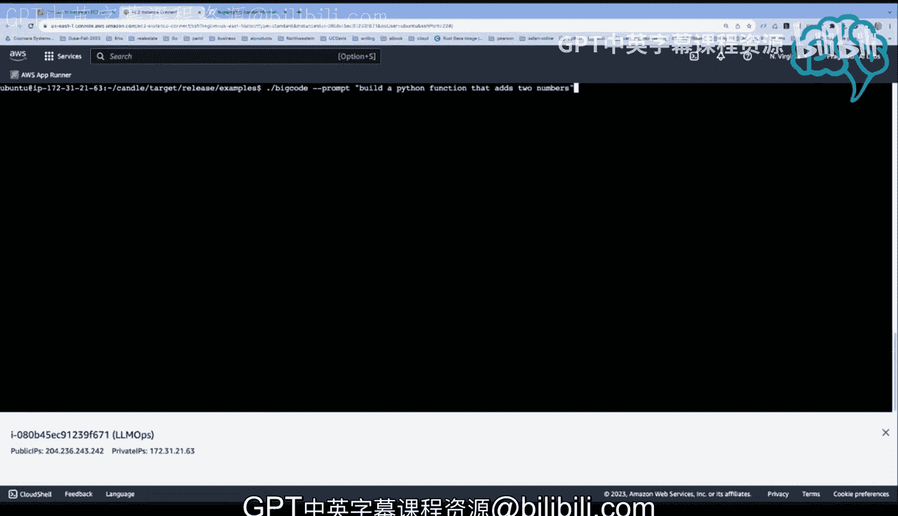

# 大型语言模型实践（高级数据工程、AWS、Databricks和本地LLM）：P175：74_04_07_AWS GPU上调用Rust Candle框架（下）

在本节课中，我们将学习如何在AWS GPU实例上，通过构建和运行Rust Candle框架的示例项目，来调用一个开源的大型语言模型。我们将以BigCode模型为例，演示从克隆代码到实际运行模型的完整流程。

上一节我们介绍了Rust Candle框架的基本概念和环境准备，本节中我们来看看如何具体构建和运行一个模型。

## 获取与更新项目代码

首先，你需要访问项目仓库并复制其地址。完成克隆操作后，即可获得项目代码。

我已经完成了克隆操作。此时，我可以执行 `git pull` 命令来获取项目的最新更新，因为该项目正在被积极开发。

更新完成后，就可以准备运行了。

## 运行模型的方法

现在，我们来看看如何实际运行这些大型语言模型。你可以查看项目中的说明文档来获取指引。

运行模型主要有两种方式。一种是直接运行，但另一种更好的方式是先构建项目，生成可执行文件，然后在目标目录中操作模型。

## 以BigCode模型为例

例如，BigCode本质上是GitHub Copilot的一个开源竞争对手。如果我们想运行它，具体该如何操作？

我们需要按照指引执行命令，但需要对其进行一些调整。

我们想执行 `cargo build` 命令，因为我们实际上需要构建一个可供我们操作的可执行二进制文件。

我们还需要添加 `--features` 参数，指定为 `cuda`。

这个操作的作用是，让构建过程针对经过优化的CUDA神经网络驱动进行编译。

我们可以通过查看项目的 `Cargo.toml` 文件来验证这一点，其中定义了可用的特性。

使用这些特性将为我们构建项目。

## 构建与运行模型

我认为目前使用这种方法的人还不够多。因为大多数人都在注册每月20美元的昂贵服务。

但实际上，你可以直接启动自己的实例，并运行一个在多数情况下性能更优的大型语言模型。

构建完成后，进入目标目录。你会看到生成的可执行文件名为 `bigcode`。

只需输入 `./bigcode` 即可运行。这样，你就拥有了一个完整的大型语言模型编程助手。

现在，我可以输入 `./bigcode` 并给出提示，例如：“构建一个将两个数字相加的Python函数”。

这非常不可思议，我无法相信没有更多人讨论这个。这再次展示了Rust的强大能力，让你能够轻松实现这类功能。

我们可以看到它的运行速度非常快。如果我想运行得更快，或者将其封装到bash脚本中，我完全可以做到，因为我拥有了自己的结对编程助手。我们还可以对它进行各种调整。

😊

## 总结

本节课中我们一起学习了在AWS GPU实例上使用Rust Candle框架的完整流程。我们从克隆和更新项目代码开始，探讨了构建与运行模型的两种方式，并以BigCode模型为例，详细演示了如何通过 `cargo build --features cuda` 命令构建项目，并运行生成的可执行文件来调用开源大模型。这种方法为我们提供了高性能、可定制的本地大模型部署方案。