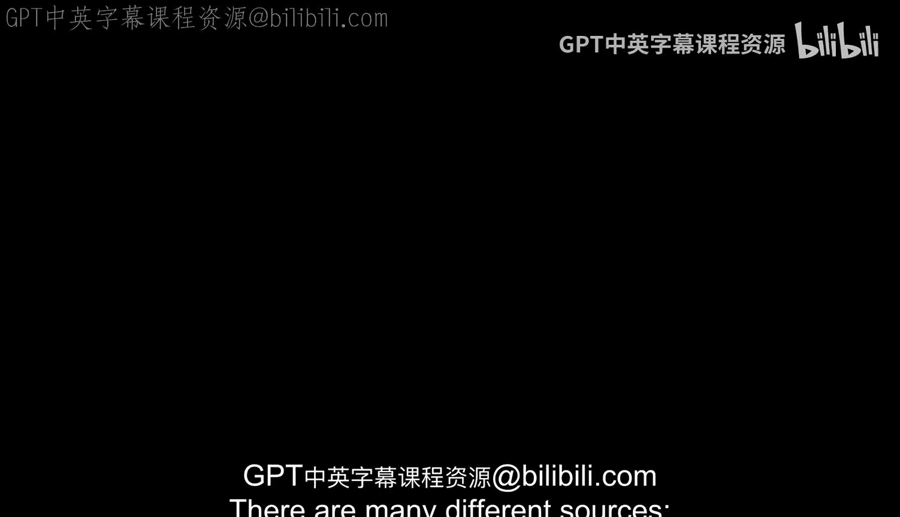

# 开源大语言模型实践：1：引言

在本节课中，我们将学习如何寻找和获取开源的大型语言模型。我们将介绍主要的模型来源平台，并探索用于与这些模型交互的工具。

## 概述

开源大型语言模型可以从多个不同的来源和平台获取。除了了解模型存放的位置，我们还需要掌握与它们交互的工具。本节将重点介绍一些主要的平台和工具，特别是Hugging Face平台，并简要了解云平台上的模型资源以及小型语言模型的独特价值。

## 模型来源与平台

上一节我们概述了课程内容，本节中我们来看看具体的模型来源平台。我们可以从多个地方找到开源的大型语言模型。

以下是主要的模型来源类型：

*   **专门的开源模型平台**：例如Hugging Face，它汇集了大量模型、数据集和演示空间。
*   **云服务平台**：例如微软Azure AI模型目录，它提供了可部署在云端的模型集合。
*   **特定机构发布的模型**：例如微软发布的Phi-2等小型语言模型。

## Hugging Face平台介绍

接下来，我们将深入了解Hugging Face平台。这是一个非常流行的平台，我个人很喜欢它。

我们将看到Hugging Face平台是什么，以及如何在该平台上找到我们需要的模型。

## 云平台模型资源

除了专门的开源社区，云平台也提供了丰富的模型资源。现在，我们来看看如何在像Azure这样的云平台上寻找模型。

在Azure上，你可以像在Hugging Face上一样，通过模型类型、许可证等条件进行筛选，从而找到对你有用的模型。

## 小型语言模型示例：Phi-2

在探索了主流平台后，我们也将快速浏览一下小型语言模型，例如Phi-2。这个模型来自微软，它构建得非常小，但同时能力也很强。

我们将探讨为什么这类模型很有趣。其吸引力无疑在于**小巧的尺寸**与**强大的能力**之间的平衡。

## 总结

本节课中，我们一起学习了开源大型语言模型的主要来源。我们介绍了Hugging Face和Azure等平台，并了解了像Phi-2这样的小型语言模型的特点。在接下来的课程中，我们将更深入地研究所有这些内容。