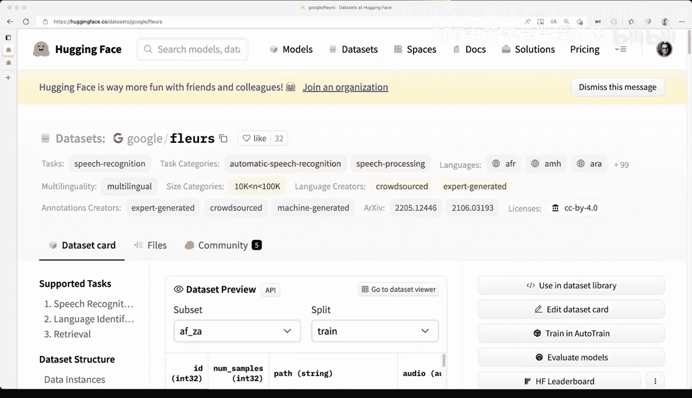

# 大型语言模型实践：P4：Hugging Face Hub 简介 🏠


在本节课中，我们将快速概览 Hugging Face Hub。Hub 是 Hugging Face 平台的核心，你可以在这里与模型、数据集、应用空间等多种资源进行交互。

## 概述

Hugging Face Hub 是一个中心化的平台，用于托管和共享机器学习资源。它类似于代码托管平台 GitHub，但专门为机器学习领域设计。通过 Hub，你可以轻松地发现、使用和贡献模型、数据集以及交互式演示应用。

## Hub 的核心组件

Hub 主要包含以下几种类型的资源，你可以根据需求与它们交互：

*   **模型**：预训练或微调好的机器学习模型。
*   **数据集**：用于训练和评估模型的数据。
*   **空间**：用于托管和分享交互式演示应用。
*   **组织**：团队协作的群组空间。

接下来，我们将逐一探索这些组件。

## 创建与使用模型

上一节我们介绍了 Hub 的核心组件，本节中我们来看看如何创建和使用一个模型仓库。

模型在 Hub 上以 Git 仓库的形式存在。要创建一个新模型，可以点击页面上的 “New” 按钮，然后选择 “Model”。这个过程与在 GitHub 上创建新仓库非常相似。

以下是创建模型时需要填写的信息：
*   **所有者**：选择模型的所有者，可以是个人账户或所属的组织。
*   **模型名称**：为你的模型起一个独特的名字。
*   **许可证**：为模型选择合适的开源许可证，例如 `MIT`。
*   **可见性**：选择模型是公开还是私有。

创建完成后，该模型仓库就可以从任何地方被访问和使用。你可以通过 Hugging Face 提供的库（如 `transformers`、`datasets`）来加载它，也可以直接在网页上查看其详情和文件。

## 管理数据集

与模型类似，数据集也是 Hub 上的重要资源。其创建和管理界面与模型仓库基本一致。

数据集同样以 Git 仓库的形式托管。你可以通过网页界面或命令行工具来上传和管理数据文件。所有仓库都支持标准的 Git 操作，如克隆、提交和拉取请求。

需要注意的是，由于数据集文件通常较大，克隆到本地时需要用到 **Git LFS**。较新版本的 Git 命令行工具可能已包含 LFS，如果没有，你需要单独安装它。克隆命令非常简单：
```bash
git clone https://huggingface.co/datasets/username/dataset_name
```

## 探索应用空间

除了静态的模型和数据集，Hub 还提供了一个强大的功能——**空间**。空间允许你托管一个交互式的机器学习应用演示。

当你创建一个新空间时，可以选择不同的框架来构建前端界面：
*   **Gradio**：快速创建友好的机器学习演示界面。
*   **Streamlit**：用于构建数据科学应用的工具。
*   **静态HTML**：托管纯静态网页。

空间功能使得分享和测试模型变得非常直观和互动，是展示项目成果的理想方式。

## 理解组织协作

最后，我们来了解一下组织功能。组织适用于团队或公司协作的场景。

如果你在一个团队中工作，可以创建一个组织，然后将成员添加进来。这样，团队内的机器学习工程师就可以在同一个组织下协作开发模型、数据集和空间。其概念与 GitHub 的组织功能完全相同。

例如，许多知名公司如 Google、Facebook 都在 Hub 上拥有自己的组织，并在其下发布官方项目。

## 总结



本节课中，我们一起学习了 Hugging Face Hub 的核心概念与基本操作。我们了解到 Hub 是一个集模型、数据集、应用空间和组织协作于一体的平台。所有资源都以 Git 仓库的形式管理，支持版本控制和协作开发。通过网页界面或命令行工具，你可以轻松地上传、发现和使用这些资源，这为机器学习项目的开发、分享和部署提供了极大的便利。