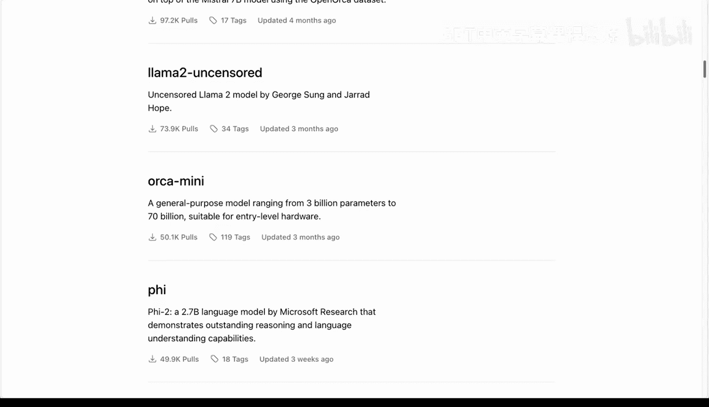

# 开源大语言模型方案：P5：开源模型的库与工具 🛠️


在本节课中，我们将要学习用于与开源大语言模型交互的核心库与工具。这些工具极大地简化了模型的加载和使用过程，使得开发者能够快速构建应用。

## 概述

当我们谈论开源模型时，必须讨论我们将要使用的工具。Hugging Face 团队开发了大量工具，我们将探索其中一些，了解它们如何帮助我们轻松地与各种模型进行交互。

## Hugging Face Transformers 库

上一节我们介绍了开源模型的重要性，本节中我们来看看最核心的工具库——Hugging Face 的 Transformers。这是一个抽象层，允许我们以动态方式轻松地与众多开源模型进行交互。

以下是 Transformers 库的核心优势：

*   **动态加载模型**：无需预先下载模型文件，库会从 Hugging Face 平台动态获取。
*   **统一 API**：无论底层框架是 PyTorch 还是 TensorFlow，都提供相似的调用接口。
*   **多模态支持**：不仅支持文本，还支持音频、图像等多种任务。

其魔力在于，只需几行 Python 代码，你就能调用一个强大的模型。例如，使用 `pipeline` API 进行情感分析：

```python
from transformers import pipeline

classifier = pipeline("sentiment-analysis")
result = classifier("I love using transformers!")
print(result)  # 输出: [{'label': 'POSITIVE', 'score': 0.9998}]
```

上面的代码动态加载了默认的情感分析模型并执行了推理。你也可以指定具体的模型：

```python
generator = pipeline("text-generation", model="gpt2")
result = generator("Once upon a time", max_length=50)
print(result[0]['generated_text'])
```

这种方式“民主化”了对这些先进模型的访问，开发者无需关心复杂的模型部署细节。

## Transformers 的 JavaScript 版本

了解了 Python 版本后，我们来看看 Transformers 的 JavaScript 版本（@huggingface/transformers.js）。它允许你在浏览器或 Node.js 环境中直接运行机器学习模型。

其 API 设计与 Python 版本高度相似，同样支持模型的动态加载。这意味着你可以在 Web 应用中直接集成 AI 功能，而无需依赖后端服务器。以下是一个在浏览器中进行情感分析的示例：

```javascript
import { pipeline } from '@huggingface/transformers';

const classifier = await pipeline('sentiment-analysis');
const result = await classifier('I love programming!');
console.log(result); // 输出: [{label: 'POSITIVE', score: 0.999}]
```

## Rust 生态中的工具

除了 Python 和 JavaScript，Rust 生态也提供了高性能的模型交互工具。

**Candle**
首先是由 Hugging Face 开发的 **Candle**。这是一个基于 Rust 的极简机器学习框架，专注于性能与易用性。

*   **特点**：可以编译成单个可执行文件，便于部署。支持 GPU 加速，能无缝运行如 Whisper、Llama 2 等大型模型。
*   **优势**：Rust 的内存安全性和高性能，使得 Candle 特别适合需要高效推理的生产环境。

**Rust Bert**
另一个工具是 **Rust Bert**，它是 Hugging Face Transformers 库的 Rust 移植版。

*   **特点**：支持使用 PyTorch 或 ONNX Runtime 作为后端。与原始库一样，它支持动态加载模型，并提供了丰富的任务接口。
*   **支持的任务**：包括文本分类、翻译、摘要、情感分析和文本生成等。

以下是 Rust Bert 进行文本生成的简化示例：

```rust
use rust_bert::pipelines::text_generation::{TextGenerationModel, TextGenerationConfig};

let model = TextGenerationModel::new(Default::default())?;
let input = "The future of AI is";
let output = model.generate(&[input], Some(TextGenerationConfig::default()));
println!("{:?}", output);
```

## 本地模型运行工具

如果你想在本地计算机上完全自主地运行大型语言模型，以下两个工具非常有用。

**Llama.cpp**
这是一个用 C/C++ 编写的项目，旨在无需强大 GPU 的情况下高效地运行 LLaMA 模型。

*   **特点**：量化模型以减小尺寸、提升推理速度。提供了简单的命令行接口和类 OpenAI 的 API 服务器。
*   **使用场景**：适合在资源受限的环境（如个人电脑、树莓派）中运行模型。

**Ollama**
Ollama 是一个用户友好的工具，用于在本地运行、管理和与大型语言模型交互。

*   **特点**：支持丰富的模型库（如 Llama 2、Mistral、Phi-2），一键下载和运行。提供了命令行和 REST API 两种交互方式。
*   **优势**：极大简化了本地模型的管理和部署流程，对初学者非常友好。

使用 Ollama 运行模型就像在命令行中输入一样简单：

```bash
ollama run llama2
```

然后你就可以直接在终端与模型对话了。

## 总结



本节课中我们一起学习了与开源大语言模型交互的主要库和工具。我们从 **Hugging Face Transformers** 库及其 **JavaScript 版本** 开始，看到了它们如何通过统一的 API 动态加载模型。接着，我们探索了 Rust 生态中的高性能工具 **Candle** 和 **Rust Bert**。最后，我们介绍了用于在本地轻松运行模型的 **Llama.cpp** 和 **Ollama**。这些工具共同构成了一个强大的生态系统，让开发者能够更便捷地利用开源大语言模型的能力进行创新和开发。