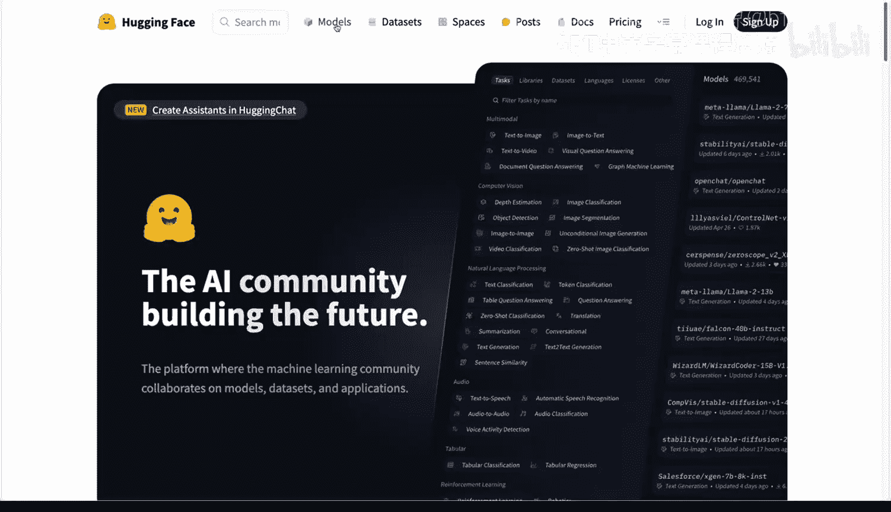
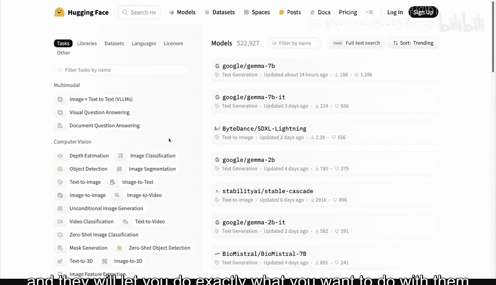

# 开源大语言模型方案：P6：06_01_06：在Hugging Face中寻找大语言模型 🔍

在本节课中，我们将学习如何在Hugging Face Hub中搜索和筛选大语言模型。我们将重点关注文本生成模型，并了解如何根据许可证等关键条件进行过滤，以找到适合我们需求的模型。

## 搜索与筛选模型

上一节我们介绍了Hugging Face平台的基本情况，本节中我们来看看如何具体地搜索和筛选模型。

首先，我们需要导航到Hugging Face Hub的模型板块。我们的目标是找到专门用于文本生成的大语言模型。在模型库中，我们可以根据模型的能力（即“任务”）进行筛选。文本生成正是我们要找的任务类型。

## 按任务类型筛选

以下是按任务类型筛选模型的步骤：

1.  在Hugging Face Hub中，进入“Models”（模型）部分。
2.  在任务筛选器中，开始输入“text generation”（文本生成）。
3.  平台会实时进行模糊匹配，显示出“Text Generation”选项。
4.  点击该选项后，页面右侧的模型列表将只显示具备文本生成能力的模型。

通过以上步骤，我们就能找到所有可用于文本生成的大语言模型。

## 按许可证筛选

找到文本生成模型后，下一步是根据使用需求考虑许可证问题。许可证决定了你可以如何使用这些模型，例如是否可以用于商业用途或产生盈利。

对于希望自由使用模型，甚至用于商业项目的用户，选择宽松的开源许可证（如Apache或MIT）是至关重要的。这些许可证通常允许你几乎任何形式的使用、修改和分发。

以下是按许可证筛选的操作：

1.  在筛选条件中找到“License”（许可证）选项。
2.  选择你需要的许可证类型，例如“Apache 2.0”或“MIT”。
3.  选择后，模型列表会立即更新，只显示符合该许可证的模型。

例如，选择“Apache 2.0”许可证后，列表会过滤出所有采用该协议的模型。这能帮助你快速找到可以自由使用的模型。

## 查看模型详情与文件

筛选出候选模型后，我们需要仔细查看其详情页。详情页提供了丰富的信息，帮助我们做出最终决定。

以“Mixtral”模型为例，其详情页显示它上个月有超过一百万次下载，并且基于它有许多有趣的实现和应用。更重要的是，我们需要关注模型文件。

在“Files and versions”（文件和版本）选项卡中，可以查看模型的具体文件构成和大小。例如，某个模型文件可能显示为 **12.1 GB**，这是一个相当大的体积。了解文件大小对于评估存储和部署成本非常重要。

## 比较不同模型

我们可以通过更换筛选条件来比较不同模型。例如，将许可证从“Apache”换成“MIT”，可能会发现像微软的“Phi-2”这样的模型。

“Phi-2”的模型文件大小约为 **5 GB**，相比之前看到的12.1 GB要小很多。实际上，通过不同的打包方式，某些大语言模型的本地体积可以更小（例如Phi-2可能只有2-3 GB）。文件大小是选择模型时一个重要的实践考量因素。

## 总结

本节课中我们一起学习了在Hugging Face Hub中寻找开源大语言模型的完整流程。我们首先通过“文本生成”任务筛选出目标模型类型，然后根据预期的使用场景（尤其是商业用途）通过“许可证”进行二次过滤。最后，我们查看了模型详情，重点关注了下载量、社区应用以及关键的模型文件大小。掌握这些筛选技巧，就能高效地找到既开源、许可宽松又符合你技术需求（如对模型大小的要求）的合适模型。