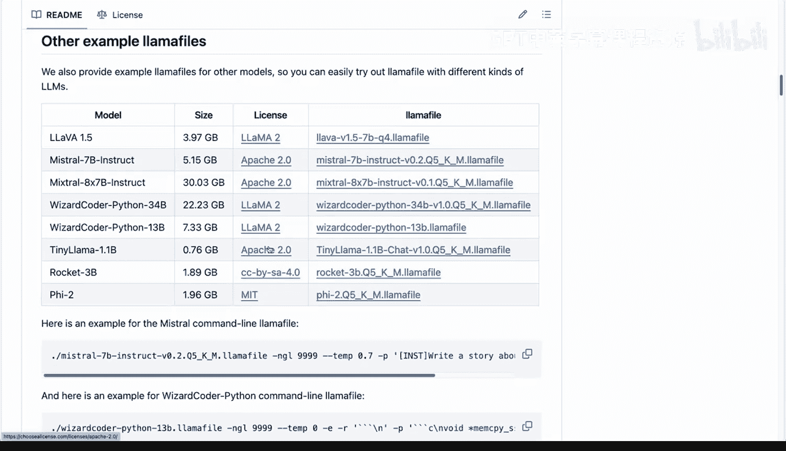

# 开源大语言模型方案：P7：什么是小语言模型 🧠

在本节课中，我们将要学习什么是小语言模型。我们将探讨其定义、特点、优势以及它与大型语言模型的关键区别。通过了解小语言模型，你将明白在何种场景下选择小模型是更高效、更经济的方案。

---

上一节我们介绍了大型语言模型的基本概念，本节中我们来看看小语言模型。

小语言模型同样值得关注，并且你手边就有多种开源选项可供使用。这里我指的是 **Phi-2**，这是微软推出的下一代模型，它实际上就是一个小语言模型。

下图展示了该模型发布时的情况。我想向你说明的是，这是“下一代”模型，因为微软最初是从 **Phi-1** 和 **Phi-1.5** 开始，然后才发展到 **Phi-2** 的。

那么，我们具体在讨论什么呢？关键在于下面这句话：

> “Phi-1.5 是 Phi 模型的上一代版本，其性能可与体积大五倍的模型相媲美。”

这一点尤其有趣，因为我们讨论的是一个模型的能力，它试图以与体积庞大得多的模型相媲美的方式运行。

**Phi-2** 版本是一个拥有 **27 亿参数** 的模型。虽然这个参数数量听起来非常庞大，但你会看到，与一些其他可能大到其 **25 倍** 的模型相比，它就相形见绌了。

这实际上非常有意思，因为它拓展了你在“尺寸至关重要”且“所需输出类型不需要最前沿或最先进技术，也不必是庞然大物”的场景下所能做的事情的范围。

---

为了更直观地理解尺寸差异，我想带你看看 Llama 文件示例，在那里你可以实际下载一些模型文件。

以下是不同类型模型及其文件大小的对比：

从这里可以清楚地看到我们讨论的是哪种类型的模型，以及尺寸从何时开始变得重要。当你看到像 **TinyLlama**、**Rocket** 或 **Phi-2** 这样的模型时，你会发现它们的大小都小于 **2 GB**。其中，TinyLlama 甚至小于 **1 GB**，而 Phi-2 大约在 **2 GB** 以下。

相比之下，**Mistral 8x7B** 模型约为 **30 GB**，专用于 Python 的 **CodeLlama** 模型约为 **22 GB**。**30 GB 对比 2 GB**，这意味着这些小语言模型的体积只有前者的约 **1/15**。

那么，为什么这一点很重要呢？尺寸可能对你想要处理的工作负载类型至关重要。当需要部署模型时，部署像这样的小模型会更便宜、更容易使其良好运行。你可能并不需要大型语言模型提供的全部强大能力，但你仍然可以利用小模型提供的相似能力。

---

本节课中我们一起学习了小语言模型的核心概念。我们了解到，小语言模型如 **Phi-2** 虽然参数规模较小（例如 **27 亿**），但在特定任务上能实现与庞大模型相媲美的性能。其核心优势在于**部署成本低、运行效率高**，在不需要尖端能力但对资源敏感的场景下是理想选择。关键点在于根据实际需求（性能 vs. 资源）在“大模型”和“小模型”之间做出权衡。