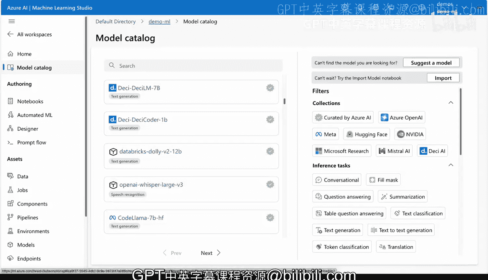

# 开源大语言模型方案：P8：Azure中的大语言模型 🚀

在本节课中，我们将学习如何在微软Azure云平台上寻找和使用大型语言模型。我们将重点介绍Azure Machine Learning Studio中的模型目录，并了解如何浏览、筛选和部署模型。

---

大型语言模型同样可以在云平台中找到。接下来，我将以微软Azure为例进行展示。其他服务提供商（如AWS、GCP）也可能提供类似体验，但本节课我们将专注于Azure。

我将进入Azure Machine Learning，这是Azure中查找模型的默认入口之一。Azure也提供OpenAI服务，但在那里无法找到开源模型。

这里我有两个工作区。我将打开一个名为“demo ML”的新建工作区，并启动其Studio界面。这些界面的具体工作原理和细节并非本节课重点，我们的核心目标是查看可访问的模型。

进入后，你立刻就能看到一些生成式AI模型。例如，这里有Falcon、Mistral Large以及Mixtral 8x7B。这些是已经预置可供查看的模型。

---

上一节我们看到了初始界面中的模型，本节中我们来看看更完整的模型目录。

要查看更多可用模型，我们需要前往模型目录。在那里，你可以看到按“集合”分类的模型。这些集合功能类似于其他服务中的筛选器，允许你根据特定任务（如对话或摘要）来过滤模型。

例如，如果我想查看微软研究的模型，我可能会找到Phi或Phi-2。这里就列出了可供你使用的模型。我特别喜欢Phi-2，因为它是一个小型语言模型，这很有趣。

进入模型页面后，你不仅能看到详细的模型描述，还能立即进行部署。你可以非常轻松地点击创建实时端点或批量端点。同时，你也可以查看模型的许可证信息。

虽然这个特定模型的许可证信息尚未发布，但你可以看到它有不同的版本。有趣的是，Azure Machine Learning Studio提供了一个模型目录服务，让你能够浏览所有可用资源。

即使是新发布的Mistral Large模型，现在也已可用。技术的发展速度非常快。通过这个平台，你可以轻松地找到所有这些模型，并且只需付出很少的努力就能完成部署。

---

本节课中，我们一起学习了如何在Azure云平台中定位和探索大型语言模型。我们了解了通过Azure Machine Learning Studio访问模型目录、使用集合进行筛选、查看模型详情与许可证，并体验了一键部署的便捷性。这为在云端利用开源大语言模型提供了一个强大的起点。