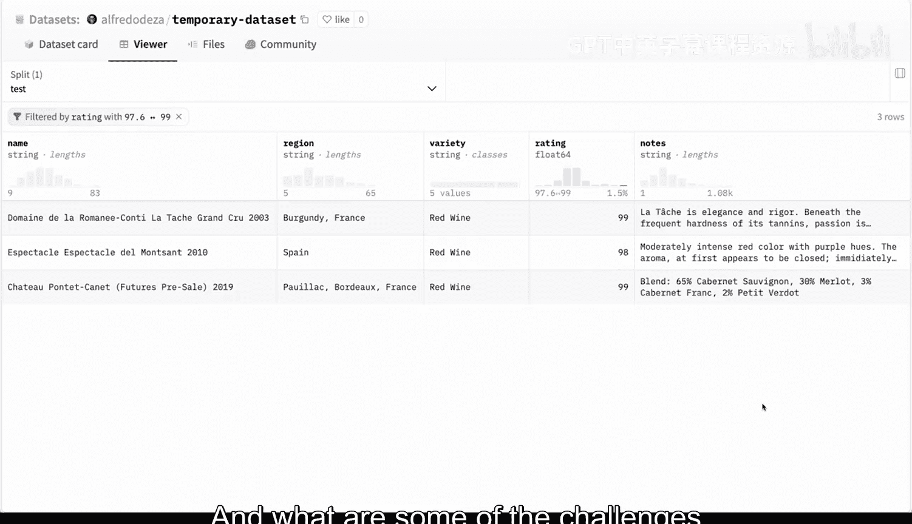
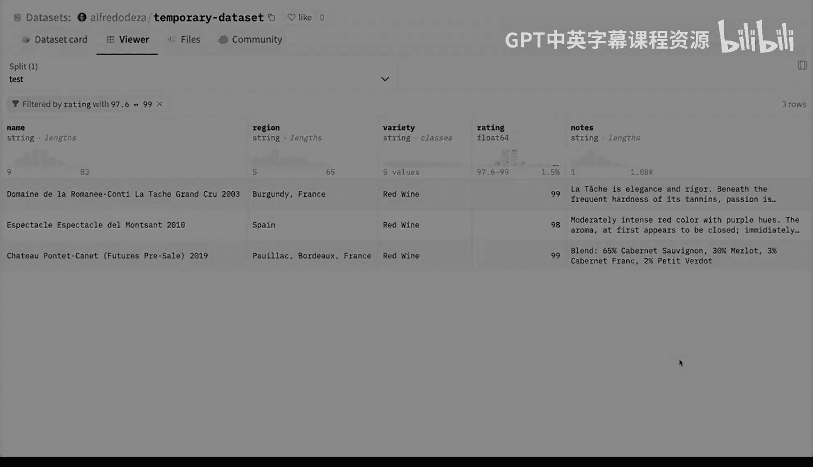

# 开源大语言模型方案：P11：什么是合成数据集增强 🧪

在本节课中，我们将要学习**合成数据集增强**的概念。我们将探讨什么是合成数据、为什么需要它，以及如何利用大型语言模型来生成有意义的合成数据以解决数据不足的问题。

## 概述：什么是合成数据？

合成数据集，或通过生成合成数据来增强或创建更多数据，是合成数据的核心。这样做的原因可能各不相同。你可能面临数据不足的情况。

例如，这里可以看到一些世界青年锦标赛的结果，实际上包含许多不同年份的数据，如1998年等。这是准确的数据，是从真实结果中处理得到的真实数据。然而，你可能希望有更多的数据点，因为你想要执行一些机器学习或数据科学任务，并进行某种生成分析。

## 数据不足的挑战

在这种情况下，你有几个选择。如果你拥有的数据有限，并且希望看到运动员在长度、地点、身高和年份等方面呈现出不同的情况，你可能不得不求助于**合成生成**这些数据。

这意味着你需要**利用大型语言模型**来帮助你。这是一个数据示例，它非常有限。我们可以看到这里只有大约30或40个条目，这是一个很好的例子。

## 一个更具体的例子

现在，让我展示一个不同的例子。这是我之前构建的一个临时数据集，它有200行。这个数据集更全面，是一个基于葡萄酒的数据集，包含葡萄酒的名称、产区、品种、评分和一些品酒笔记。

这是一个完美的例子。例如，评分似乎从85到99不等。但假设你只想关注评分在97到99之间的葡萄酒。我可以进行筛选，但这当然需要一些时间。

这里的问题是，你可能没有足够的数据。这是一个非常典型的例子，说明现有数据可能不够好。你看到只有三个结果是不够的，这取决于你想要执行的任务类型。

## 合成数据生成的方法

你可能希望增强这些数据。有几种方法可以做到这一点：
*   你可以随机生成数据。
*   你可以编写一些代码，从一些著名产区中随机选取名称，放入品种信息，并生成一个97到99之间的随机数。

然而，当你希望生成一些**有意义的品酒笔记**时，事情就变得棘手了。这正是**大型语言模型**大显身手的地方。

## 总结与核心价值

本节课程中，我们一起学习了合成数据集增强。我们了解到，合成数据是为了弥补数据不足而人工生成的数据。通过一个葡萄酒数据集的例子，我们看到了数据过滤后可能面临样本量过小的问题。解决这个问题的方法包括随机生成或编写规则代码，但在需要生成符合语境和逻辑的文本内容（如品酒笔记）时，**利用大型语言模型**是更优的选择。这帮助我们理解了何时会遇到数据不足的问题，以及在尝试解决此问题时可能面临的一些挑战。