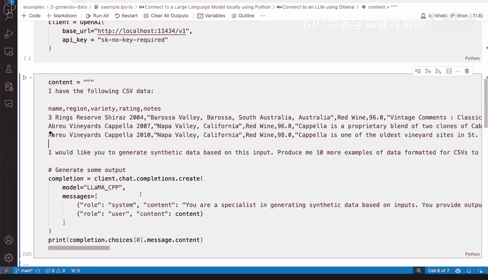

# 开源大语言模型方案：P13：13_01_05：测试本地LLM进行数据增强 🧪


在本节课中，我们将要学习如何利用本地运行的大型语言模型来生成合成数据，以增强现有数据集。我们将重点探讨在生成过程中可能遇到的格式挑战，以及如何通过精心设计系统提示词来获得可直接使用的、格式规整的输出。

## 与本地LLM交互的挑战

上一节我们介绍了如何连接到本地或远程的大型语言模型。本节中我们来看看在实际生成合成数据时可能面临的具体问题。当我们与大型语言模型交互，要求其基于现有数据生成更多样本时，一个核心挑战在于确保输出的格式符合我们的要求。

例如，我们有一个关于葡萄酒的CSV文件，其列顺序固定为：`name`、`region`、`variety`、`rating`、`notes`。`rating`列使用浮点数，`notes`列包含描述性文本。如果我们简单地要求模型“基于输入生成10个合成示例”，其原始回复可能包含问候语、解释性文字、甚至重复的表头，这些内容无法被程序直接解析为有效的CSV数据。

## 优化系统提示词以获取规整输出

为了解决上述格式问题，关键在于修改给模型的“系统提示词”，明确约束其输出行为。通过调整提示词，我们可以将模型视为一个纯粹的“数据生成API”，而非一个会进行自由对话的助手。



以下是优化后的系统提示词核心要点：
*   **角色定义**：明确指令模型“作为一个生成合成数据的API”。
*   **格式要求**：严格规定输出必须为“CSV格式”。
*   **内容限制**：禁止提供任何反馈、问题或其他非CSV有效的文本。
*   **数据细节**：指示模型无需输出CSV表头，仅提供数据行。

通过应用这套优化的提示词，模型的输出将变得干净、规整，每一行都是有效的CSV数据，可以直接用于后续的数据增强流程。

## 实践：生成格式规整的合成数据

让我们看看应用优化提示词后的效果。模型生成的响应将直接是如下格式的数据行，没有任何多余的文本：

```
"Château Mirage","Bordeaux, France","Cabernet Sauvignon",4.7,"A bold wine with notes of dark cherry and oak."
"Sunrise Vineyards","Napa Valley, USA","Chardonnay",4.5,"Crisp and refreshing with hints of green apple."
...
```

你可以看到，生成的数据严格遵循了原始数据的格式：名称、产区、品种、评分（浮点数）和品酒笔记。这种输出可以直接被程序读取并追加到原始数据集中，从而实现高效、自动化的数据增强。

本节课中我们一起学习了如何通过优化系统提示词，引导本地大型语言模型生成格式规整的合成数据。关键在于将模型交互从“开放式对话”转变为“受控的API调用”，明确指定输出格式并禁止无关内容。这种方法能有效克服数据解析的挑战，使得利用LLM进行数据增强变得可行且高效。