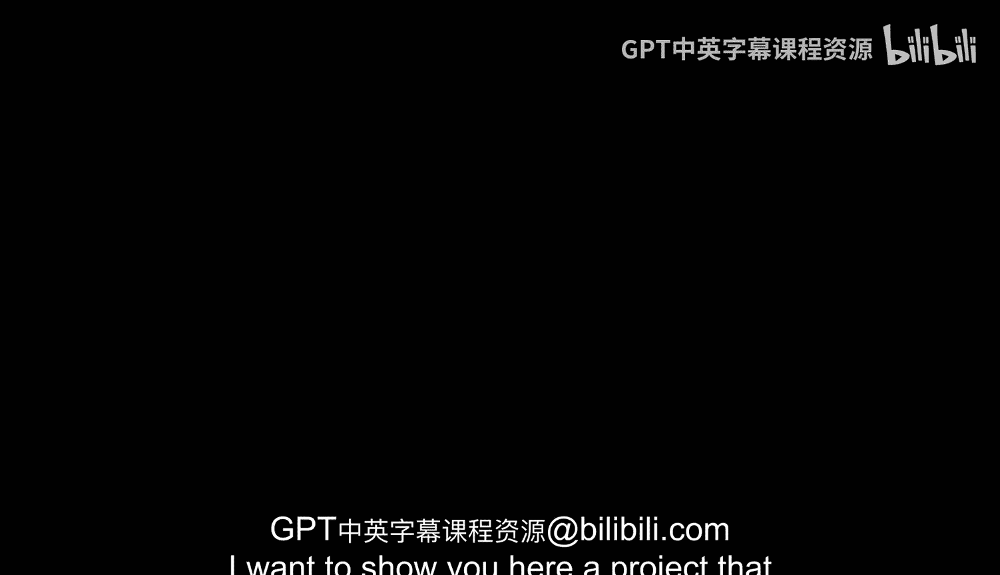
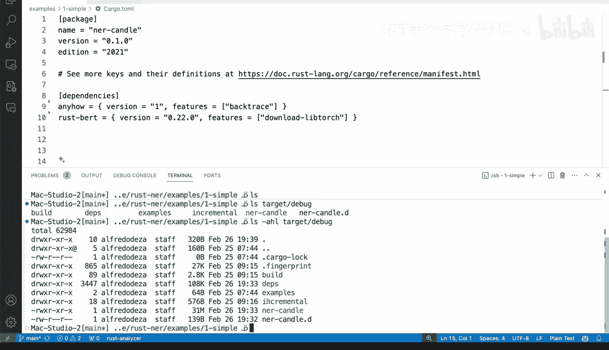

# 开源大语言模型方案：P19：使用Rust BERT进行命名实体识别




在本节课程中，我们将学习如何使用 Rust BERT 库来执行命名实体识别任务。我们将通过一个简单的 Rust 项目，了解如何加载预训练模型、处理输入文本并提取出文本中的人名、地名和组织机构名。

---

## 项目概述与依赖

我们将展示一个非常简单的项目，该项目使用 Rust BERT 库。我们将使用 Rust BERT 来执行命名实体识别。命名实体识别是一种使用模型来检测文本中特定名称（如人名、地名）的能力。

以下是项目的依赖项。我们只有一个 Rust 依赖项，名为 `anyhow`。它允许你在 Rust 中处理错误，但对于我们当前的目标来说，这个依赖项不是核心。我们在这里要重点介绍的是 Rust BERT 库。它让你能够获得与使用 Hugging Face 的 Transformers 库相似或相同的体验。

```toml
[dependencies]
anyhow = "1.0"
rust-bert = { version = "0.21", features = ["download-libtorch"] }
```

上一节我们介绍了项目的目标和依赖。接下来，让我们看看实际的代码文件。

---

## 代码解析

让我们来看一下实际的代码文件。这个文件并不大，总共只有 23 行。我们将逐行进行讲解。

首先，我们从这里开始。这里我们使用了一个预构建的、开箱即用的命名实体识别模型。NER 就代表命名实体识别。`pipeline` 意味着所有的抽象工作都已经为我们完成，我们只需要写很少的 Rust 代码就能得到有趣的结果。这就是它的作用。

我们的 `main` 函数首先会设置模型。我们将实例化、创建这个模型变量，并使用默认配置创建一个新实例。

```rust
use rust_bert::pipelines::ner::NERModel;

fn main() -> anyhow::Result<()> {
    // 设置模型
    let ner_model = NERModel::new(Default::default())?;
```

然后，我们在这里模拟输入。我们将传入三个短语或句子。

```rust
    // 模拟输入文本
    let input = [
        "My name is Alfredo. I was born in Peru.",
        "Portugal is great.",
        "I used to work in a small company called Shocu.",
    ];
```

接下来，我们将获取这个输入，并在模型中使用它。这个输入将传递到这里。

然后，这个命名实体识别模型有一个函数，叫做 `predict_entities`。它接收我们传入的输入。

```rust
    // 使用模型进行预测
    let output = ner_model.predict(&input);
```

之后，我们将对输出中的每一个项目进行循环处理。模型会生成多个项目，我们将遍历它们，并打印出模型识别出的内容。

```rust
    // 遍历并打印结果
    for (sentence, entities) in input.iter().zip(output.iter()) {
        println!("Sentence: {}", sentence);
        for entity in entities {
            println!("  Word: {:?}, Label: {:?}, Score: {:.4}", entity.word, entity.label, entity.score);
        }
        println!();
    }
    Ok(())
}
```

那么，这个循环是如何工作的呢？让我切换到终端。

---

## 运行与结果

现在终端已经打开，我将运行 `cargo run` 命令。当我执行 `cargo run` 时，它会在后台进行构建，然后运行生成的可执行文件。

你可以在这里看到，结果是一个一个输出的。第一个是 “Alfredo”，第二个是 “Portugal”，第三个是 “Shocu”。它正确地检测出第一个词 “Alfredo”，其标签是 “PER”，代表这是一个人名。

所以它正确地将其检测为一个真实的人名。它为你提供了一些信息。

然后它继续处理单词 “Peru”，并告诉你标签是 “LOC”，代表地点。它还精确地告诉你这个词在文本中的起始和结束位置，并给出了一个分数，代表模型对其正确性的确信程度。

因此，你可以处理置信度很低的例子，那些可能效果不佳。

接下来是 “Portugal”，标签是 “LOC”，与 “Peru” 类似，效果很好。

然后是 “Shocu”，标签是 “ORG”，代表组织机构，并带有一定的确信度。

效果非常好，非常简单和方便。

---

## 注意事项与总结

使用 Rust BERT 时需要注意的一个问题是，它要求你安装 PyTorch。如果你查看依赖项中的特性，你会看到 `download-libtorch`。这意味着在我安装时，它会自动为我下载 PyTorch。这是这个库的一个需要注意的要求。

否则，如果我们查看 `target/debug` 目录，你会看到可执行文件在那里。让我们检查一下你构建的可执行文件有多大，它有 31 MB。

这实际上是一个相当有说服力的理由，让你考虑使用像 Rust 这样的语言。使用 Rust BERT 可以让你以一种非常快速、简单的方式来处理模型，从而能够做像命名实体识别这样有趣的事情。




在本节课中，我们一起学习了如何使用 Rust BERT 库进行命名实体识别。我们从项目配置、代码编写到运行和结果分析，完成了一个完整的流程。你学会了如何利用预训练的 NER 模型快速从文本中提取关键实体信息，并了解了使用 Rust 进行此类任务的优势与注意事项。