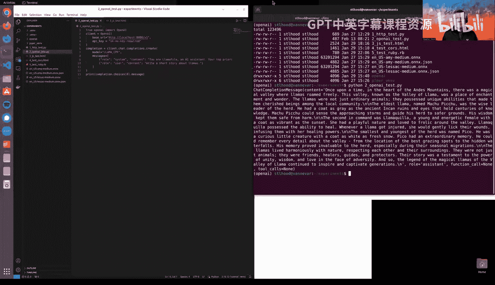
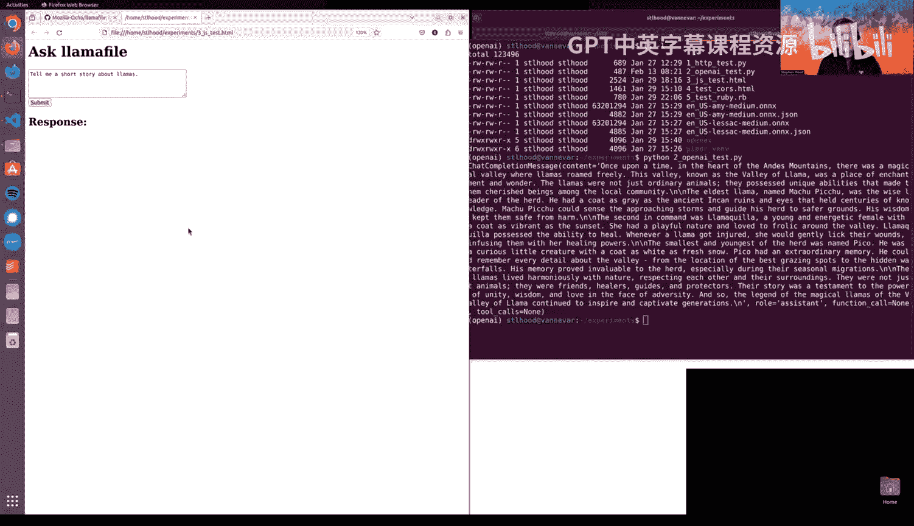

# 开源大语言模型方案：P22：22_02_04_使用LlamaFile API 🚀


## 概述
在本节课中，我们将要学习如何使用LlamaFile的服务器模式及其提供的OpenAI兼容API。这将允许你将原本为OpenAI编写的代码无缝切换到本地运行的LlamaFile模型上。

---

## LlamaFile的服务器模式与API

当你启动任何一个LlamaFile时，默认情况下它也会在后台启动一个服务器。这个服务器提供了一个与OpenAI兼容的API端点。这意味着它模仿了OpenAI API的签名，用于完成文本生成和其他功能，但背后使用的是你本地机器上运行的LlamaFile模型，而非OpenAI的服务。

上一节我们介绍了LlamaFile的基本概念，本节中我们来看看其API的具体应用。

## 代码兼容性与切换

这种设计的意义在于，你可以直接使用那些为OpenAI编写的代码，并将其与LlamaFile配合使用。这使你能够从一个商业化的集中式服务（如OpenAI）切换到一个由你控制的开源、免费可用的系统。

你可以选择在本地机器上运行，也可以将LlamaFile容器化（Dockerize）并在服务器上运行。这两种方式都有人使用。

## Python示例

以下是一个使用OpenAI Python库的简单代码示例。我所做的唯一改动是将`base_url`指向我本地运行LlamaFile的主机地址。

```python
import openai

client = openai.OpenAI(
    base_url="http://localhost:8080/v1", # 指向本地LlamaFile服务器
    api_key="not-needed" # 本地运行无需真实API密钥
)

completion = client.chat.completions.create(
    model="local-model", # 模型名称可自定义
    messages=[
        {"role": "system", "content": "你是一个乐于助人的助手。"},
        {"role": "user", "content": "请给我讲一个关于大语言模型的短故事。"}
    ]
)

print(completion.choices[0].message.content)
```
当我在控制台运行这段代码时，它会调用本地的API端点。代码以为自己在与OpenAI对话，但实际上是与运行在我本地机器上的模型交互。输出结果会被直接打印到控制台。

## JavaScript示例



同样地，你也可以使用JavaScript来实现。以下是一段非常简单的JavaScript代码，它直接使用HTTP请求与相同的API签名进行通信，只是将请求目标从OpenAI改为了我的本地主机。



```javascript
async function getStory() {
    const response = await fetch('http://localhost:8080/v1/chat/completions', {
        method: 'POST',
        headers: {
            'Content-Type': 'application/json',
        },
        body: JSON.stringify({
            model: 'local-model',
            messages: [
                { role: 'system', content: '你是一个乐于助人的助手。' },
                { role: 'user', content: '请给我讲一个关于大语言模型的短故事。' }
            ]
        })
    });
    const data = await response.json();
    console.log(data.choices[0].message.content);
}
```
这段代码在浏览器中运行，可以实现相同的功能。通过一个简单的网页界面提交问题，所有交互都通过JavaScript完成，并将原始的响应内容输出到控制台。

## 纯服务器模式与优化

LlamaFile的这一功能现已可用。当你创建自己的LlamaFile时，可以将其配置为**仅运行在服务器模式**。这意味着它不会启动任何Web用户界面，纯粹作为一个API服务器运行。如果你的使用场景只需要API，这样可以进行优化。

我们非常希望开发者能享受使用此功能的过程。我们的目标是让人们更容易地从集中的商业服务转向开源方案，因为我们相信这将有助于加速开源领域所期望看到的所有进展。

---

## 总结
本节课中我们一起学习了LlamaFile的服务器模式及其提供的OpenAI兼容API。我们了解了如何通过修改代码中的端点地址，将原本为OpenAI设计的应用程序无缝迁移到本地或自托管的LlamaFile模型上，并通过Python和JavaScript的实例演示了具体操作方法。这为利用开源大语言模型提供了极大的灵活性和控制权。