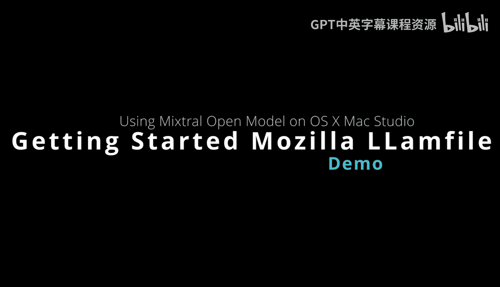
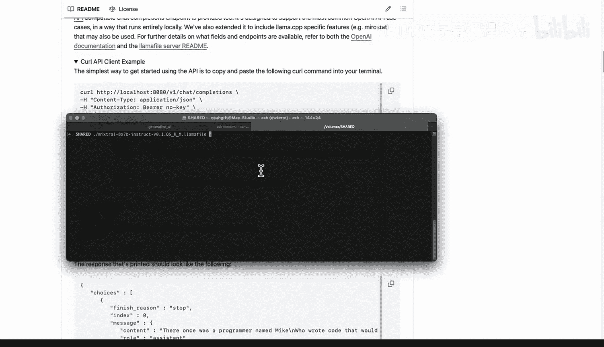
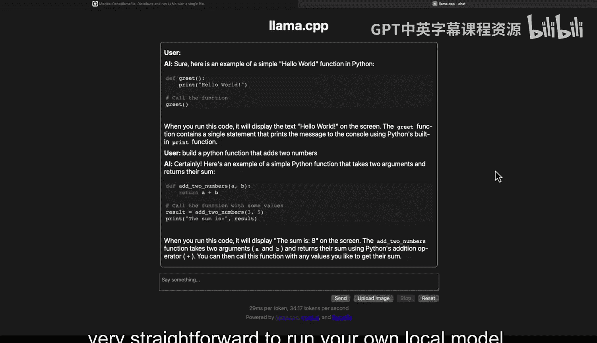
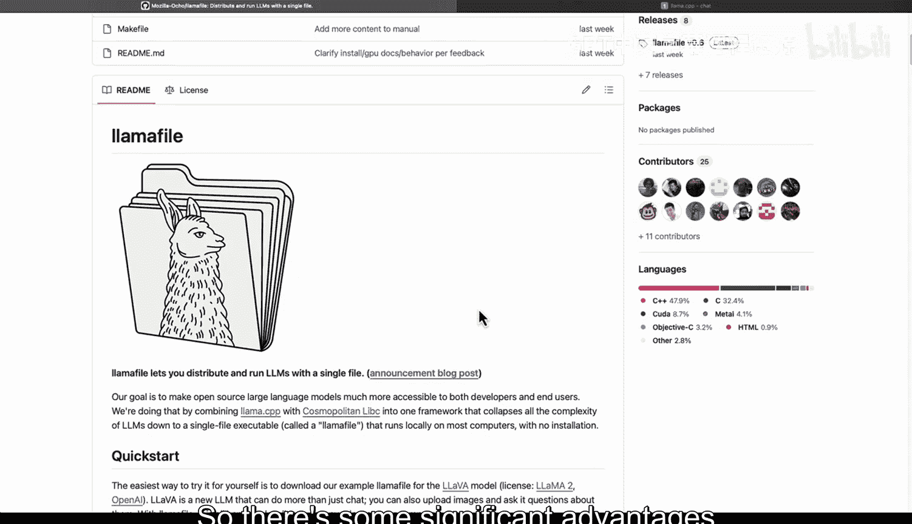

# 开源大语言模型方案：P25：LlamaFile入门指南 🚀



## 概述
在本节课中，我们将要学习如何使用LlamaFile项目，这是由Mozilla推出的一个极其简便的本地运行大型语言模型的方案。我们将了解其核心优势、基本结构以及如何实际操作。

---

## 项目简介与优势

LlamaFile项目可能是运行本地大型语言模型最简单的方式。许多人对此感兴趣，主要出于隐私保护的考虑，同时，使用自己的机器运行模型是完全免费的。

上一节我们介绍了本地运行大模型的动机，本节中我们来看看LlamaFile的具体实现。

LlamaFile允许你通过单个文件来分发和运行大型语言模型。其最吸引人的特点是，它使用了名为 **`cosmopolitan Lib C`** 的库，能够将所有组件压缩成一个名为 **`LlamaFile`** 的单一可执行文件。

尽管名字叫LlamaFile，但它并不局限于特定的某个大语言模型。项目页面上提供了多个模型示例。

以下是项目的一些核心优势：
*   **隐私性**：你的数据不会被发送到任何公司。
*   **性能**：由于没有网络延迟，本地调用的性能通常优于调用外部API。
*   **免费**：使用自己的硬件，无需支付API调用费用。

---

## 模型选择与获取

项目提供了多种模型可供选择。其中一个例子是 **`Lava`**，它是一个能够读取图像内容的模型，非常有趣。

我个人认为比较有意思的是 **`Mixtral`** 模型。它是目前性能较好的开源模型之一，采用Apache2许可证。不过，它的文件大小约为30GB，下载量较大。

获取模型后，你只需要下载它，然后在终端中执行 **`./run`** 命令即可启动。

---

## 核心功能与API

LlamaFile的一个很酷的功能是，它提供了一个模仿OpenAI API的Python API。这意味着你可以轻松地将代码从封闭的商业专有模型迁移到开源模型上。

此外，你还可以使用 **`curl`** 命令通过HTTP接口与模型进行交互。

---



## 实际操作演示

让我们来看看它是如何工作的。我已经在终端中下载并准备好了Mixtral模型。

运行模型非常简单，只需执行：
```bash
./run
```
这样，**`llama.cpp`** 就在本地运行起来了。

如果需要重置到某种默认状态，可以执行重置操作。

在实际使用中，我可以更改AI助手的名称，然后向它提问。例如，我可以要求它编写一个Python的“Hello, World!”函数。

发送请求后，模型会利用我Mac的GPU进行快速推理并返回结果。

围绕Mixtral的一些评测指标显示，它的性能与闭源的专有模型相当。我可以继续让它完成更多功能，比如编写一个将两个数字相加的Python函数。

---

## 总结





本节课中我们一起学习了LlamaFile项目。关键结论是，运行自己的本地模型实际上非常直接简单。使用LlamaFile的主要优势在于：保障了数据隐私、获得了更低的延迟和更好的性能，并且完全免费。这些是探索这个项目的显著优点。


我鼓励你去查看LlamaFile项目，并尝试使用它。