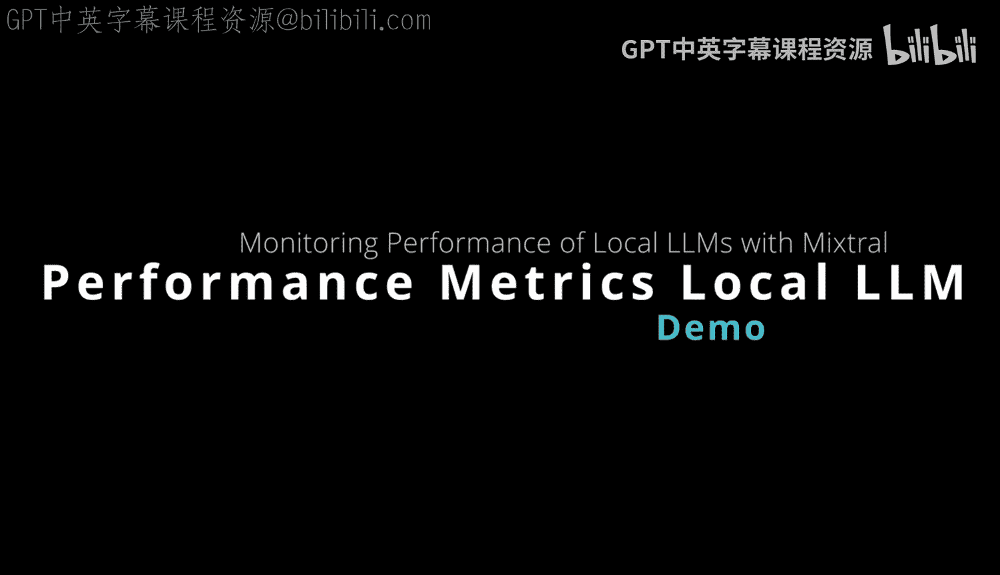
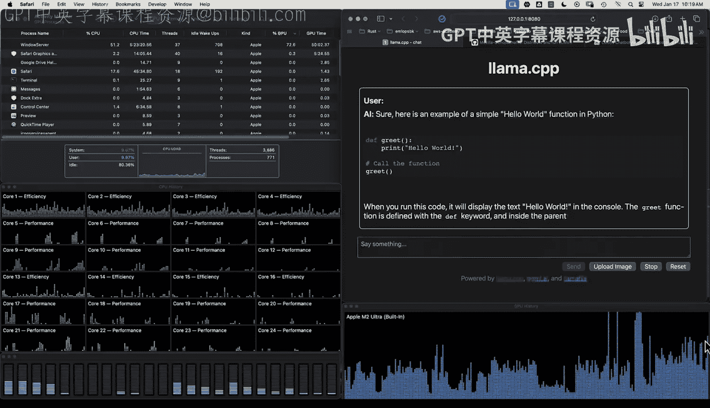

# 开源大语言模型方案：P26：26_02_04_LlamaFile本地系统指标

## 概述
在本节课中，我们将学习如何使用LlamaFile来监控本地运行大型语言模型时的系统指标。我们将了解如何查看GPU使用率、核心负载等关键性能数据，并评估本地模型的性能表现。

---

## 监控系统指标
上一节我们介绍了LlamaFile的基本使用，本节中我们来看看如何利用它来监控系统运行指标。

首先，我们可以从模型的Elo评分来观察其实际表现。这反映了用户对该模型能力的感知。如图所示，这个混合模型的表现与商业模型相差无几，这表明只要性能足够好，会有大量用户有兴趣在本地运行它。

那么，性能是否足够好呢？让我们来仔细看看这个LlamaFile项目。目前，它正运行在这个浏览器窗口中，并且旁边显示了所有的系统指标，让我们能够观察运行状态。

以下是需要关注的关键指标：
*   **GPU时间**：这是一个重要指标。
*   **所有核心**：观察所有CPU核心的负载情况。
*   **M2 Ultra GPU**：我使用的这款拥有60个GPU核心。得益于LlamaFile和Llama.cpp开发者的出色工作，在Mac操作系统上能够充分利用所有这些GPU核心。

---

## 观察GPU使用情况
接下来，我们通过实际操作来观察GPU的使用情况。让我们运行一个Python函数来看看效果。

向下滚动，我们可以观察GPU指标的变化。实际上，我们会看到这里的GPU使用率出现峰值，同时这里也应该显示一些GPU活动。

我们可以看到，这个`.a1.9`进程确实在调用GPU。实际上，我们看到它再次运行。我们可以再试一次，例如，要求它“给我一个Python中递归函数的例子”。

然后看看它做了什么。看，它生成了一个Python递归函数，同时我们也能看到，它确实在使用GPU。

---

## 性能评估与思考
由此可见，其性能实际上非常出色。我们能看到历史GPU数据，证明它能够有效利用GPU资源。

对于正在使用商业模型的用户来说，商业模型显然有其价值。但这无疑引出了一个长期问题：如果你可以下载一个性能足够好、表现惊人且免费的模型，为什么还要使用商业模型呢？

因此，在你尝试使用LlamaFile，甚至考虑为大型语言模型签订商业协议之前，有两点值得思考：
1.  首先，仔细看看本地模型的真实性能。
2.  观察各项系统指标，你会发现它的表现非常令人印象深刻。

---

## 总结
本节课中，我们一起学习了如何使用LlamaFile监控本地运行大语言模型的系统指标。我们查看了GPU时间、核心负载等关键数据，并通过实际生成代码的例子观察了GPU的利用情况。最后，我们对比了本地模型与商业模型的性能，认识到本地部署在性能足够时是一个极具吸引力的选择。