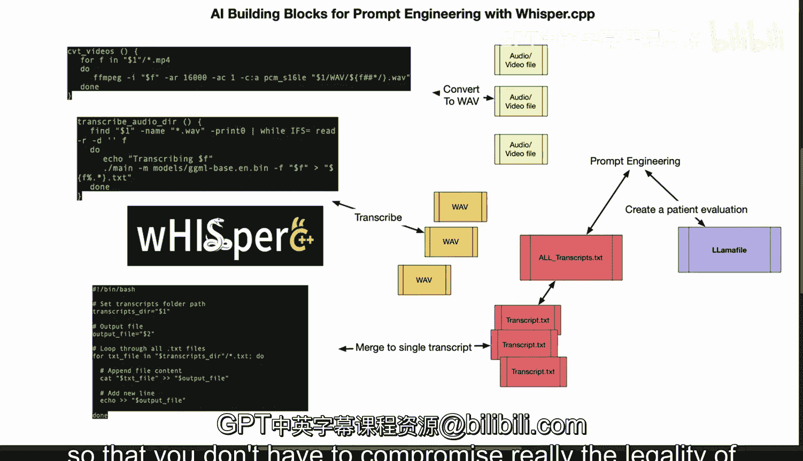

# 开源大语言模型方案：P27：使用Whisper构建GenAI基础模块


在本节课中，我们将学习如何利用Whisper CPP转录库，为提示工程构建基础模块。我们将通过一个具体的应用场景——处理医疗音频记录，来演示如何将音频文件转换为文本，并整合到生成式人工智能工作流中，同时确保数据处理的本地化和安全性。

## 构建基础模块的流程概述

上图展示了一个利用Whisper CPP转录库为提示工程构建基础模块的流程图。这是一个重要但容易被忽略的细节。

假设你是一名医生，拥有大量患者档案或与患者会话的录音。你如何在生成式人工智能系统中实际应用这些资料？

## 第一步：音频格式转换 🎵

首先，你需要将视频或音频文件转换为WAV格式。以下是一段Bash脚本，它可以遍历一个包含大量不同患者录音文件的目录，并将它们批量转换为正确的格式。

```bash
# 示例：遍历目录并转换音频格式
for file in /path/to/patient/recordings/*.mp3; do
    ffmpeg -i "$file" "${file%.mp3}.wav"
done
```

## 第二步：使用Whisper CPP进行转录 📝

转换格式后，我们便可以使用Whisper CPP进行转录。Whisper CPP的优势在于其优化后的速度、丰富的模型选择（从微型模型到巨型模型）以及出色的转录性能。

我们可以再次使用脚本，遍历包含WAV文件的目录，为每个文件生成独立的转录文本。

```bash
# 示例：使用Whisper CPP转录WAV文件
for wav_file in /path/to/converted/*.wav; do
    ./whisper-cpp -m models/ggml-base.bin -f "$wav_file" -otxt
done
```

## 第三步：转录文本的后处理与整合 📄

转录完成后，我们可以选择就此停止，也可以进行后续的生成式AI处理。另一种常见做法是将所有独立的转录文本合并成一个主文档。这取决于我们处理的具体任务以及可用的大语言模型上下文窗口大小。

例如，我们可以将所有转录文本合并到一个名为 `all_transcripts.txt` 的文件中。

## 第四步：构建提示词并生成分析报告 🤖

现在，我们可以利用整合后的文本来构建提示词。假设我是一名放射科医生，希望从这些记录中寻找特定模式，以生成患者评估报告，判断哪些患者需要进一步检查。

我会将 `all_transcripts.txt` 的内容输入给一个大语言模型，并给出如下提示：

> 阅读这些转录文本，并为所有不同的患者生成一份患者评估报告。

**关键点**：这项工作可以使用本地部署的大语言模型完成。对于医疗转录等敏感数据，你可能担心将其上传到云端系统的法律风险。使用本地模型可以生成自动化的患者评估报告，而无需在数据安全上妥协。

## 核心价值与总结

使用开源工具的关键组成部分之一，就是利用这些基础模块，并结合人们已经使用了几十年的常规自动化技术。

以下是构建此类工作流时推荐使用的技术：
*   使用Bash进行文件操作和批量处理。
*   使用脚本语言（如Python）实现复杂逻辑。
*   使用DevOps技术实现流程自动化。

你可以看到，这种非常简单的自动化形式，极大地赋能了生成式AI工作流。现在，你可以将所有的转录文本整合在一起，创建一个复杂的提示词，并且让整个流程在本地运行。这样，你在处理医疗转录等敏感事务时，就无需在合法性上做出妥协。

本节课中，我们一起学习了如何利用Whisper CPP将音频数据转换为文本，并通过自动化脚本将其整合，最终作为提示词输入给本地大语言模型，以构建安全、高效的生成式AI应用模块。这体现了将传统自动化与前沿AI技术结合的巨大潜力。



