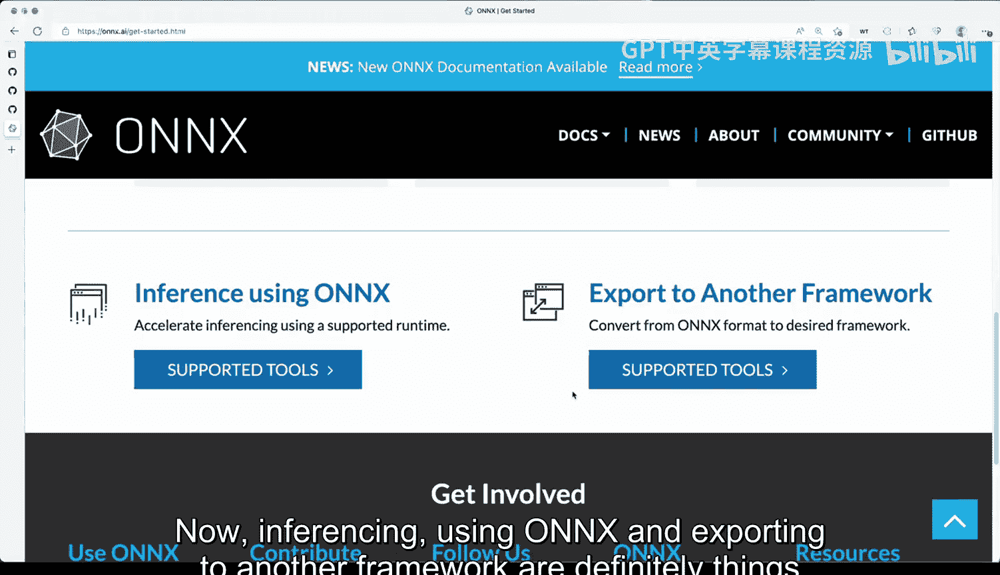
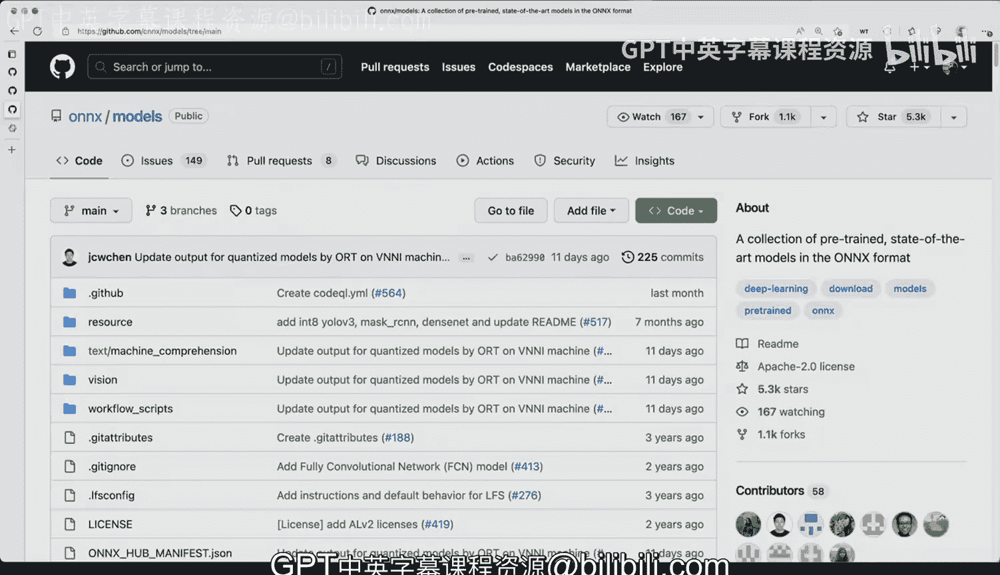

# 开源大语言模型方案：P31：什么是ONNX 🧠


在本节课中，我们将要学习ONNX（Open Neural Network Exchange）格式的基本概念，了解它如何帮助我们在不同框架和硬件架构之间部署机器学习模型。我们将重点介绍如何结合Hugging Face库使用ONNX，并探索相关的配置和模型库。

---

## 概述

ONNX是一种开放的模型格式，旨在实现不同机器学习框架（如PyTorch、TensorFlow）之间的互操作性。通过将模型导出为ONNX格式，我们可以将其部署到多种硬件和运行时环境中，而无需依赖原始的框架。本节课将引导你了解ONNX的核心概念、如何设置环境，以及如何开始使用Hugging Face的`transformers`库与ONNX进行交互。



---

## 环境设置与依赖安装

上一节我们介绍了ONNX的基本概念，本节中我们来看看如何设置工作环境。为了使用Hugging Face和ONNX，我们需要安装特定的依赖包。

以下是创建一个Conda环境所需的依赖项，它们被定义在一个YAML配置文件中：

```yaml
name: onnx_env
channels:
  - pytorch
dependencies:
  - python=3.8
  - pytorch
  - transformers[onnx]
  - onnxruntime
  - ipykernel
```

这个环境文件指定了Python 3.8、从PyTorch渠道安装的PyTorch、带有ONNX额外功能的Hugging Face `transformers`库、ONNX运行时以及用于Jupyter Notebook的组件。安装这些依赖后，你就可以快速开始工作了。

---

## 验证安装与探索功能

环境设置完成后，我们需要验证所有组件是否安装正确，并探索可用的功能。

你可以通过命令行工具来验证`transformers`库的ONNX模块是否已成功安装。运行以下命令可以查看帮助菜单：

```bash
python -m transformers.onnx --help
```

这个命令的输出会显示可用的选项和参数。关键点包括：
*   你可以指定从PyTorch或TensorFlow导出模型（本教程默认使用PyTorch）。
*   你需要使用一个位置参数来指定输出ONNX模型的名称。

---

## 理解模型配置

在开始导出模型之前，理解模型的配置至关重要。Hugging Face为许多流行模型（如BERT、GPT-2、RoBERTa、T5）提供了预定义的配置。

以下是如何导入和查看RoBERTa模型配置的示例代码：

```python
from transformers.models.roberta import RobertaConfig, RobertaOnnxConfig

# 查看可用的配置特性
config = RobertaOnnxConfig(RobertaConfig())
print(config)
```

这段代码允许你查看该模型可用于ONNX导出的不同特性和设置。选择合适的配置是成功导出模型的第一步。

---

## ONNX模型库简介

除了自己导出模型，我们还可以利用现有的ONNX模型库。ONNX维护了一个官方的模型库，称为ONNX Model Zoo。

ONNX Model Zoo是一个GitHub仓库（`onnx/models`），其中存储了许多预训练的ONNX格式模型。例如，你可以找到用于机器阅读理解任务的RoBERTa模型。每个模型页面通常会提供以下信息：
*   **模型描述**与**用途**
*   所需的**依赖项**
*   支持的**ONNX版本**和**Opset版本**（这是两个关键的技术细节）
*   关于**预处理**和**预期输出**的说明
*   下载链接（模型通常使用Git LFS存储）

许多模型库中的模型本身就基于Hugging Face `transformers`构建，因此你可以轻松地使用熟悉的工具（如分词器）与之配合。

---

## 总结



本节课中我们一起学习了ONNX的核心价值——作为桥梁促进不同机器学习框架的模型互操作与部署。我们完成了从设置Python环境、安装必要的库（如`transformers[onnx]`和`onnxruntime`），到验证安装并探索命令行工具的过程。我们还了解了如何利用Hugging Face提供的预配置来简化ONNX导出，并介绍了ONNX官方模型库（Model Zoo）作为获取预转换模型的资源。掌握这些概念是后续进行模型导出、优化和跨平台推理的基础。