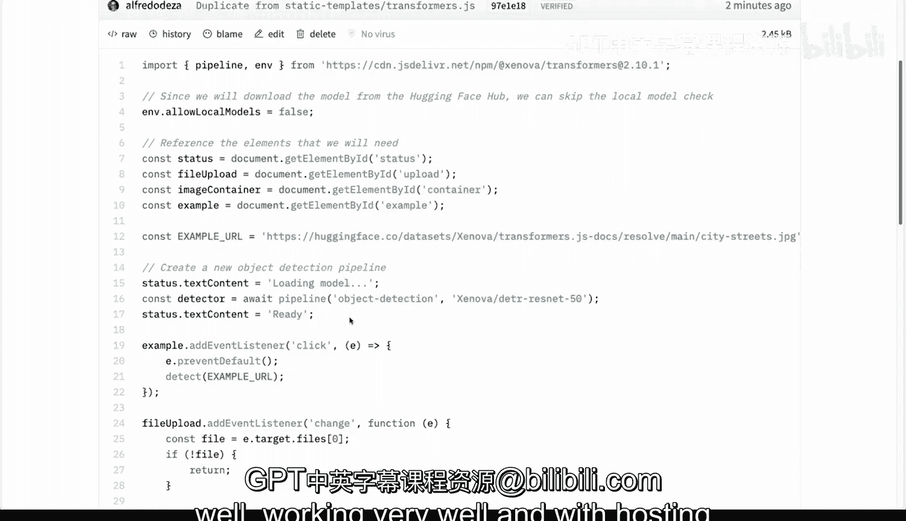

# 开源大语言模型方案：P33：在浏览器中使用Transformers.js 🚀

## 概述
在本节课中，我们将学习如何使用Transformers.js库在浏览器中直接运行机器学习模型。我们将通过一个具体的、可操作的示例——在Hugging Face平台上创建一个“Space”并部署一个物体检测应用——来演示整个过程。你将看到如何利用现成的模板快速构建一个无需后端服务器、完全在浏览器中运行的AI应用。

---

## 在Hugging Face平台创建演示空间

上一节我们介绍了Transformers.js的基本能力，本节中我们来看看如何将其付诸实践，创建一个可交互的在线演示。

通过Transformers.js，你可以在浏览器中运行模型。我们已经了解了一些它能做的事情，现在我将展示一个具体的操作。我们将基于官方文档中的示例，运行一个模板。

我滚动到文档页面的底部。你可以在这里创建一个新的“Space”。Hugging Face平台提供了这个非常棒的功能，他们称之为“Spaces”，你可以在浏览器中甚至配合后端应用来运行模型。但本次我们将专注于Transformers.js。

我将点击“Template”按钮。我已经登录了我的账户。界面会显示“Create a new space”。我将其命名为“demo-transformers”。

然后选择一个许可证，MIT许可证即可。可以看到，它已经自动选择了“Static Website”类型，并且正在使用Transformers.js，这非常好。

这样做的好处是，它已经由平台提供的硬件支持，并且因为我有账户，可以免费使用。你可以看到这是免费的，我不需要支付任何费用。这个仓库（或空间）将是公开的。我点击“Create Space”。

创建完成后，它会加载这个应用程序。

---

## 运行物体检测演示

那么这个演示具体会做什么呢？它将使用Transformers.js进行物体检测。

我可以上传一张图片，或者尝试一个已有的示例。这个应用已经在浏览器中准备就绪。我点击“Try an example”。现在它加载完成了，你可以看到Transformers.js及其背后的模型正在进行大量检测。

检测结果显示：这是一个交通信号灯、一盏灯、一个人、一辆自行车。这里有一个不准确的检测——它把一幅自行车的图画识别成了真实的自行车，但这没有问题。这有效地展示了它的运行方式，并且你拥有一个实时演示。

---

## 查看应用文件结构

现在我想展示一下文件结构。因为我放大了视图，你看不到它们，我会暂时缩小一下，然后展示文件。

当我查看文件时，这就是实际的应用。在这个案例中，所有的示例文件都已准备就绪，使我能够快速启动应用。

让我展示一下它的样子：这是`index.html`文件。你可以看到里面有一些HTML代码，那就是我们刚才看到的演示界面。而`index.js`文件则是所有魔法发生的地方。

在`index.js`的代码中，我们导入了`transformers`库并启动它。我们实际使用的模型是`EfficientDet (ResNet-50)`，这就是执行物体检测的模型。你可以看到这里的`pipeline`函数，它定义了我们要从这个模型执行的具体任务（物体检测），整个应用就是这样联系起来的。

---

## 总结

本节课中我们一起学习了如何利用Transformers.js在浏览器中运行AI模型。我们通过一个具体的物体检测示例，演示了如何在Hugging Face平台上快速创建和部署一个“Space”。这种方法非常快捷、简便，让你能够直接在浏览器中尝试各种模型，并且得益于Hugging Face平台提供的托管服务，整个过程运行顺畅且无需复杂的后端配置。