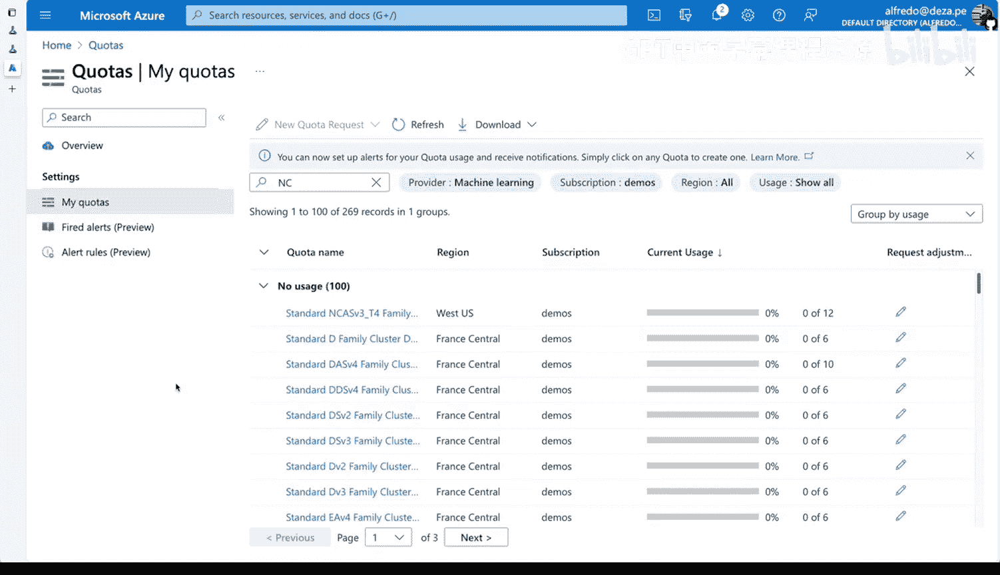

# 大型语言模型实践：P100：GPU配额与可用性 🎮

在本节课中，我们将学习在Azure平台上工作时，如何理解和处理GPU配额问题。这对于部署生成式AI模型至关重要。

## 概述

在Azure上部署生成式AI模型时，GPU配额是需要重点关注的资源限制。本节将演示如何在Azure AI机器学习工作室中检查配额，并介绍当配额不足时可能的处理方式。

## 配额检查与部署尝试

上一节我们介绍了配额的重要性，本节中我们来看看实际操作中会遇到什么情况。

在Azure AI机器学习工作室中，当你尝试部署某些生成式AI模型时，系统会检查你的配额。例如，我们尝试部署一个名为 **Miralal AI 7b instruct Per1** 的模型。

点击部署并选择创建实时端点后，系统通常会提示你可能没有足够的配额来创建虚拟机。

## 申请更多配额

以下是申请增加配额的标准流程，但需要注意，Azure的申请方式可能随时变化。

1.  在配额页面，找到你需要的资源系列，例如 **ND A100 v4 系列** 专用GPU。
2.  点击“请求增加配额”。
3.  填写申请表格并提交。

然而，在本课程录制时，系统可能存在一个已知问题：提交申请后可能会报错。例如，错误信息可能显示“你的支持计划类型是免费的”，即使你使用的是付费订阅。这通常是临时的系统问题。

## 通过门户查看配额详情

如果标准申请路径遇到问题，我们可以返回Azure门户查看更详细的配额信息。

在门户中，导航到“配额”部分。配额不仅针对GPU，但对我们而言，重点是机器学习相关的配额。

1.  在配额页面，选择“机器学习”。
2.  页面会列出所有类型的配额。我们可以筛选出特定的GPU系列。例如，**NCv3系列** 对应的是NVIDIA Tesla V100 GPU。
3.  使用筛选功能，输入“NC”进行搜索。

筛选后，你可以看到特定区域（如美国东部）的配额详情，例如“0 / 12”，表示该区域该类型GPU的已用量和总配额。

## 区域选择的重要性

从这里可以看出，**区域是配额管理的关键**。不同区域的GPU可用性完全不同。

如果你在某个区域配额不足，可以尝试切换到有可用配额的其他区域来创建Azure机器学习工作室资源。这能让你获得所需的计算资源类型。

## 配额调整的限制

需要注意的是，并非所有配额都能直接通过门户申请调整。有时，系统会提示你需要返回Azure机器学习工作室内提交申请。这体现了不同服务之间配额管理流程的差异。

## 总结

本节课中我们一起学习了：
*   在Azure AI机器学习工作室部署模型时会触发配额检查。
*   如何通过标准流程申请增加配额，并了解可能遇到的临时问题。
*   如何通过Azure门户详细查看**特定订阅**和**特定区域**下的机器学习与GPU配额。
*   理解了**区域选择**对资源可用性的决定性影响。

掌握这些知识，你将能够更好地规划资源，并成功部署所需的生成式AI模型计算实例。