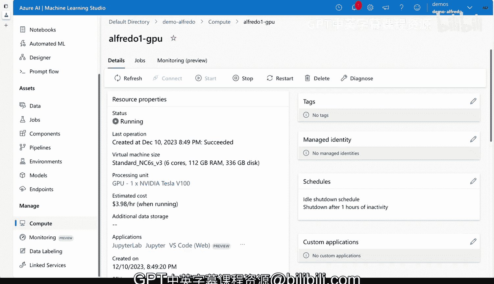

# 大型语言模型实践：P101：创建计算资源 💻

在本节中，我们将学习如何在Azure机器学习工作室中创建并配置一个计算实例。这个计算实例将作为我们后续部署和运行大型语言模型的基础计算资源。

## 概述

我们将逐步完成在Azure机器学习工作室中创建GPU计算实例的过程，包括选择机器类型、配置参数以及了解创建后的管理选项。这是运行计算密集型任务（如大型语言模型）的关键第一步。

## 创建计算实例

上一节我们介绍了Azure机器学习工作室的界面，本节中我们来看看如何创建一个具体的计算资源。

首先，在Azure机器学习工作室中，向下滚动到“管理”区域，然后点击“计算”选项。

点击后，将进入计算管理页面。为了运行后续任务，我需要创建一个正在运行的计算实例。因此，点击“新建”按钮来创建新的计算实例。

## 配置计算实例

以下是配置计算实例时需要设定的几个关键参数：

1.  **命名**：可以为计算实例命名。通常可以使用像“GPU”这样的名称，以帮助识别所创建资源的用途。
2.  **选择虚拟机类型**：将虚拟机类型选择为“GPU”。选择后，列表会被筛选，只显示可用的GPU选项。
3.  **选择具体规格**：在可用选项中，选择“Standard_NC6s_v3”规格。虽然可能存在更便宜的选项（如Tesla B100），但可能受到配额限制。`Standard_NC6s_v3` 规格目前可用且合适。

在选择规格后，可以点击“查看并创建”来确认配置。

## 高级设置与资源配置

在创建前，可以查看和设置一些高级选项。

一个非常有用的功能是“空闲时自动关闭”。可以设置为在60分钟无活动后自动关闭实例以节省成本。当然，也可以根据需要更改此设置。

此外，还可以启用SSH访问，以便直接登录到虚拟机进行管理。

现在，让我们查看所选虚拟机的详细资源配置：
*   **核心数**：6个vCPU
*   **内存**：112 GB RAM
*   **存储**：336 GB 存储空间

这是一个相当不错的入门级GPU配置，足以支持我们进行几次大型语言模型的部署和交互。

确认所有配置无误后，点击“创建”按钮。

## 等待创建完成

创建过程就像在云中启动任何常规虚拟机一样，需要几分钟时间。一旦创建完成，我们就可以使用这个计算实例来实际部署大型语言模型。

让我们稍等片刻，直到它完成创建。

## 管理已创建的计算实例

现在，虚拟机已经创建完毕并处于运行状态。界面中可能会显示一些可以在此机器上运行的应用程序，但目前我们不需要启动它们。

点击计算实例名称，可以查看和管理它。

在管理界面中，可以执行以下操作：
*   **监控任务**：查看在此实例上运行的作业。目前没有任务，因为这是一个全新的实例。
*   **管理生命周期**：可以停止、重启或删除该实例。
*   **查看成本与信息**：可以看到该实例运行时的成本约为每小时4美元。同时，可以查看其内部IP地址和所关联的特定订阅信息。

这些信息对于资源管理和成本控制非常重要。

## 总结

本节课中我们一起学习了在Azure机器学习工作室中创建计算实例的完整流程。我们首先导航到计算管理页面，然后逐步配置了实例的名称、GPU类型和具体规格（`Standard_NC6s_v3`）。接着，我们查看了包括自动关机在内的可选设置，并确认了虚拟机的核心数、内存和存储配置。最后，我们创建了实例，并了解了创建后如何对其进行基本管理，如监控任务和查看成本。现在，这个配置了Tesla V100 GPU的计算实例已经准备就绪，可以用于后续部署大型语言模型的实际操作了。