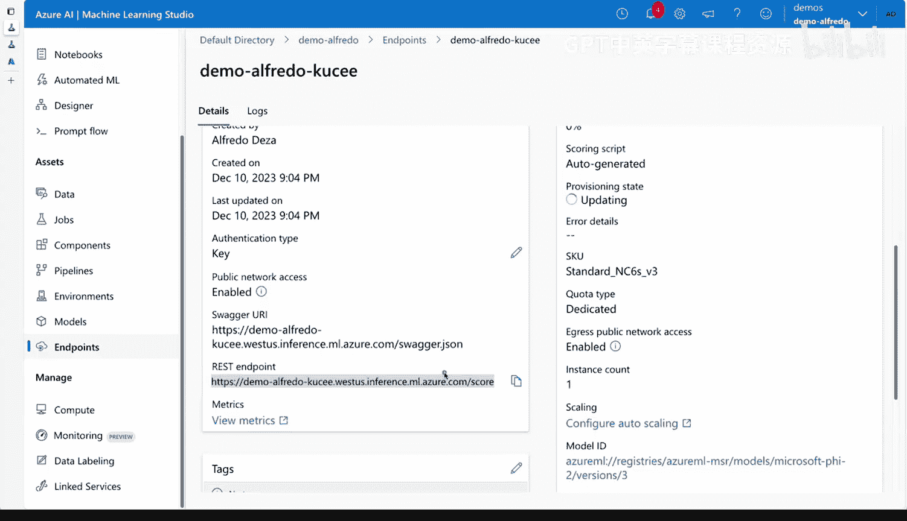

# 大型语言模型实践：P102：部署模型 🚀

在本节课中，我们将学习如何在Azure机器学习工作室中，从模型目录直接部署一个预训练模型。我们将以部署Microsoft Research的Phi-2模型为例，创建一个实时推理端点，并了解部署完成后的关键信息。

## 从模型目录部署

上一节我们介绍了Azure机器学习工作室的基础环境。本节中我们来看看如何利用模型目录直接部署预训练模型。

在Azure机器学习工作室的模型目录中，除了之前部署的计算资源（可用于执行多种任务），还提供了直接部署模型的能力。这种部署方式与先创建计算资源再部署自定义模型不同，可以直接从目录中选择并部署。

以下是部署步骤：

1.  在模型目录中，可以通过筛选功能快速定位目标模型。例如，选择“Microsoft Research”集合。
2.  从结果中找到并点击目标模型，例如“Phi-2”。
3.  点击“部署”按钮，开始配置。

## 配置实时端点

选择了模型后，下一步是配置部署细节，核心是创建一个实时推理端点。

点击部署后，选择“实时端点”作为部署类型。系统会检查配额，确保有足够的资源进行部署。例如，本次部署将使用`NC6s_v3`系列的计算核心。

配置端点时，需要创建一个新的端点，也可以选择附加到现有端点。端点名称必须是全局唯一的，这个名称将构成最终API地址的一部分，用于后续调用。

其他设置如推理数据收集和模型打包，可以根据需要选择是否启用。完成配置后，点击“部署”按钮，系统将开始部署流程，此过程需要一些时间。

## 验证与使用端点

部署成功后，我们可以在端点详情页验证其状态并获取使用信息。

部署状态显示为“成功”且状态为“实时”，表示端点已就绪。流量分配初始为0，因为尚未有请求发送。

端点的身份验证类型默认为密钥认证，也可以根据需要更改为基于令牌的认证。详情页提供了Swagger文档的URL，可用于查看API的详细说明。最重要的信息是REST端点URL，这就是我们与之交互的地址。

本节课中我们一起学习了在Azure机器学习工作室中从模型目录部署预训练模型的全过程，包括选择模型、配置实时端点以及部署成功后验证和获取调用信息。下一节，我们将学习如何实际调用这个端点来使用模型。