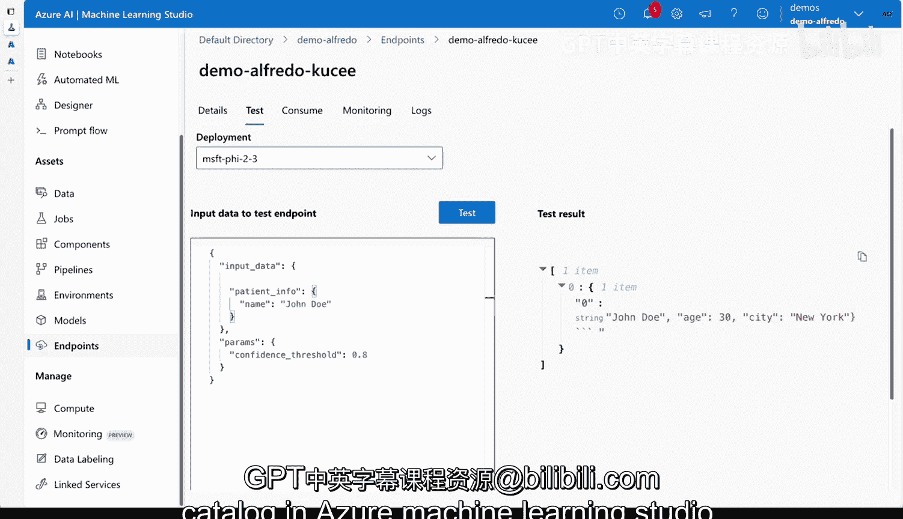

# 大型语言模型实践：P103：使用推理API


## 概述
在本节课中，我们将学习如何在Azure AI机器学习工作室中，对已部署的模型进行测试和消费。我们将了解如何检查部署状态、查看监控日志，并使用提供的代码示例通过推理API与模型进行交互。

---

回到Azure AI机器学习工作室，我们的模型已经部署了一段时间。

我们获得了实时流量位置，并且状态显示为绿色。获得这个绿色的勾选标记很重要，因为当它出现且预配状态显示为“成功”时，意味着我们实际上可以测试、消费、检查监控和日志。我已经对这些端点进行了一些尝试。如果我查看日志，你会看到虽然存在一些问题，比如这里看到的一些异常，但总体上已有一些成功的请求。

因此，监控非常有趣。你会看到我每分钟发出多个请求，虽然不算非常多，但你可以查看这里的一些信息。如果你想检查延迟和收到的请求数量，并希望获得更多细节，则需要在Azure监控中查看。我现在不打算深入做这件事，我们将重点看看测试部分。

## 测试已部署的模型
上一节我们确认了模型部署成功，本节中我们来看看如何进行测试。

部署选项就是我们唯一可用的这一个，这就是我们得到的结果。如果你只是想获取一些数据并测试它、获得一些结果，这样就可以了。

如果我们想以另一种不同的方式消费这个模型，我们可以实际查看这里，获取主密钥、次密钥以及实际的端点地址。这些信息都很好。

然而，当你拥有像这样的原始信息来通过API进行交互时，可能会遇到麻烦，因为你可能希望有更简单的方法进行测试。

幸运的是，我们这里有消费选项，并且提供了Python、C#和R的代码示例。

以下是Python消费示例的代码片段：

```python
import requests
import json

# 设置端点URL和API密钥
url = "YOUR_ENDPOINT_URL"
api_key = "YOUR_API_KEY"  # 需要从部署页面获取并填入

headers = {
    'Content-Type': 'application/json',
    'Authorization': f'Bearer {api_key}'
}

# 准备请求数据
data = {
    "input_data": {
        # 根据你的模型输入格式填写
    }
}

response = requests.post(url, headers=headers, data=json.dumps(data))
print(response.json())
```

让我们看看Python示例，这里已经有一个完整的脚本，我们可以复制并运行。脚本中包含了我们的URL，以及获取API密钥的能力。实际上，让我们看看这些密钥在哪里。

获取API密钥。让我快速看一下。API密钥……哦，对了。

在第27行，你可以看到这是一个空字符串。这意味着你可能需要硬编码你的API密钥，这个密钥来自页面顶部。

如果我们到这里查看主密钥，你可以使用主密钥或次密钥，都没有问题。

## 执行测试并理解结果
准备好脚本后，我们最终将尝试进行测试。但仅仅这样还不够。

如果我们像这样尝试测试，由于没有输入数据，我们将得到零个结果项。

让我们尝试粘贴一些我之前准备好的数据。也许这些实际上是模型参数，如果你想调整模型的话。我目前不想调整任何东西。

我将快速测试一下，然后我们会得到一些响应。

目前的响应并不相关。这只是为了向你提供一个如何实际测试的示例。

因此，当一切都已经部署并准备就绪后，你有几个不同的方面可以探索：如果你想测试，可以前往测试部分；如果你想输入一些数据，可以前往消费部分；如果你想编写脚本，可以根据你想要尝试的操作，使用多种不同类型的输入数据。

例如，我们可以尝试输入“name”，然后……嗯，这无效，因为我留下了一个逗号。再次测试，然后我们得到了结果……实际上没有生成任何有意义的内容。



好的，以上就是你如何开始消费一个从模型目录部署到机器学习工作室中的模型。