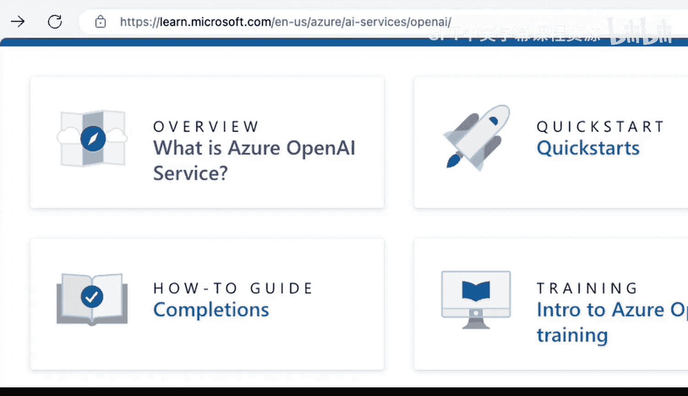

# 大型语言模型实践：P106：获取Azure OpenAI服务访问权限 🔑

在本节课中，我们将学习如何申请并获得Azure OpenAI服务的访问权限。由于目前该服务的访问权限受到一定限制，我们将详细介绍申请流程和所需步骤。

## 概述

Azure OpenAI服务提供了强大的语言模型能力。要使用它，首先需要申请访问权限。本节将引导你完成整个申请过程。

## 访问申请流程

上一节我们介绍了Azure OpenAI服务的背景，本节中我们来看看如何具体申请访问权限。

申请访问的主要入口是Microsoft Learn平台上的Azure OpenAI服务文档页面。该页面不仅是获取访问权限的起点，也包含了服务介绍、资源创建、嵌入功能使用以及OpenAI模型应用等所有必要信息，其中快速入门指南非常实用。

以下是申请访问权限的具体步骤：

1.  访问Azure OpenAI服务官方文档页面。
2.  在页面的“其他资源”部分找到访问申请链接。
3.  点击链接进入申请页面。

需要注意的是，网站结构可能发生变化。如果找不到申请链接，一个更简单易记的方法是直接访问短链接：`aka.ms/oai/access`。这个链接会直接跳转到申请页面。

## 填写申请表单

进入“申请访问Azure OpenAI服务”页面后，请仔细阅读所有说明。

以下是填写申请表单时的关键注意事项：

*   **邮箱地址**：请勿使用个人邮箱地址。申请需要使用与组织或公司相关的邮箱。
*   **所需信息**：你需要准备并填写个人信息（如姓名）、Azure订阅ID、公司名称、公司地址等详细信息。
*   **信息用途**：所有提供的信息将用于服务审核和开通。

填写完毕后，滚动到页面底部提交申请。提交后，需要等待一段时间审核才能获得访问权限。

## 服务访问说明

目前，Azure OpenAI服务的注册申请存在一定的流量控制或限制。这是当前申请过程中可能遇到的情况。

为了确保你遵循的流程是最新且准确的，最佳做法是始终通过Microsoft Learn平台，搜索并进入“Azure OpenAI服务”官方文档页面，以查看最新的申请指南和要求。

## 总结

本节课中我们一起学习了如何申请Azure OpenAI服务的访问权限。关键步骤包括：通过Microsoft Learn文档或短链接找到申请入口，使用公司邮箱填写详细的申请表单，并耐心等待审核结果。请务必通过官方渠道获取最新信息以确保流程正确。