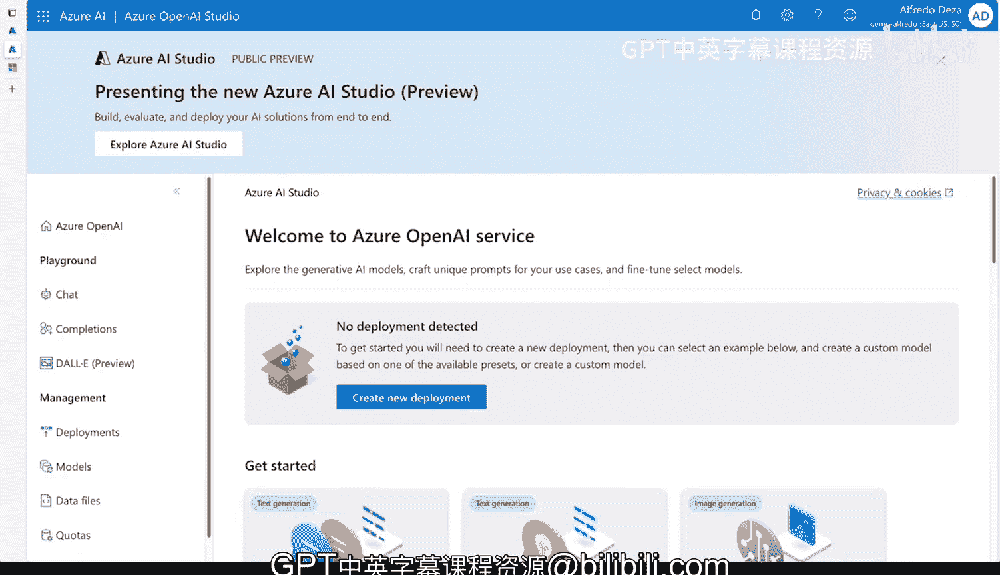

# 大型语言模型实践：P107：创建Azure OpenAI服务资源

## 概述
在本节课中，我们将学习如何在Azure门户中创建并配置一个Azure OpenAI服务资源。这是使用Azure OpenAI服务的第一步，我们将了解创建过程中的关键步骤和注意事项。

---

## 创建资源
首先，我们需要访问Azure门户。你可以通过搜索找到它，或者像我一样，如果之前打开过，可以直接点击进入。为了创建一个新的资源，我们需要点击“创建”按钮。

点击“创建”后，一个表单将会出现，我们需要填写必要的信息。

---

## 填写基本信息
以下是创建Azure OpenAI服务资源时需要填写的基本信息列表：

*   **订阅**：从你的订阅列表中选择一个。我将使用我的演示订阅。
*   **资源组**：建议为演示创建一个专门的资源组，例如“demo-openai-alfredo”。这有助于资源管理和后续清理。
*   **名称**：资源名称必须是全局唯一的。例如，输入“demo”可能无法通过，因为相关的子域名已被占用。我尝试使用“demo-alfredo”，这个名称通过了验证。
*   **定价层**：选择“标准”层。你可以点击“查看完整定价详情”来了解更多信息，但本节课我们不做深入探讨。

填写完基本信息后，点击“下一步”。

---

## 配置网络与标签
接下来是网络配置。默认选项是允许所有网络（包括互联网）访问此资源。你也可以选择更严格的网络限制。本节课，我们选择允许所有网络访问。

标签部分是可选的，你可以根据需要添加标签来组织资源。本节课我们不添加任何标签。

配置完成后，系统会在后台进行验证。验证通过后，点击“创建”即可开始部署。

---

## 部署与访问
Azure OpenAI服务的部署速度通常很快。部署成功后，你可以点击“转到资源”按钮。

现在，资源“demo-alfredo”已经准备就绪。有一个关键点需要注意：当你准备使用服务的API端点时，你需要使用访问密钥。这些密钥不在Azure AI Studio或Azure OpenAI Studio中，而是在Azure门户的资源管理页面里，具体位置是“密钥和终结点”。

点击“密钥和终结点”，你就能找到API密钥和终结点URL（例如 `https://demo-alfredo.openai.azure.com/`）。这些信息在后续调用服务时至关重要。

最后，我们可以从概述页面点击“Azure OpenAI Studio”来启动该资源的管理界面。请注意，这个界面有时也被称为“Azure AI Studio”。在这里，你可以查看配额、与模型交互，并开始使用Azure OpenAI服务。

---

## 总结
本节课中，我们一起学习了如何在Azure门户中创建Azure OpenAI服务资源。我们完成了从选择订阅、设置资源组、命名资源、选择定价层，到配置网络和最终部署的完整流程。最重要的是，我们明确了API密钥和终结点URL的查找位置，这是后续实际调用服务的基础。现在，你的Azure OpenAI服务实例已经创建成功，可以开始下一步的探索和使用了。