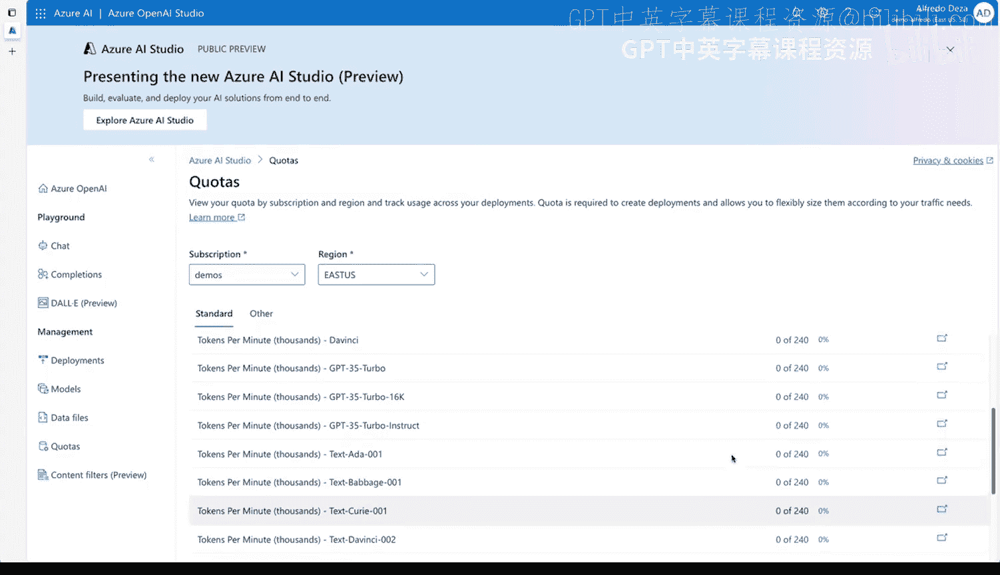
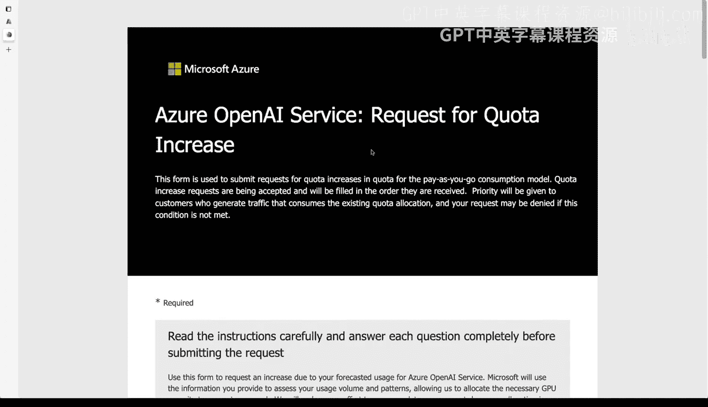
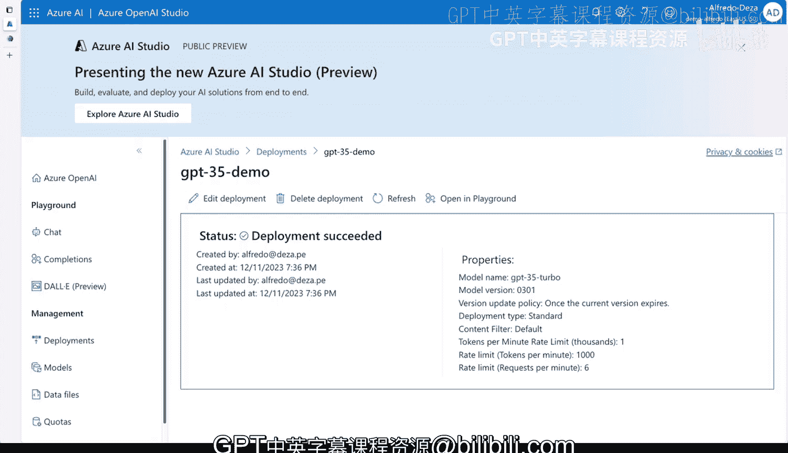

# 大型语言模型实践：1.2：部署OpenAI模型 🚀

在本节课中，我们将学习如何在Azure AI Studio中部署一个OpenAI模型。我们将从了解配额设置开始，然后一步步完成GPT-3.5 Turbo模型的部署过程，并熟悉部署后的管理界面。

---

## 配额概览与设置

在开始部署模型之前，我们需要先了解Azure AI Studio中的配额系统。配额决定了我们使用模型资源的速率限制。

上一节我们介绍了Azure AI Studio的基本界面，本节中我们来看看如何管理配额。请注意，界面名称可能从“Azure OpenAI Studio”变更为“Azure AI Studio”，但核心功能一致。

在配额页面，你会发现配额的管理方式有所不同。与由服务预设配额不同，这里允许你设置自己的限制。例如，你可能会看到类似 **240,000 tokens/分钟** 的总限制。这个数值单位是千。

以下是配额设置的关键点：
*   配额以每分钟处理的令牌数为单位进行设置。
*   你可以看到一个百分比进度条，用于监控使用情况。
*   如果需要更高的限制，可以申请提升配额（本教程不涉及此流程）。

了解配额设置后，我们就可以开始部署模型了。

---

## 部署GPT-3.5 Turbo模型

现在，我们进入“模型”页面，选择GPT-3.5 Turbo模型进行部署。

点击“部署”按钮后，系统会要求你进行一些配置。

### 模型配置选项

你需要为此次部署选择具体的模型版本并为其命名。

以下是部署配置步骤：
1.  **选择模型版本**：从提供的几个选项中选择一个，例如 `gpt-35-turbo-0613`。
2.  **命名部署**：为此次部署起一个名字，例如 `GPT-35-Demo`。

### 高级配额设置

点击“高级选项”，我们可以进一步调整配额。这是之前提到过的动态配额功能。

关键设置如下：
*   **可用配额**：系统显示当前有 **240,000 tokens/分钟** 的配额可用于此部署。
*   **配额调整**：你可以将此配额从最高值下调至最低 **1,000 tokens/分钟**。
*   **优势**：此动态配额机制让你能灵活利用可用容量，并且只在实际使用时产生费用。

我们保持启用此选项，然后点击“创建”。由于这是通过API操作，部署过程会非常迅速。很快，你会看到“成功创建部署 GPT-35-Demo”的提示。

---

## 管理已部署的模型

模型部署成功后，我们需要知道在哪里找到并管理它。

我们进入“部署”页面，在这里可以看到所有已创建的部署。状态显示为“成功”即表示模型已就绪。

### 部署详情与操作

点击我们刚刚创建的 `GPT-35-Demo` 部署，可以查看其详细信息。

部署详情页面提供了丰富的信息和操作入口：
*   **查看信息**：可以查看模型的速率限制、令牌使用情况等。
*   **管理部署**：你可以编辑部署配置、创建新部署或删除当前部署。
*   **快速测试**：一个非常实用的功能是，你可以直接点击“在Playground中打开”或“前往聊天”，立即开始测试和使用这个刚部署好的模型。

点击“在Playground中打开”，便会进入一个交互式界面，你可以直接与模型对话。虽然我们现在不进行测试，但这是你后续使用模型的主要方式之一。

### 探索Azure AI Studio

让我们快速回到Azure AI Studio的主界面。这个仍处于预览模式的新界面整合了所有必要功能。

关键区域包括：
*   **浏览模型目录**：在这里可以查找所有可用模型。
*   **试用Azure OpenAI**：点击此入口，你会再次看到模型目录，方便你尝试不同的模型。

回到我们的 `GPT-35-Demo`，至此，模型部署的所有必要步骤已完成。我们将在后续学习API调用时，与这些已部署的模型进行交互。

---

本节课中我们一起学习了在Azure AI Studio中部署OpenAI模型的完整流程。我们从配额设置入手，逐步完成了GPT-3.5 Turbo模型的选择、配置和部署，并熟悉了部署后的管理界面。核心在于理解动态配额的优势，并掌握通过Playground快速验证模型部署成功的方法。这些操作为后续通过API集成和使用大语言模型打下了基础。