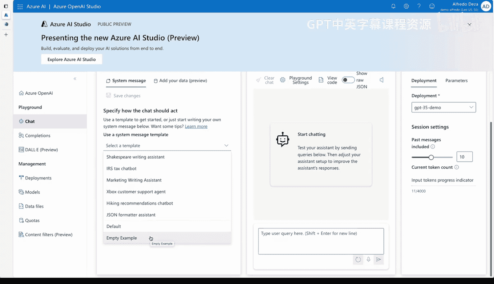
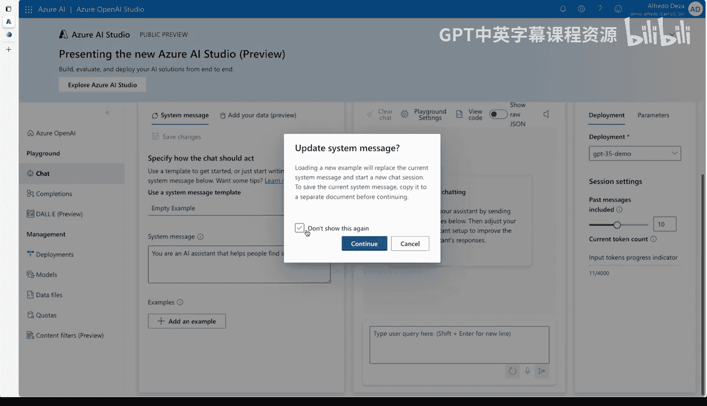
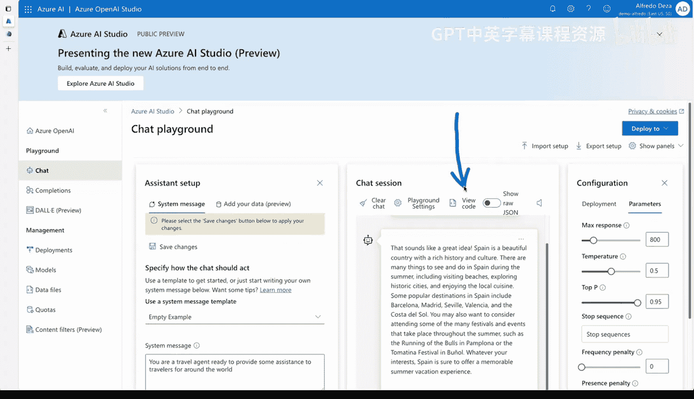
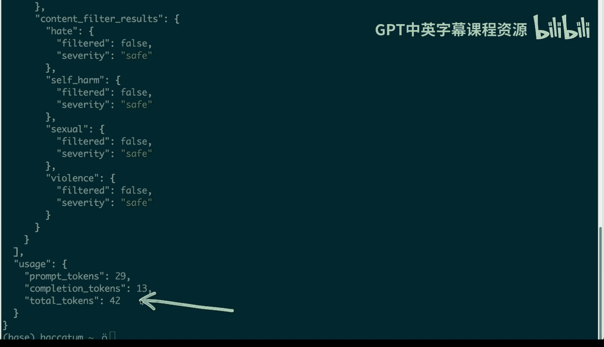
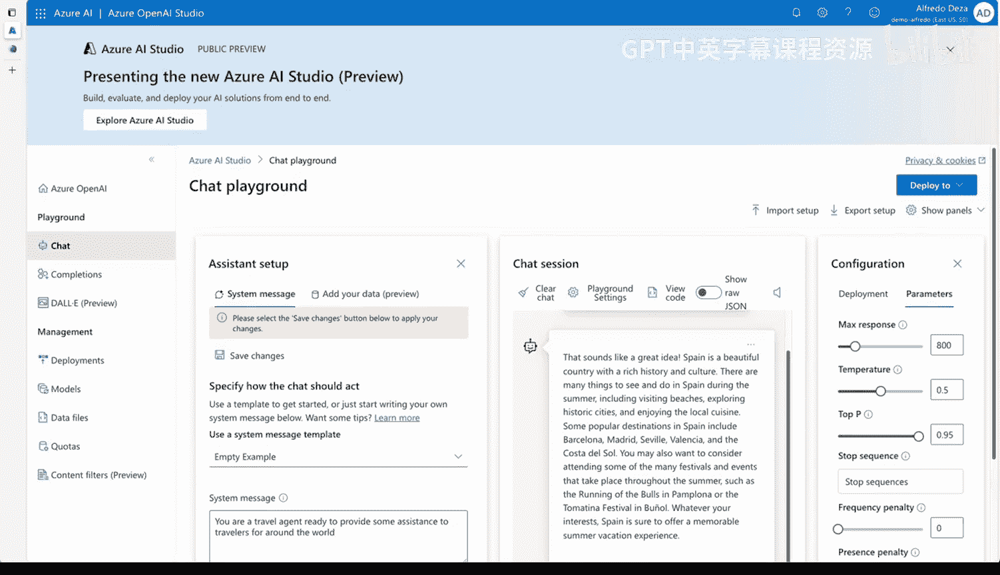

# 大型语言模型实践：第2章：使用Playground与API调用模型 🚀


在本节课中，我们将学习如何与已部署的Azure OpenAI模型进行交互。我们将通过两种主要方式来实现：使用Azure AI Studio中的Playground界面，以及通过命令行使用cURL直接调用API。这两种方法都能让你快速测试和验证模型的功能。

---



## 部署模型与Playground交互



上一节我们介绍了如何部署模型，本节中我们来看看如何实际使用它。首先，我们需要在Azure OpenAI服务中找到已部署的模型。

1.  在Azure AI Studio中，导航到“部署”部分。
2.  找到名为“G35 demo”的部署。
3.  点击“在Playground中打开”选项。

进入Playground后，你将看到一个交互界面。以下是配置步骤：

*   **选择模板**：界面提供了一些预设模板。我们将选择“空示例”来从头开始。
*   **设置系统消息**：在系统消息框中输入：`你是一位旅行助手，准备为世界各地的旅行者提供帮助。`
*   **输入用户查询**：在用户消息框中输入：`我想在夏天去西班牙旅行。`
*   **生成回复**：点击“生成”按钮，模型将返回回复，例如：“这听起来是个很棒的主意！西班牙是一个拥有丰富历史和文化的美丽国家……”

通过Playground，你可以轻松地与模型对话，并实时调整参数，如“温度”和“最大响应长度”，以观察它们对输出结果的影响。

---

## 查看代码与API调用



除了使用图形界面，我们还可以直接通过代码调用API。Playground提供了“查看代码”功能，可以生成对应的调用示例。

在生成的Python代码中，核心部分是构建请求消息。一个基本的请求结构如下：

```python
messages=[
    {"role": "system", "content": "你是一个AI助手，帮助人们查找信息。"},
    {"role": "user", "content": "讲个笑话"}
]
```

这段代码定义了一个系统角色（设定助手行为）和一个用户角色（提出请求）。

---

## 使用cURL进行命令行调用

如果你想在命令行中快速测试API，可以使用cURL工具。以下是调用步骤和关键参数说明：

1.  **准备信息**：你需要从Azure OpenAI服务获取`API密钥`和`终结点`URL。
2.  **构建cURL命令**：以下是一个完整的命令示例。

```bash
curl $ENDPOINT \
  -H “Content-Type: application/json” \
  -H “api-key: $API_KEY” \
  -d ‘{
    “messages”: [
      {“role”: “system”, “content”: “你是一个AI助手，帮助人们查找信息。”},
      {“role”: “user”, “content”: “讲个笑话”}
    ],
    “max_tokens”: 100,
    “temperature”: 0.7
  }’ | jq
```

以下是命令中关键部分的解释：

*   **`-H`**：设置HTTP请求头。`Content-Type`指定数据格式为JSON，`api-key`用于身份验证。
*   **`-d`**：传递请求数据（正文）。其中包含消息列表和生成参数。
*   **`max_tokens`**：限制模型生成回复的最大长度（以令牌计）。
*   **`temperature`**：控制输出的随机性。值越高（如0.8），回复越多样、有创意；值越低（如0.2），回复越确定、保守。
*   **`jq`**：一个可选工具，用于将返回的JSON数据格式化输出，便于阅读。

执行命令后，你会收到一个JSON格式的响应。响应中通常包含：
*   `choices[0].message.content`：模型生成的回复内容（例如一个笑话）。
*   `usage`：本次调用消耗的令牌数量统计。
*   内容安全过滤结果。

---

## 总结





本节课中我们一起学习了与已部署的Azure OpenAI模型交互的两种核心方法。首先，我们使用**Playground**界面进行直观的对话测试和参数调整。接着，我们探讨了如何通过**查看代码**功能获取编程示例，并详细演示了如何使用**cURL命令**在终端中直接调用API，包括如何设置请求头、构建消息体以及理解关键参数如`max_tokens`和`temperature`的作用。这两种方式为你提供了从快速原型验证到集成到应用程序中的灵活选择。