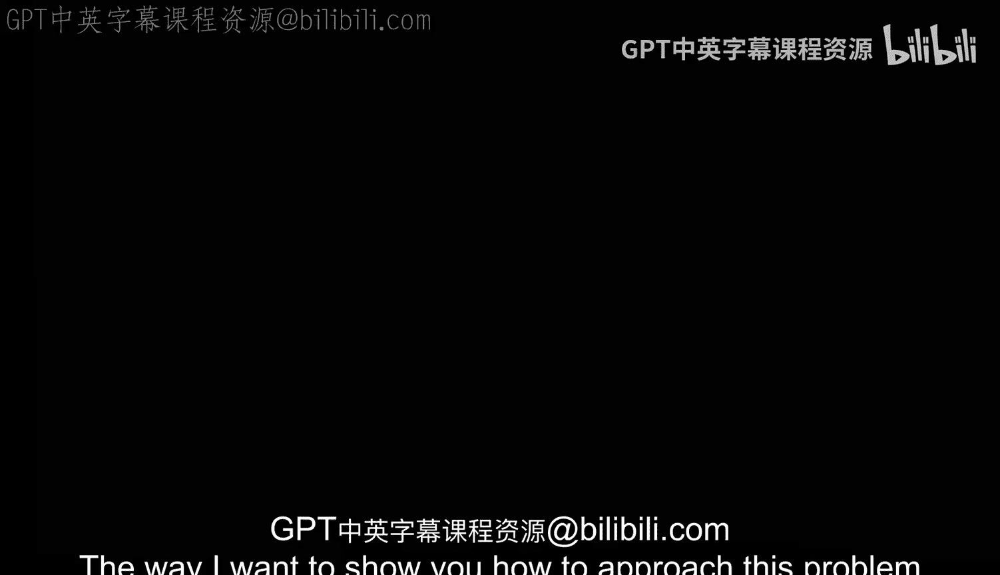
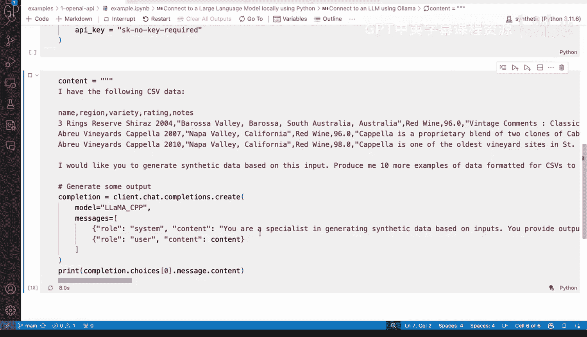

# 大型语言模型实践（开源大语言模型方案）：P12：12_01_04：增强应用程序概述 🚀



在本节课中，我们将学习如何使用大型语言模型来生成合成数据集。我们将保持方法简单，使用基于OpenAI的API来连接一个本地运行的大型语言模型。通过本教程，你将了解如何设置连接、发送请求并获取模型生成的合成数据。

---

## 连接本地大型语言模型

上一节我们介绍了课程目标，本节中我们来看看如何具体连接到本地运行的大型语言模型。我们将使用两种主要方式：Llamafile和Ollama。这两种方式在连接细节上略有不同。

以下是连接本地大语言模型的两个选项：

1.  **使用 Llamafile**：Llamafile 默认在 `localhost:8080` 运行，并且其API端点需要包含 `/v1`。API密钥字段可以填写任意内容，因为它不是必需的。
2.  **使用 Ollama**：如果你在系统中安装了Ollama，连接地址会稍有不同。同样，API密钥不是必需的，但需要根据后台使用的具体模型来调整连接时指定的模型名称。

无论选择哪种方式，第一步都是实例化一个客户端来建立连接。

## 与模型交互并生成数据

现在我们已经建立了连接，本节中我们来看看如何与模型进行交互以生成合成数据。核心是通过向模型发送包含系统指令和用户输入的消息来完成请求。

在代码中，我们使用 `client.chat.completions.create` 方法来与模型对话。关键在于构建 `messages` 参数。

以下是一个消息结构的示例：

```python
messages = [
    {"role": "system", "content": "你是一个根据输入生成合成数据的专家。"},
    {"role": "user", "content": "用户提供的输入文本在这里..."}
]
```
*   **系统消息**：用于指导模型的行为模式。在本例中，我们指示模型扮演一个合成数据生成专家的角色。
*   **用户消息**：包含我们希望模型基于其生成数据的具体输入内容。

## 运行模型并获取结果

为了让整个流程工作，我们需要在本地运行一个大型语言模型实例。这通常通过在终端中启动相应的模型服务来完成。

启动服务后，我们回到代码编辑器，执行与模型交互的代码。生成结果可能需要几秒钟时间，具体取决于本地系统的性能。最终，模型将返回生成的合成数据条目。

---



本节课中我们一起学习了如何使用本地大型语言模型生成合成数据。我们涵盖了连接模型的两种方法（Llamafile和Ollama），学习了如何通过系统指令和用户输入构建请求消息，并完成了从启动本地模型到获取生成结果的完整流程。这是一个构建数据增强应用程序的快速入门概述。