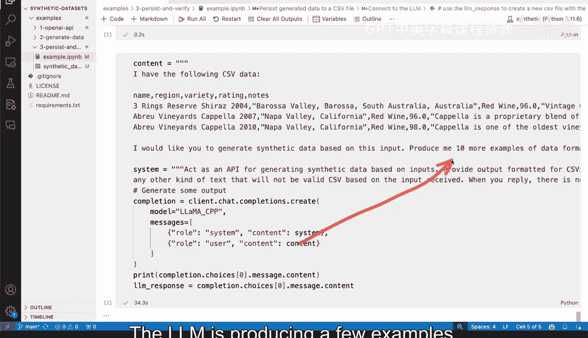

# 大型语言模型实践（开源大语言模型方案）：P14：增强和验证增强后的数据集 🧪


在本节课中，我们将学习如何利用大型语言模型（LLM）生成合成数据，并将其持久化保存为一个新的CSV文件。我们将涵盖从生成数据到验证数据格式的完整流程。

---

## 生成合成数据

上一节我们介绍了如何通过提示词与LLM交互。本节中，我们来看看如何具体生成我们所需的合成数据。

我们已准备好将大型语言模型生成的合成数据持久化保存。我们已成功连接到大型语言模型。我是在本地运行的模型，但这与你使用其他方式（无论是本地模型还是托管API）并无本质区别。提示词传递了三个示例项目，并要求生成10个类似的新项目。

系统提示词指示大型语言模型扮演一个API的角色。这意味着响应中不会包含任何多余的描述性文字，只会专注于生成我们指定的内容，即CSV格式的输出。

正如我们之前所见，我们得到了完美的输出，它为我们提供了10个非常优质、可靠的示例。

---

## 持久化数据到CSV文件

现在，我们希望将这些数据持久化保存。我们将使用一点Python代码来实际写入并创建一个新的CSV文件。这将创建一个基于我们所得数据的新CSV文件。

我们之前已知的列名是：`region`、`variety`、`rating` 和 `note`。

以下是创建CSV文件的步骤：

我们将创建一个新的CSV文件，并使用Python内置的`csv`模块。如果你处理更复杂的数据，可能会考虑使用`pandas`，但对于写入一个普通的CSV文件，这不会造成问题，因此`csv`模块足够使用。

1.  我们将把以单个字符串形式返回的输出按换行符进行分割。
2.  我们将以写入模式（`'w'`）打开名为`synthetic_data.csv`的文件。
3.  我们将创建一个`csv.writer`实例，并指定分隔符为逗号。
4.  首先，我们将写入列名。
5.  然后，对于输出中的每一行，如果该行不为空，我们将对其进行解析并写入文件。

**代码示例：**
```python
import csv

# 假设 `llm_output` 是包含生成数据的字符串
lines = llm_output.split('\n')

with open('synthetic_data.csv', 'w', newline='') as file:
    writer = csv.writer(file, delimiter=',')
    writer.writerow(['region', 'variety', 'rating', 'note'])  # 写入列名

    for line in lines:
        if not line.strip():  # 跳过空行
            continue
        # 解析行内容，移除多余的引号，并按逗号分割（考虑引号内的逗号）
        # 这里假设生成的数据格式是 "值1","值2","值3","值4"
        parsed_row = [field.strip('"') for field in line.split('","')]
        writer.writerow(parsed_row)
```

运行此代码后，我们将得到`synthetic_data.csv`文件。打开文件，可以看到数据已正确格式化，这正是我们所期望的结果。

---

## 数据解析的重要性

之前提到解析是必要的。如果不进行解析，直接写入原始行，数据会是什么样子呢？

如果我们简单地写入原始行（即`writer.writerow([line])`），然后再次运行，生成的`synthetic_data.csv`文件看起来就不会很规整。数据可能会因为字段内包含逗号和引号而错位。虽然使用`pandas`处理这类问题可能更容易，但直接写入会破坏数据的结构。

因此，在处理持久化数据或创建此类文件时，必须考虑数据格式的解析。重新运行正确的解析代码后，一切数据又恢复了应有的格式。

---

## 生产环境考量

最后，我想说明，如果要在生产环境中编写此类代码，使其更加专业化，我可能会考虑以下几点：

1.  将数据生成和写入功能封装成可调用的函数。
2.  用于生成提示的三个示例，可以从现有数据中随机抽取，而不仅仅是固定的几个。
3.  一旦LLM能够生成一些示例，我们或许可以要求它生成更多（例如超过10个）。
4.  此外，还需要验证返回的数据（即我们得到的这些数据）是否是有效的CSV格式。



---

本节课中，我们一起学习了如何利用大型语言模型生成合成数据、将数据正确解析并持久化保存为CSV文件，以及在生产环境中需要考虑的优化和验证点。这就是你整合工具、利用大语言模型生成合成数据并增强数据集的完整方法。