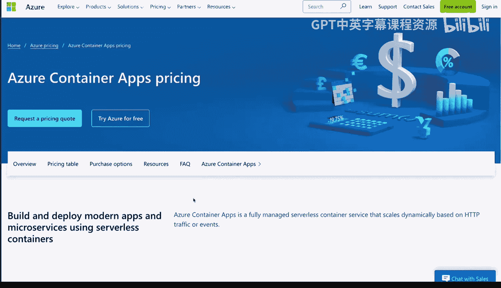
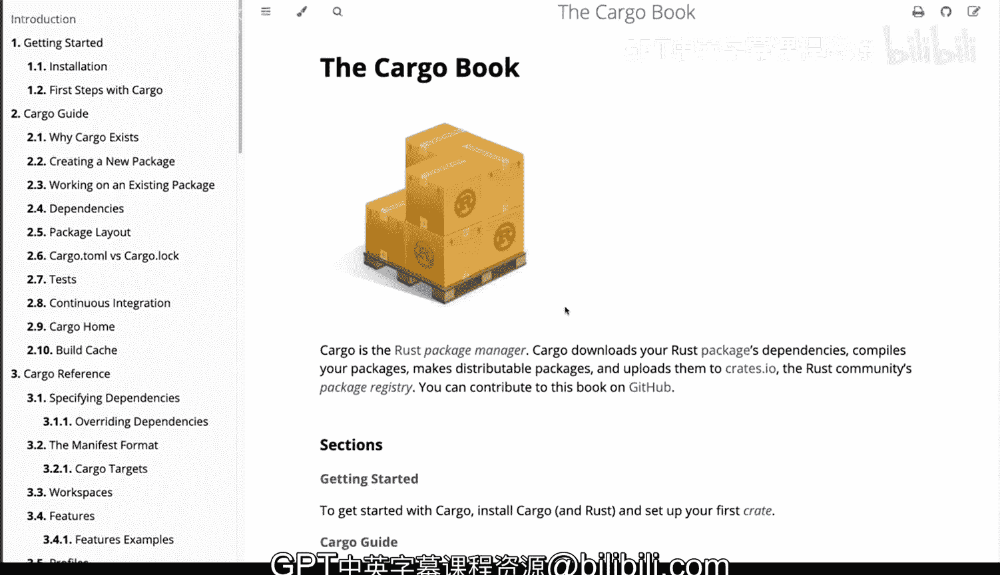

# 大型语言模型实践（开源大语言模型方案）：P17：17_01_03：考虑使用Rust替代Python 🦀

在本节课中，我们将探讨在大型语言模型相关项目中，为何可以考虑使用Rust替代Python。我们将重点分析几个关键原因，包括云部署成本、性能表现以及项目打包与分发的便捷性。

## 云部署成本考量 💰

上一节我们介绍了编程语言选择的一般背景，本节中我们来看看一个非常实际的问题：云部署成本。当你计划将应用程序部署到云端时，需要计算它将消耗多少内存和CPU资源，这直接决定了成本。

为了具体说明，我们以微软云Azure的容器应用定价为例。选择Rust而非Python，成本可能降低一个数量级，因为Rust应用的内存和CPU需求远低于Python。

以下是Azure消费计划的定价选项概览：

*   **Rust应用示例**：一个Rust Web API应用可以仅使用**0.25个vCPU**和**100 MB RAM**进行部署。
*   **免费额度影响**：Azure每月提供180，000 vCPU秒的免费额度。使用0.25个vCPU意味着你可以将免费额度效用**提升四倍**，因为你并非每秒都占用一整个vCPU。
*   **内存免费额度**：每月360，000 GB秒的内存免费额度，使得低内存占用的Rust应用优势更明显。

通过简单的计算器对比，就能看出在云成本方面，Rust是一个极具说服力的选择。

## 性能与本地运行优势 ⚡

除了云成本，Rust还能带来纯粹的**性能**提升。无论是在云端发布项目，还是在本地运行，你都能获得更强的处理能力、更低的资源消耗以及卓越的运行效率。

## 项目打包与分发的复杂性 📦

现在，让我们转向项目分发和部署的挑战。Python在这方面的一个普遍问题是**打包**。当你想要分发Python项目时，如果涉及依赖管理，事情会变得复杂。

尽管Python打包生态已有积极改进，但仍存在一些棘手且难以理解的挑战。以下是Python打包流程中可能涉及的部分工具和概念：

1.  **包安装器**：通常从`pip`开始，但它可能需要升级，且并非处理所有任务的唯一工具。
2.  **依赖定义文件**：存在多种格式，如`pyproject.toml`、`requirements.txt`、`setup.py`，缺乏一个强制的、单一的标准方式。
3.  **构建工具**：可能需要单独安装`build`等工具来构建分发包。
4.  **虚拟环境**：为了隔离包安装，通常需要使用虚拟环境。
5.  **发布工具**：上传分发包到仓库可能需要另一个工具，例如`twine`。

可以看到，仅打包环节就可能需要四到五种不同的工具，过程复杂且缺乏一个统一的、强约定的工作流。

## Rust的Cargo工具链 🛠️

相比之下，Rust的主要优势之一是拥有**Cargo**。如果我们查看Cargo手册，它是Rust的包管理器，功能高度集成。

以下是Cargo作为单一工具所能完成的核心工作：

*   `cargo build`：构建项目。
*   `cargo run`：运行项目。
*   `cargo test`：运行测试。
*   `cargo fmt`：格式化代码。
*   `cargo publish`：发布包到crates.io。

Cargo使用`Cargo.toml`文件来定义项目元数据和依赖，其结构类似于`pyproject.toml`。这种简单且高度约定俗成的方式，避免了Python中多种工具碎片化带来的复杂性。

此外，当你使用Cargo构建一个二进制文件时，它会确保所有内容都被包含在**单个可执行文件**中。这个文件可以在具有相同CPU架构的任何系统上运行，使得应用的分发变得极其简单。

## 总结 📝

本节课中我们一起学习了考虑使用Rust替代Python的几个重要原因。

1.  **显著降低云部署成本**：得益于更低的内存和CPU占用。
2.  **获得更优的运行时性能**：无论是在云端还是本地。
3.  **极大简化项目打包与分发**：通过**Cargo**这一单一、强大的工具链，实现从依赖管理、构建、测试到发布的统一流程，并生成易于分发的独立二进制文件。

对于关注效率、成本和部署便捷性的项目，尤其是资源敏感型的LLM应用部署场景，Rust提供了一个值得认真考虑的替代方案。