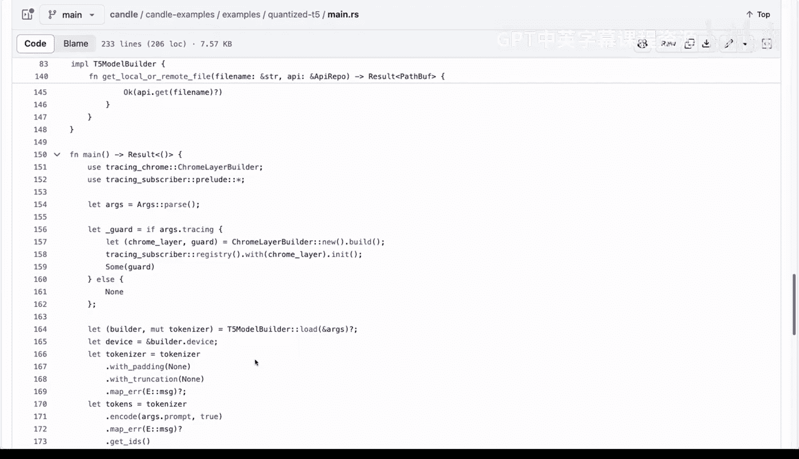
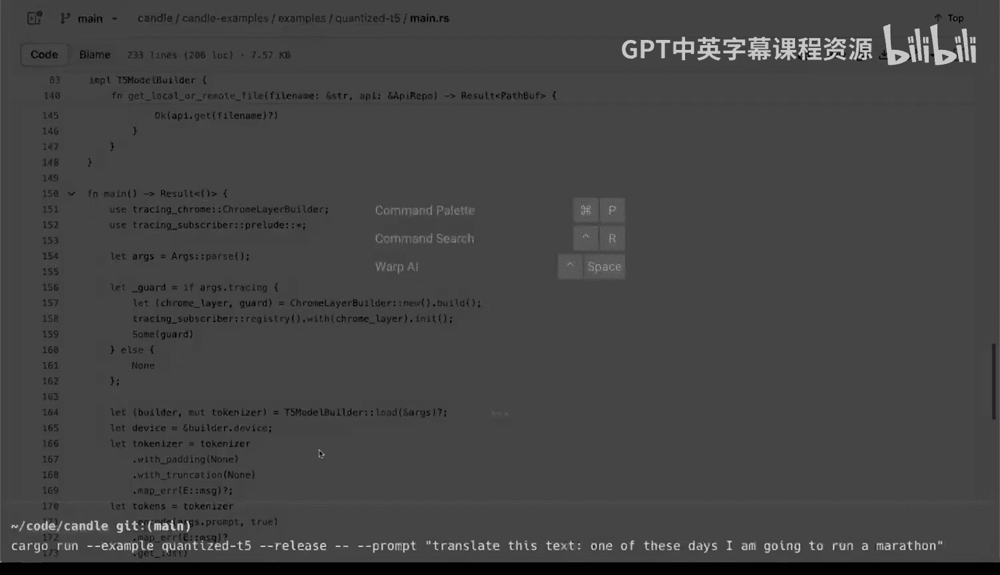
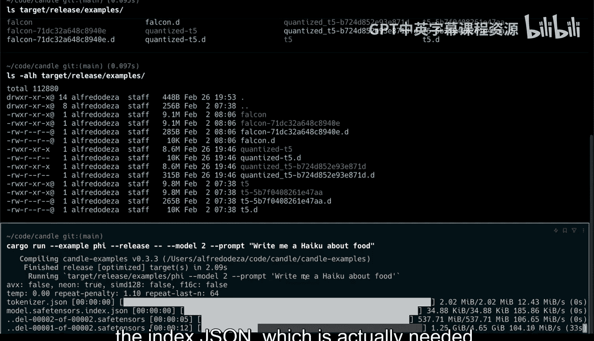
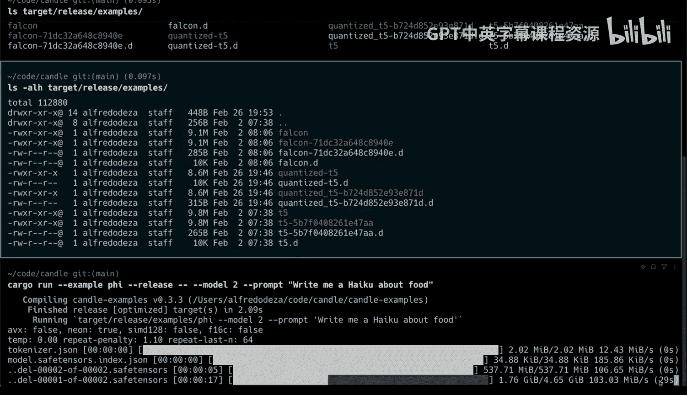
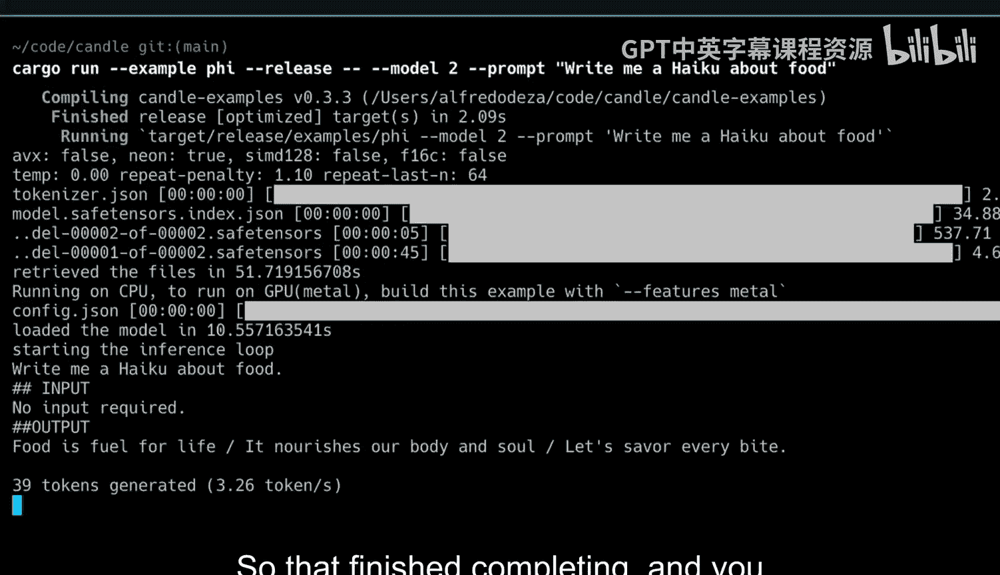
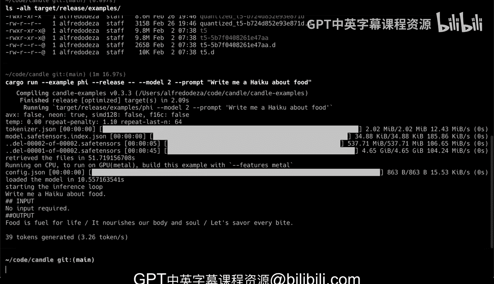

# 大型语言模型实践（开源大语言模型方案）：P18：18_01_04：使用Rust Candle 🕯️

在本节课中，我们将要学习如何使用 Rust Candle 库来运行大型语言模型。Candle 项目允许你将模型和所有依赖打包成一个独立的可执行文件，无需外部依赖，这为部署和使用模型提供了极大的便利。

## 概述

Candle 与其他工具（如 Rut Bt）不同，它让你拥有一个单一的可执行文件，无需任何其他外部依赖。这使你能够在一个二进制文件中运行模型，功能非常强大。

## 浏览Candle示例

接下来，我们将浏览 Candle 的示例代码。我们将具体使用一个执行翻译任务的示例。为此，我们将深入查看量化 T5 模型的示例。运行它并不复杂，但在运行和演示之前，我们先来看看代码。

### 代码结构分析

代码量较大，有 233 行。但不必担心，因为这是一个命令行工具，允许你运行从 T5-small 到 T5-extra-extra-large 等多种模型。因此，代码中包含了处理不同模型选项的逻辑。

你可以想象，较小的模型下载和执行所需资源较少，但能力可能较弱；而较大的模型可能具备更强的能力。

由于这是一个命令行工具，代码中包含了参数解析部分。你可以看到它尝试启用追踪、理解版本信息、处理权重和配置文件缓存。`prompt` 参数是你为模型提供输入的地方。

许多选项会从后台自动获取。我们之前讨论过 Hugging Face 平台可以托管所有这些模型。你可以看到量化 T5 模型就在 `lmc` 组织下。这允许你在运行时动态检索模型。

代码最后会与模型交互：读取输入，进行分词，然后将分词后的输入发送给模型进行处理。

## 终端演示

现在，让我们转到终端看看实际效果。

在我的终端中，我正在运行量化 T5 示例。我将输入以下文本进行翻译：
`translate this text one of these days I'm going to run a marathon`

运行后，你可以看到它生成了 18 个令牌，并以每秒 24.8 个令牌的速度运行。它成功地将文本翻译成了德语。虽然我的德语不好，但这个翻译过程非常快。

当我们使用 `--release` 标志运行时，意味着它将构建所需的一切。这很好。

如果我们执行 `ls` 命令查看 `target` 目录，你会看到 `release` 文件夹。让我们看看 `release` 里面有什么，并查看量化 T5 示例的最终文件大小。

执行 `ls -lh` 后，你可以看到文件大小为 9.8 MB。这非常令人印象深刻。不过，这个大小不包括模型本身，模型是预先单独下载的。

为了演示这一点，我将运行一个不同的示例。这次，我将运行 T5 模型，并使用其 v2 版本。我将输入一个有趣的提示：
`write me a haiku about food`

在后台，你可以看到它正在构建和下载模型。它下载了 537 MB 的数据，速度相当快。它同时下载了 safetensors 文件、分词器以及必需的索引文件。这需要几秒钟来完成。

下载完成后，你可以看到 T5 模型开始生成输出。这次速度没有那么快，我只能达到每秒 3.26 个令牌的速度。这一切都是动态发生的。

终端还提示我当前在 CPU 上运行，并提醒在 CPU 上运行会慢很多。这就是我们观察到性能下降的原因。

## 总结

本节课中，我们一起学习了如何使用 Rust Candle 库来运行和测试大型语言模型。我们了解了 Candle 如何将模型打包成单一可执行文件的优势，浏览了其示例代码的结构，并在终端中演示了运行量化 T5 模型进行翻译和生成俳句的过程。Candle 是一个非常有潜力的工具，希望你能尝试运行这些示例，并探索如何利用这些模型解决实际问题。