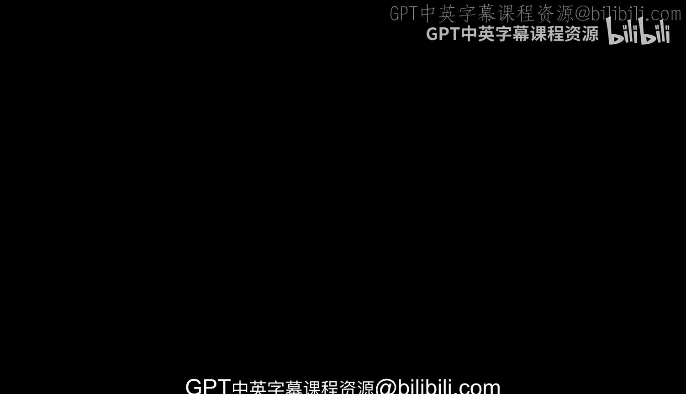

# 大型语言模型实践（开源大语言模型方案）：P1：01_01_02：认识你的讲师阿尔弗雷多·德萨

## 概述

在本节课中，我们将认识本课程的讲师阿尔弗雷多·德萨，并了解本课程将要涵盖的核心内容与目标。

## 讲师介绍

大家好，我是阿尔弗雷多·德萨。

在本课程中，我们将深入探讨开源大语言模型的诸多方面。

## 课程内容概览

我们将学习如何与开源模型进行交互，以及如何寻找并使用它们。

以下是本课程将涉及的主要开源模型类型：

*   我们将探索你可能希望与之交互的各种开源模型。
*   我们将学习如何寻找这些模型。

我们将贯穿一些特定的场景或技术方案。

以下是本课程将实践的具体技术场景：

*   在浏览器中使用JavaScript运行模型，我认为这非常不可思议。
*   使用Python库与模型交互，这也是非常普遍的方式。
*   使用Rust语言与模型交互。

我们将探讨Python和Rust之间的一些差异，以及你为何会选择其中一种而非另一种。

但课程的核心将集中在如何让这些技术变得易于理解和实现。

我们将力求使内容通俗易懂、简单明了。

在某些情况下，我们将使用开箱即用、可直接在本地运行的模型。

我们将构建有趣的项目，你将能够通过动手实践应用许多这些概念。

课程将包含大量实验和非常实用的示例，你可以亲自尝试我们在整个课程中将要实践的所有概念。

## 讲师背景

我拥有多年教授机器学习和Python的经验。

我曾是一名软件工程师和系统管理员。

我认为，我在演示这些示例、管理代码仓库以及所有课程内容时采用的方法，将使你能够在整个学习过程中，通过非常实用和直接的例子，获得一些相关的经验。

## 总结

本节课中，我们一起认识了讲师阿尔弗雷多·德萨，并了解了本课程的目标是帮助你深入理解如何与开源大语言模型协作，并最终能够将所学知识应用到你自己的项目和想法中。