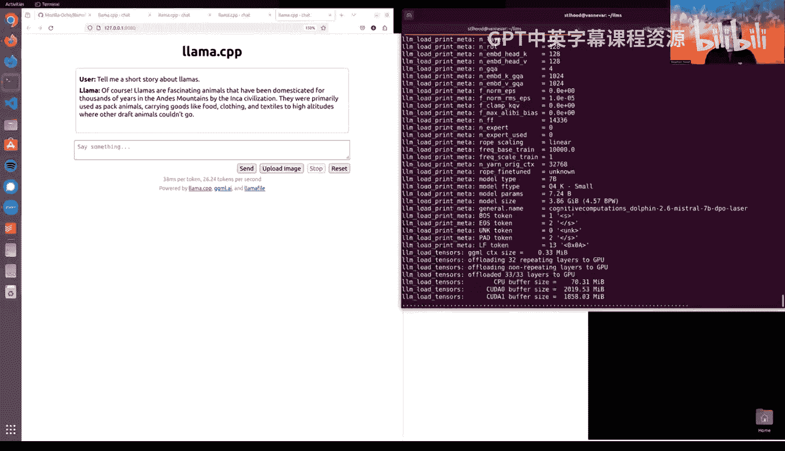

# 大型语言模型实践（开源大语言模型方案）：P23：23_02_05_创建LlamaFile 🦙


在本节课中，我们将学习如何使用 **LlamaFile** 工具，这是一个能够将开源大语言模型轻松打包成可执行文件的方案。我们将了解其基本用法、性能表现以及如何创建自定义的模型文件。

---

## 概述

LlamaFile 是一个便捷的工具，它允许用户下载或创建可直接运行的大型语言模型可执行文件。这些文件封装了模型权重和推理引擎，无需复杂的环境配置即可在本地运行，支持纯CPU和GPU加速两种模式。

## 获取与运行LlamaFile

要获取 LlamaFile，可以访问其官方网站或 GitHub 仓库。仓库的说明文件中提供了许多预构建的模型文件示例，这些文件托管在 Hugging Face 平台上。

以下是获取和运行 LlamaFile 的基本步骤：

1.  **访问资源**：前往 LlamaFile 的官方网站或 GitHub 仓库。
2.  **下载文件**：从提供的链接中下载所需的预构建模型可执行文件。
3.  **直接运行**：将下载的文件作为普通可执行程序运行即可。

例如，运行 `Mistral-7B` 模型文件时，它会自动将模型加载到内存中，并启动一个交互式聊天界面。

```bash
./mistral-7b-model.llamafile
```

## 性能演示：CPU vs GPU

上一节我们介绍了如何运行一个模型。本节中，我们来看看在不同硬件下的性能差异。

首先，在仅使用CPU的情况下运行模型。虽然速度不及云端服务，但仍具备可用性。例如，在演示中获得了约 **11.34 tokens/秒** 的生成速度。

```bash
# 默认使用CPU运行
./mistral-7b-model.llamafile
```

接下来，通过添加命令行参数，可以指示 LlamaFile 尽可能将模型加载到GPU显存中，从而利用GPU进行加速。

```bash
# 使用GPU加速运行
./mistral-7b-model.llamafile --gpu
```

启用GPU加速后，性能得到显著提升。在演示中，生成速度达到了近 **120 tokens/秒**。这展示了GPU加速的强大能力，并且LlamaFile能够开箱即用地支持NVIDIA和AMD显卡。

## 多模态模型示例

除了纯文本模型，LlamaFile 也支持多模态模型。以下是使用 `Lava` 多模态模型的一个例子。

多模态模型意味着它可以接受图像和文本作为输入。运行对应的LlamaFile后，你可以上传一张图片并向模型提问。

例如，上传一张图片后提问：“这张图片里有什么？”。模型会分析图像内容并生成描述，展示了开源社区在 multimodal AI 方面的进展。

## 在资源受限环境中运行

LlamaFile 的优势之一是能在资源受限的设备上运行。以下是一个在小型设备上运行的例子。

以 `Rocket-3B` 模型为例，这是一个非常小的模型，专为受限环境设计。即使在没有GPU加速、仅使用CPU的树莓派（一款约35美元的信用卡大小电脑）上，它也能快速生成虽然简短但合理的回答。这证明了开源AI技术已变得非常易于获取和部署。

## 创建自定义LlamaFile

最后，我们来学习如何将自己的模型转换为 LlamaFile。这对于想要使用特定版本或自定义微调模型的用户非常有用。

LlamaFile 支持流行的 `GGUF` 格式模型权重文件。你可以在 Hugging Face 上找到成千上万不同量化级别的GGUF文件。

创建自定义 LlamaFile 的步骤如下：

1.  **准备GGUF文件**：从 Hugging Face 或其他来源下载你需要的GGUF格式模型文件。
2.  **使用转换命令**：通过一行命令将该数据文件转换为可执行的 `.llamafile` 文件。

转换命令的格式如下：
```bash
llamafile-convert [你的GGUF文件名]
```
例如，将一个4位量化的、经过微调的Mistral模型文件进行转换：
```bash
llamafile-convert mistral-7b-instruct-v0.2.Q4_K_M.gguf
```
转换完成后，会生成一个 `.llamafile` 文件。这个新文件就可以像我们之前演示的其他模型一样直接运行了。

## 总结



本节课中，我们一起学习了 **LlamaFile** 工具的核心用法。我们了解了如何获取和运行预构建的模型，对比了CPU与GPU模式下的性能差异，见识了多模态模型的能力，探索了在树莓派等受限设备上运行模型的可行性，并最终掌握了如何将任何GGUF格式的模型权重转换为自定义的可执行LlamaFile。这个工具极大地简化了开源大语言模型在本地部署和使用的流程。