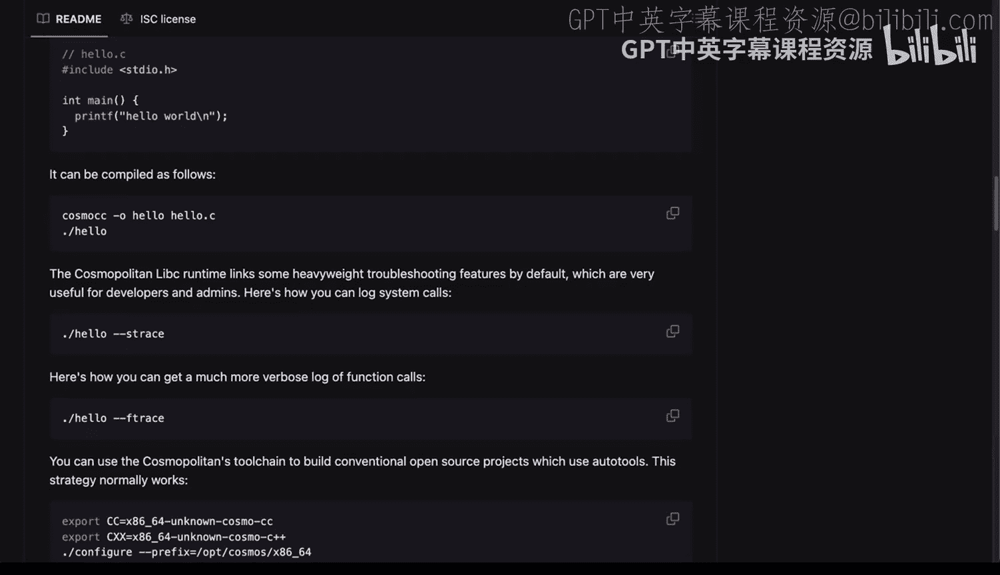
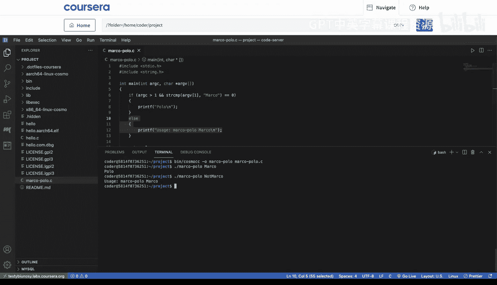
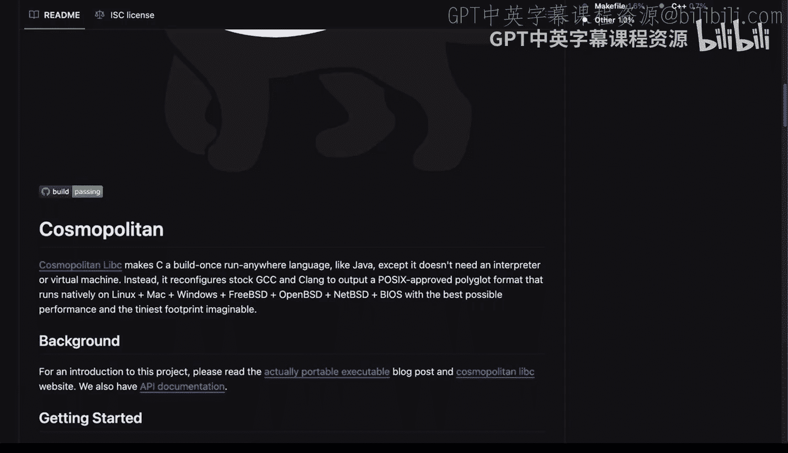
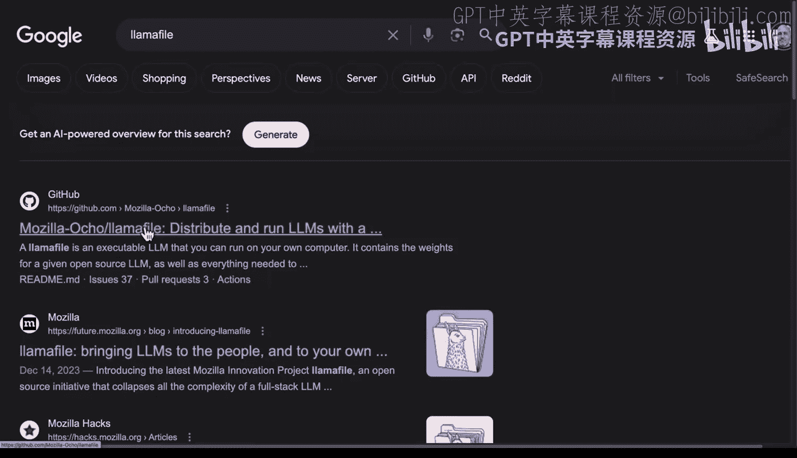
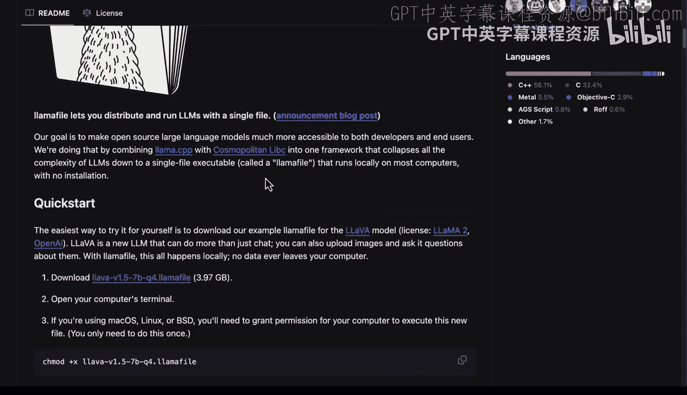

# 大型语言模型实践（开源大语言模型方案）：P24：使用Cosmopolitan构建便携式二进制文件 🚀


在本节课中，我们将要学习一个名为Cosmopolitan的核心库。这个库是Lamaophil项目的核心，它使得构建便携式的大型语言模型成为可能。我们将通过实际操作，了解如何使用Cosmopolitan来创建“一次构建，到处运行”的二进制文件。

---

## 概述与核心概念

Cosmopolitan Libc是一个C语言库，其目标是实现类似Java的“一次构建，到处运行”（Build Once Run Anywhere）特性。这意味着你可以编译一个程序，然后在多种操作系统（如Linux、macOS、Windows）上直接运行，而无需重新编译。

它的核心是`cosmocc`编译器。使用它编译程序的基本命令格式是：
```bash
cosmocc -o [输出文件名] [源代码.c文件]
```

---

## 第一步：创建并编译“Hello World”程序



上一节我们介绍了Cosmopolitan的基本概念，本节中我们来看看如何用它编译一个最简单的程序。

首先，我们需要创建一个C语言源代码文件。

以下是创建和编辑`hello.c`文件的步骤：
1.  使用`touch`命令创建文件：`touch hello.c`
2.  打开`hello.c`文件，并输入以下代码：
    ```c
    #include <stdio.h>

    int main() {
        printf("Hello World\n");
        return 0;
    }
    ```
    这段代码引入了标准输入输出库，并在`main`函数中打印“Hello World”。

文件创建好后，就可以使用Cosmopolitan编译器进行编译了。

使用`cosmocc`编译器编译`hello.c`文件的命令如下：
```bash
./bin/cosmocc -o hello hello.c
```
这个命令会生成一个名为`hello`的便携式二进制文件。

最后，运行编译生成的可执行文件：
```bash
./hello
```
如果一切顺利，终端将输出：`Hello World`。

---

## 第二步：构建一个更复杂的程序（Marco Polo）

在成功运行了简单的“Hello World”程序后，我们可以尝试构建一个逻辑稍复杂的程序来加深理解。

接下来，我们将创建一个名为“Marco Polo”的程序。它会检查用户输入的命令行参数。

首先，创建源代码文件：`touch marco_polo.c`

然后，在`marco_polo.c`文件中输入以下代码：
```c
#include <stdio.h>
#include <string.h>

int main(int argc, char *argv[]) {
    if (argc == 2 && strcmp(argv[1], "Marco") == 0) {
        printf("Polo\n");
    } else {
        printf("Usage: %s Marco\n", argv[0]);
    }
    return 0;
}
```
这段代码的逻辑是：如果用户运行程序时附带了一个参数，并且这个参数是字符串“Marco”，那么程序就打印“Polo”；否则，程序会打印使用说明。

代码编写完成后，同样使用`cosmocc`编译器进行编译。

编译`marco_polo.c`文件的命令如下：
```bash
./bin/cosmocc -o marco_polo marco_polo.c
```
这个命令会生成名为`marco_polo`的便携式二进制文件。

现在，让我们来测试这个程序的功能。

运行程序并传入参数“Marco”：
```bash
./marco_polo Marco
```
终端将输出：`Polo`。

运行程序但不传入参数，或传入错误参数：
```bash
./marco_polo
```
终端将输出类似的使用说明：`Usage: ./marco_polo Marco`。





---

## 总结与关联

本节课中我们一起学习了如何使用Cosmopolitan库来构建便携式二进制文件。我们从最简单的“Hello World”程序开始，逐步过渡到一个能处理命令行参数的“Marco Polo”程序，实践了编译和运行的全过程。





之所以要深入了解Cosmopolitan，是因为它是**Lamaophil项目的核心**。Lamaophil是一个用于运行和分发大型语言模型的工具。通过从底层原理入手，亲自体验其核心库的工作方式，我们能够更好地理解并欣赏Lamaophil在设计上的优雅与强大。掌握这个基础，将为后续学习和使用更高级的大型语言模型部署工具打下坚实的基础。