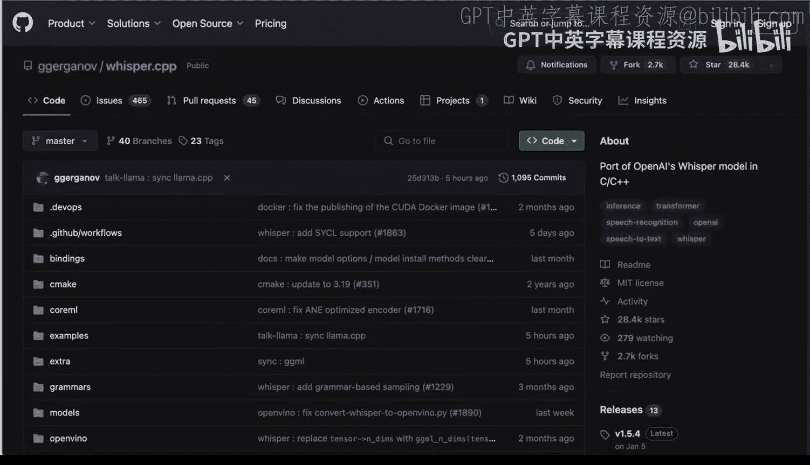
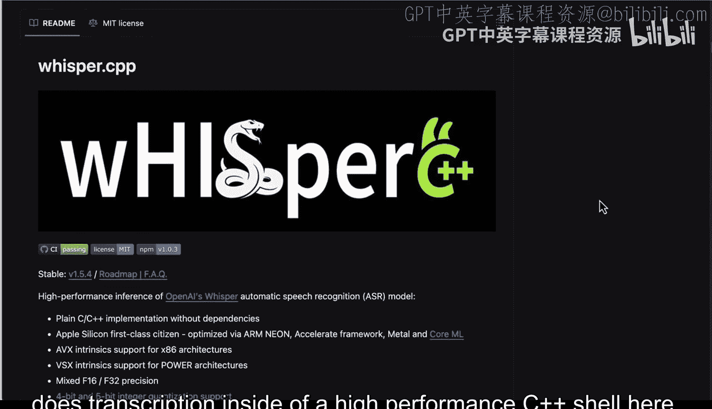
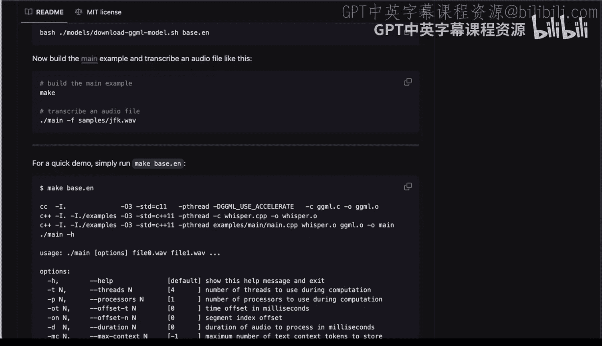
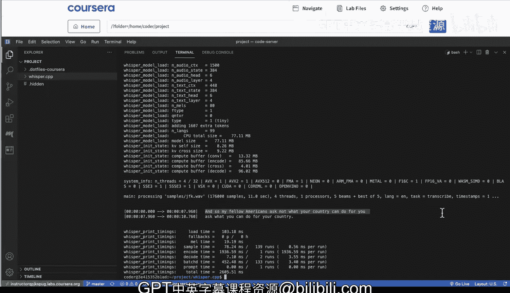

# 大型语言模型实践（开源大语言模型方案）：P28：28_02_05：使用Whisper CPP进行转录 🎤

在本节课中，我们将学习如何使用 **Whisper.cpp** 项目，这是一个将转录功能的大型语言模型封装在高效C++外壳中的工具。我们将了解其优势、如何获取与运行，并探讨其在构建生成式AI工作流中的应用。

## 项目概述与优势

Whisper.cpp 项目能够将现有的、用于转录的大型语言模型包装在一个高性能的 C++ 外壳中。

以下是该项目的主要优势：
*   **纯C++实现**：没有任何外部依赖。
*   **Apple芯片支持**：在M系列芯片上运行良好。
*   **出色的GPU性能**：在GPU上具有极高的性能表现。
*   **其他优秀特性**：项目内部还包含许多其他优点。

## 快速开始指南

上一节我们介绍了Whisper.cpp的优势，本节中我们来看看如何开始使用它。要开始使用，你需要克隆项目仓库并下载转换为 **GGML** 格式的模型。

这里使用的是基础模型，但还有其他模型可供选择，例如稍后会展示的 **tiny** 模型，以及更大的模型。令人惊讶的是，**tiny** 模型实际上非常有效。

## 运行Tiny模型示例

接下来，让我们具体看看这个 **tiny** 模型能做什么。这里有一个沙盒环境，我已经编译好了Whisper.cpp。

在这个目录中，我编译了Whisper。要运行它，我只需执行 `./main -m` 命令，然后在这里指定模型路径。例如，我会输入 `models/` 并指定使用 **tiny** 模型。

我们可以查看一下这个模型的大小，以了解其体积。执行命令 `du -sh` 查看 **tiny** 模型的大小，可以看到它只有 **74 MB**。尽管体积小，它却能完成非常精确的转录任务。

因此，对于嵌入式设备或小型实验环境来说，这是一个非常有效的转录工具。

## 执行转录操作

我们下一步要做的是给它输入一个 **WAV** 音频文件。你可以复制多个此音频文件，上传不同的WAV文件等，以测试不同的工作流程。

核心思想是，你能够运行这个程序。即使在CPU上，它也能以相当不错的性能完成转录，并生成带时间戳的文本。在这个例子中，它处理了一段著名的GFK演讲，并成功输出了转录文字。

## 应用场景与总结

你可能会问，为什么要这样做？这是构建生成式AI工作流的基本要素。例如，你可以给它一个装满文件的目录，然后将所有这些文件合并成一个主要的转录文本，再输入提示词来获取更多灵感。

对于想要开始构建自己独立的生成式AI工作流的人来说，这是一个极好的起点。

本节课中我们一起学习了Whisper.cpp的安装、运行及其在音频转录中的应用。请查看 **whisper.cpp** 项目以获取更多信息。