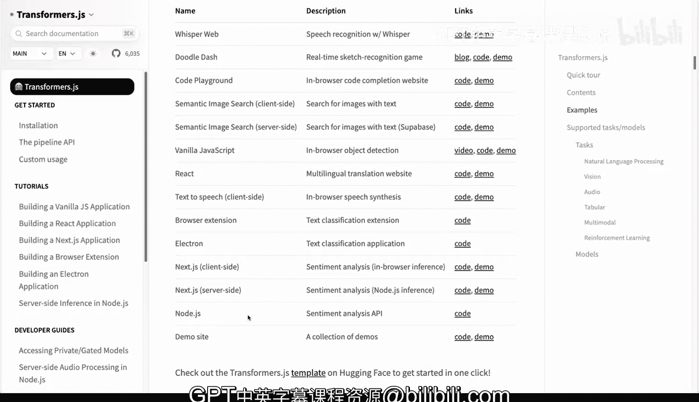

# 大型语言模型实践（开源大语言模型方案）：P30：30_03_03：什么是Transformers.js 🚀


在本节课中，我们将要学习一个名为Transformers.js的JavaScript库。这个库允许我们在浏览器中直接加载模型，并使用JavaScript与模型进行交互。这与我们之前需要依赖其他系统工具的运行方式完全不同。

## 概述

Transformers.js是一个基于浏览器的库，它让我们能够直接在网页环境中运行机器学习模型。这意味着用户无需安装任何额外的软件或依赖服务器端处理，所有计算都在本地浏览器中完成。

## 核心要求：ONNX运行时

上一节我们介绍了Transformers.js的基本概念，本节中我们来看看使用它的一个核心前提条件。Transformers.js要求我们使用**ONNX运行时**。这是一个实现细节，但至关重要。

**核心公式/概念**：
```
Transformers.js 运行条件 = 模型必须基于 ONNX 格式
```

这意味着，任何我们想要在Transformers.js中交互的模型，都必须转换为ONNX格式。幸运的是，Hugging Face等平台使得这种转换变得非常容易。虽然存在多种转换方法，但将模型转换为ONNX是使用此库的必要步骤。

## 获取与使用模型

一旦决定使用Transformers.js，下一步就是引入你想要工作的模型。

以下是获取和使用模型的步骤：

1.  **选择模型**：在Hugging Face等模型库中，寻找标有ONNX格式的模型。例如，课程中演示的“基于BERT的多语言情感分析”模型。
2.  **确认格式**：在模型页面，确认其文件格式为ONNX，并且任务类型（如文本分类）被支持。
3.  **注意模型大小**：由于模型将直接在浏览器中下载和加载，其文件大小是一个重要考量因素。例如，演示中的完整模型约为670MB，而其量化版本仅为169MB。量化是一种压缩技术，能在轻微影响精度的情况下显著减小模型体积。

## 功能与应用示例

Transformers.js的功能不仅限于文本分析。在官方文档和示例中，你可以找到丰富的演示。

以下是一些有趣的应用方向：

*   语音识别
*   浏览器内的文本补全
*   以文搜图
*   以及许多其他任务

你可以浏览这些在线演示，亲身体验Transformers.js的各种实现，这有助于激发你将此技术集成到自己项目中的灵感。

## 总结



本节课中我们一起学习了Transformers.js库。我们了解到它是一个纯浏览器端的JavaScript库，允许直接加载并与ONNX格式的模型进行交互。我们讨论了使用它的核心前提（ONNX运行时），查看了如何获取和选择模型，并特别提醒了需要注意的模型大小问题。最后，我们预览了该库广泛的应用可能性。掌握Transformers.js为在Web应用中便捷地部署AI功能打开了新的大门。