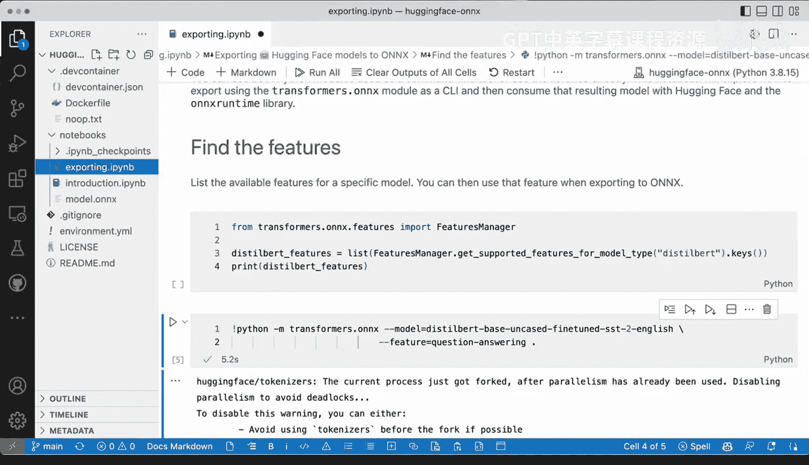

# 大型语言模型实践（开源大语言模型方案）：P32：将模型导出为ONNX格式 🚀


在本节课中，我们将学习如何将Hugging Face上的预训练模型导出为ONNX格式。ONNX是一种开放的模型格式，旨在提高模型在不同框架和硬件平台之间的互操作性。通过将模型转换为ONNX，我们可以更灵活地部署和优化模型。

---

## 准备工作与环境配置

首先，确保你拥有正确的运行环境。在本示例中，我们使用一个已安装所有必要依赖的Conda环境内核。这是顺利进行后续操作的基础。

## 探索模型支持的任务特性

上一节我们介绍了环境配置，本节中我们来看看如何确定模型支持的任务类型。理解模型能处理的任务对于后续的导出操作至关重要。

我们需要从`transformers.onnx`模块中导入`features`模块，具体来说是导入一个`FeaturesManager`。通过它，我们可以查看特定模型（例如`distilbert-base-cased`）支持哪些功能特性。

```python
# 示例：导入FeaturesManager
from transformers.onnx import FeaturesManager
```

运行上述代码后，我们可以查看该模型支持的任务。常见的任务包括：
*   **序列分类**
*   **多项选择**
*   **标记分类**
*   **问答** - 这是我们将要使用的任务类型。

了解模型支持的任务之所以重要，是因为在导出模型时，我们需要明确指定目标用途。例如，如果我们只需要一个用于问答任务的模型，就可以在导出时精确指定，从而得到一个更精简、针对性更强的ONNX模型。

## 使用命令行工具导出模型

在明确了模型的任务特性后，我们现在开始进行实际的导出操作。我们将使用`transformers.onnx`模块作为命令行工具来完成这个步骤。

以下是导出命令的核心组成部分和步骤解析：

1.  **调用工具**：使用`python -m transformers.onnx`来运行该模块。
2.  **指定模型**：通过`--model`参数指明要导出的模型。在本例中，我们使用的是`distilbert-base-cased-finetuned-sst-2-english`。
3.  **指定任务**：通过`--feature`参数声明模型用途。这里我们选择`question-answering`（问答）。
4.  **指定输出路径**：命令末尾的`.`点号表示将生成的ONNX模型文件保存在当前目录。你也可以指定一个具体的路径和文件名。

完整的导出命令示例如下：
```bash
python -m transformers.onnx --model=distilbert-base-cased-finetuned-sst-2-english --feature=question-answering .
```

执行此命令后，程序会首先下载指定的模型，然后开始转换过程。这个过程可能需要几秒钟时间。

## 验证导出结果

命令执行完成后，我们需要在输出信息中确认模型是否成功导出并验证通过。

请关注输出信息的末尾部分，寻找类似“All good, model saved at ...”和“Validating ONNX model...”的成功提示。这些信息表明模型已顺利通过验证并保存。

同时，输出中还会列出生成的ONNX模型文件的输入输出名称，这些信息在后续使用该ONNX模型时是必需的。

回到文件浏览器，你可以看到当前目录下新生成了一个`.onnx`文件，这就是我们成功导出的、可用于问答任务的ONNX格式模型。

---



本节课中我们一起学习了将Hugging Face模型导出为ONNX格式的完整流程。我们首先探索了模型的任务特性，然后使用命令行工具指定模型和任务进行导出，最后验证了导出结果。通过这种方式，我们可以将Transformer模型便捷地转换为更具部署灵活性的ONNX格式。