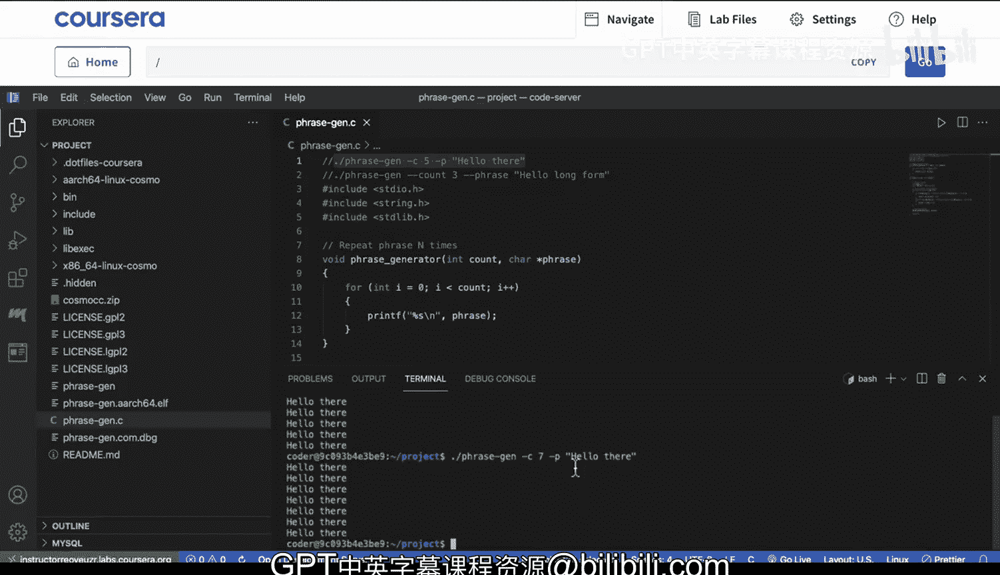

# 大型语言模型实践（开源大语言模型方案）：P35：使用Cosmopolitan构建短语生成器 🛠️


在本节课中，我们将学习如何使用Cosmopolitan可移植二进制框架来构建一个简单的短语生成器命令行工具。我们将了解其基本结构、编译过程以及如何运行生成的跨平台二进制文件。

## 概述

Cosmopolitan框架能帮助开发者构建可移植的二进制文件。本节将演示如何用它创建一个简单的短语生成器工具。该工具允许用户指定重复次数和短语，并能在Windows、Linux、Unix等多种操作系统上运行。

## 代码结构与解析

首先，我们来看一下构建此工具所需的C语言源代码的基本结构。

### 头文件引入

代码开头引入了必要的标准库头文件。

```c
#include <stdio.h>
#include <string.h>
#include <stdlib.h>
```

*   `stdio.h` 用于输入输出操作。
*   `string.h` 用于字符串函数，例如字符串比较。
*   `stdlib.h` 用于声明工具函数，例如 `atoi`，它用于将字符串转换为整数。

### 核心功能函数

接下来，我们定义了一个核心函数，用于重复输出指定的短语。

```c
void repeat_phrase(int count, const char* phrase) {
    for (int i = 0; i < count; i++) {
        printf("%s\n", phrase);
    }
}
```

这个 `repeat_phrase` 函数接受一个整数 `count` 和一个字符串指针 `phrase` 作为参数。它通过一个 `for` 循环，将短语打印输出指定的次数。

### 主函数逻辑

主函数 `main` 包含了程序的入口逻辑，负责解析命令行参数并调用相应的功能。

```c
int main(int argc, char *argv[]) {
    int count = 1; // 默认重复次数
    const char* phrase = "Hello, World!"; // 默认短语

    // 解析命令行参数
    for (int i = 1; i < argc; i++) {
        if (strcmp(argv[i], "--count") == 0 || strcmp(argv[i], "-c") == 0) {
            if (i + 1 < argc) {
                count = atoi(argv[i + 1]);
                i++; // 跳过下一个参数（数值）
            }
        } else if (strcmp(argv[i], "--phrase") == 0 || strcmp(argv[i], "-p") == 0) {
            if (i + 1 < argc) {
                phrase = argv[i + 1];
                i++; // 跳过下一个参数（短语）
            }
        }
    }

    // 生成短语
    repeat_phrase(count, phrase);
    return 0;
}
```

程序逻辑如下：
1.  设置默认的重复次数（`count = 1`）和默认短语（`"Hello, World!"`）。
2.  遍历所有的命令行参数（`argv`）。
3.  使用 `strcmp` 函数进行字符串比较，判断参数是 `--count`（或 `-c`）还是 `--phrase`（或 `-p`）。
4.  根据参数类型，读取其后的值，并更新 `count` 或 `phrase` 变量。
5.  最后，调用 `repeat_phrase` 函数，根据解析得到的参数生成并输出短语。

## 编译与运行

上一节我们介绍了代码的结构，本节中我们来看看如何使用Cosmopolitan框架将其编译成可移植的二进制文件。

### 编译命令

Cosmopolitan框架自带编译器。我们使用以下命令进行编译：

```bash
bin/cosmo-cc -o phrase_gen phrase_gen.c
```

*   `bin/cosmo-cc` 是Cosmopolitan的C语言编译器。
*   `-o phrase_gen` 指定输出的可执行文件名为 `phrase_gen`。
*   `phrase_gen.c` 是我们的源代码文件。

执行此命令后，会生成一个名为 `phrase_gen` 的二进制文件，以及一些其他构建产物。这个二进制文件具有跨平台的可移植性。

### 运行示例

生成二进制文件后，我们可以直接运行它。以下是几个运行示例：

1.  使用默认参数运行（输出一次“Hello, World!”）：
    ```bash
    ./phrase_gen
    ```

2.  指定重复次数为5次：
    ```bash
    ./phrase_gen --count 5
    ```
    或使用短参数：
    ```bash
    ./phrase_gen -c 5
    ```

3.  同时指定自定义短语和重复次数：
    ```bash
    ./phrase_gen --phrase "LLM Ops" --count 3
    ```
    或使用短参数组合：
    ```bash
    ./phrase_gen -p "AI is great" -c 7
    ```

你可以自由更改次数和短语内容进行测试。

## 优势与应用场景

短语生成器本身是一个简单的教学示例，但它清晰地展示了Cosmopolitan框架的核心价值：**一次构建，多处运行**。

使用此框架构建的二进制文件，可以无需修改或重新编译，直接部署到Windows、Linux、macOS、FreeBSD等多种操作系统上。这对于需要广泛分发和部署的工具软件尤其具有吸引力。

在大型语言模型（LLM）领域，这种可移植性非常重要。例如，Llama.cpp等项目就利用类似技术来确保其工具能在各种用户环境中轻松运行，降低了部署和使用门槛。

## 总结



本节课中我们一起学习了如何使用Cosmopolitan可移植二进制框架。我们从代码结构解析开始，了解了如何编写一个简单的命令行短语生成器，包括参数解析和功能实现。接着，我们掌握了使用Cosmopolitan专用编译器将C源代码编译成跨平台二进制文件的方法。最后，我们探讨了这种“一次构建，多处运行”的技术在LLM等实际应用场景中的优势。通过这个实践，你可以将相同的思路应用于构建更复杂的静态网站生成器、AI工具或其他需要跨平台部署的命令行程序。