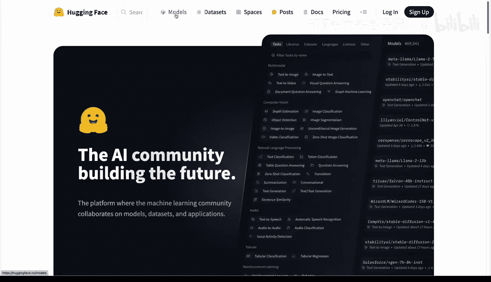
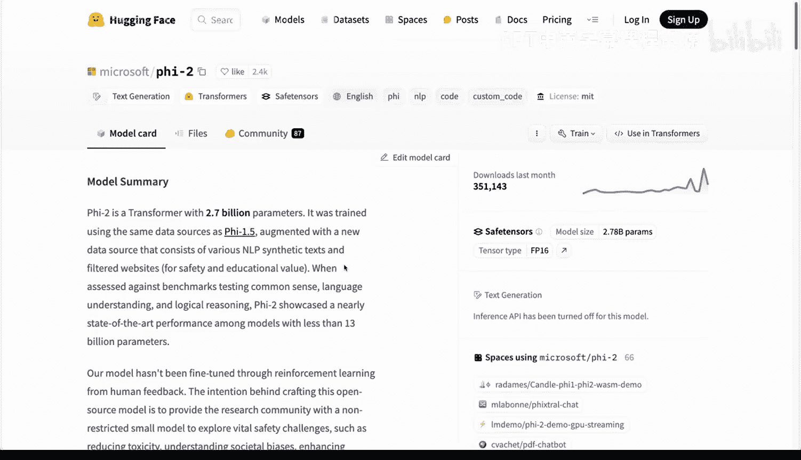
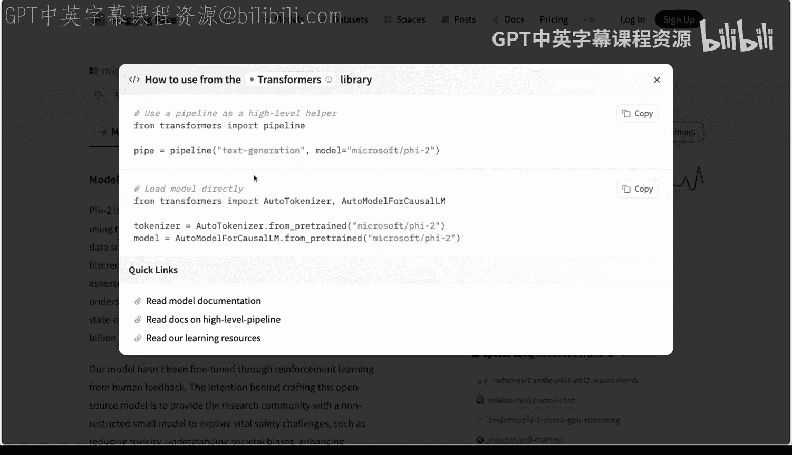
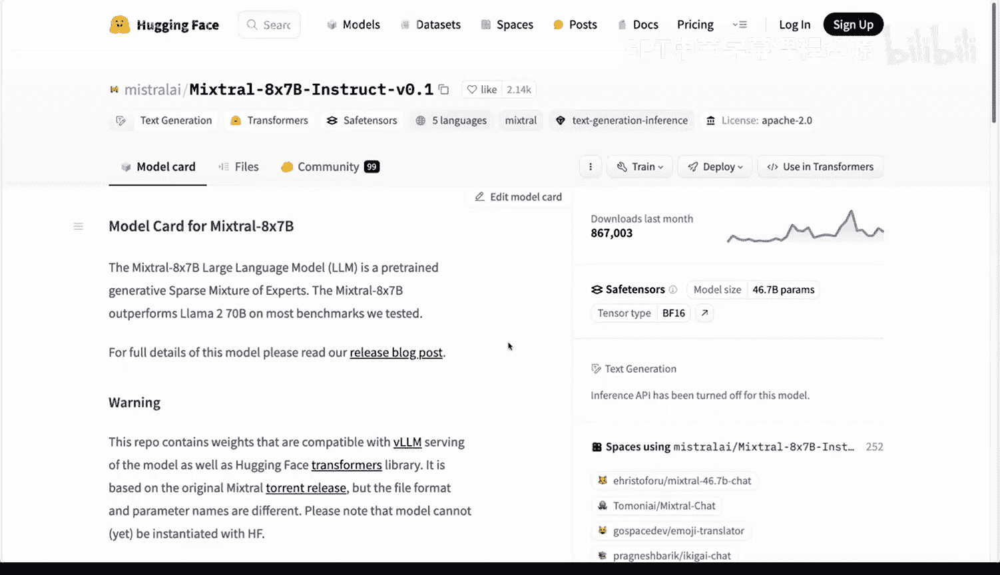
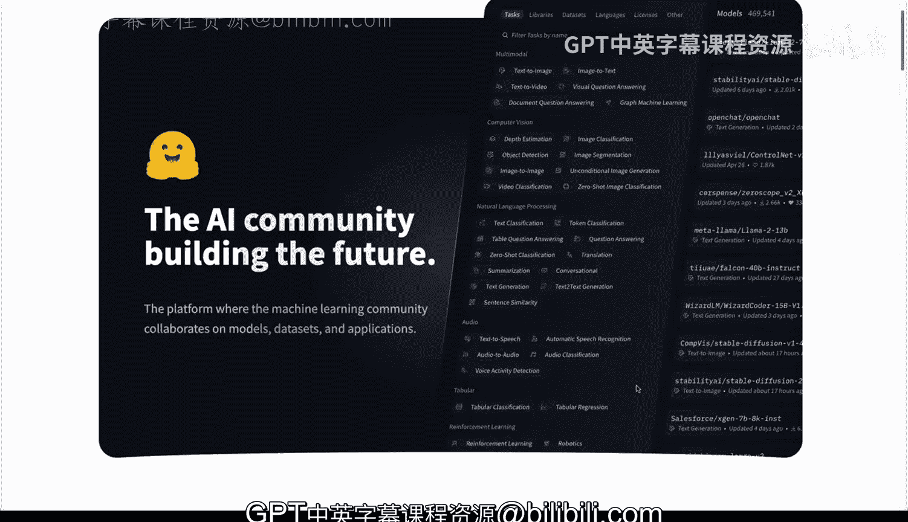

# 大型语言模型实践（开源大语言模型方案）：P3：03_01_03_Hugging Face平台上的开源模型

在本节课中，我们将要学习Hugging Face平台，这是一个专门托管和分享开源模型的重要场所。我们将了解平台的基本结构、核心功能以及如何利用它来探索和使用各种模型。

当我们谈论开源模型时，无疑会提到Hugging Face这家公司。

Hugging Face是一家专注于……的公司，但更准确地说，Hugging Face就像一个代码仓库，一个我们可以托管和分享模型的地方。许多公司，包括众多云服务提供商，都允许将他们的模型托管在这个平台上。

因此，Hugging Face不仅是一家公司，也是一个平台，许多开源模型都托管在这里。

那么这具体意味着什么呢？在平台的最顶部，你会看到许多不同的选项：我们有“模型”、“数据集”、“空间”。这些是什么呢？让我们快速进入“模型”部分看看。

点击“模型”后，你会看到即使是像微软这样的公司，实际上也将模型放在这里。需要注意的一点是，其中一些模型非常具体。例如，微软的Phi-2是一个专门用于文本生成的模型。这意味着它的主要任务、主要目的就是文本生成，其功能类似于我们之前看到的提供聊天服务的系统，如ChatGPT和其他服务提供商。这并非唯一的例子，你可以看到Mistral AI也有Mistral模型，同样用于文本生成。

那么Hugging Face在这里扮演什么角色？它与所有这些模型是什么关系？实际上，它是一个托管和存放这些模型的流行且优秀的服务平台。

例如，如果我们点击进入Phi-2模型，你会获得一些关于这个模型是什么以及它如何工作的信息。你会看到一些描述，比如如何使用它，以及一些关于如何实现它的说明。这非常棒，但我们还可以看到更多不同的东西。

我们可以查看如何使用它的代码示例，这里展示了一些Python代码。我们还可以浏览构成该模型的实际文件，例如一些配置文件以及分词器所需的一些文件（我们尚未深入探讨分词器）。所有这些文件共同构成了这个模型的功能。

你可以看到这里显示模型大小为564兆字节，这看起来是一个大文件。你实际上可以继续下载这些文件，或者甚至……

……立即试用它们。例如，如果我已登录，我将能够尝试那个文本生成功能。不过，该模型的API试用功能已被关闭，我们暂时不会尝试。所以我要完全返回到模型列表。

你可以看到还有其他功能的模型，所有这些模型都关联着不同类型的任务：计算机视觉、自然语言处理、音频处理等等，有各种各样不同的东西。

并非所有模型都完全是开源的。有些模型可能是闭源的。例如，我们来看看Mistral AI的模型，并尝试弄清楚它的许可证。你可以看到这里的许可证是Apache 2.0，这是一个非常宽松的许可证。但是，这些许可证会变化，并非所有模型都具有相同的许可证。

其中一些许可证允许你做更多事情，另一些则限制更多，或者约束更严格，例如仅允许用于研究。

因此，每当你听到Hugging Face，每当你听到开源模型时，请确保你理解Hugging Face只是一个你可以分享、上传、托管模型的地方，包括大多数开源模型。许多公司和许多人也在这里托管他们的模型。

本节课中我们一起学习了Hugging Face平台的核心概念。我们了解到它是一个集中托管和分享模型的中心，涵盖了从文本生成到计算机视觉等多种任务。重要的是，我们认识到模型的开源程度和许可协议各不相同，在使用前需要仔细检查。掌握这个平台是探索和利用开源大语言模型世界的关键第一步。