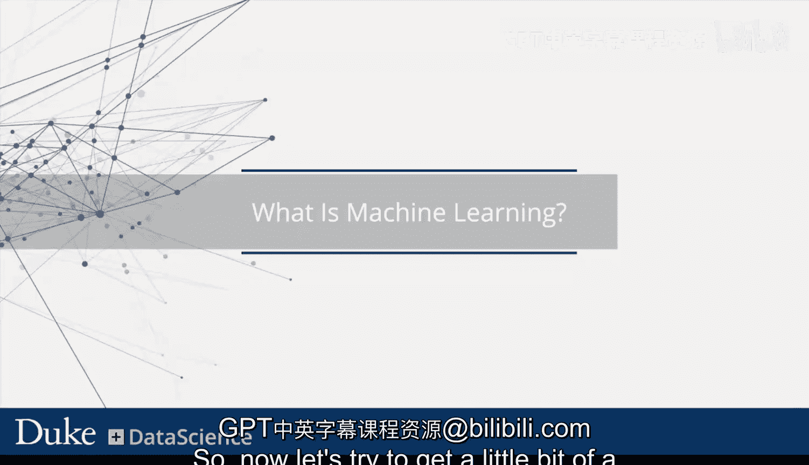
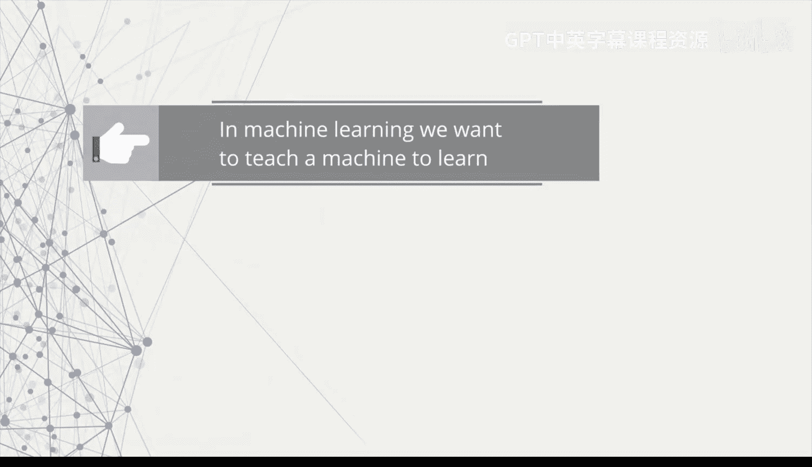
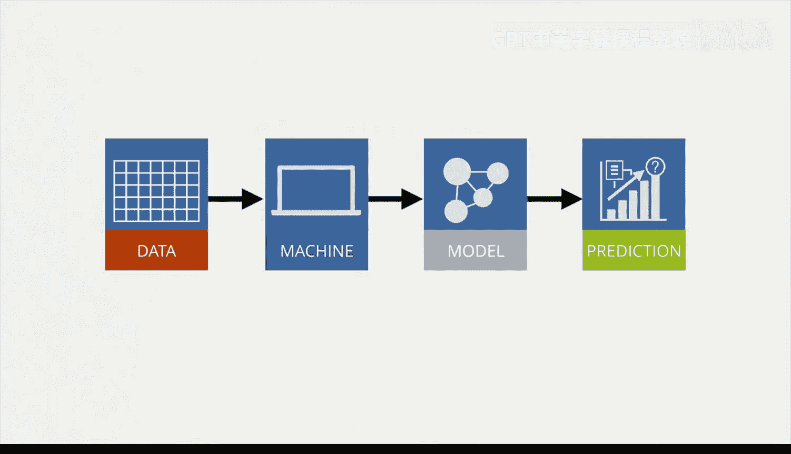
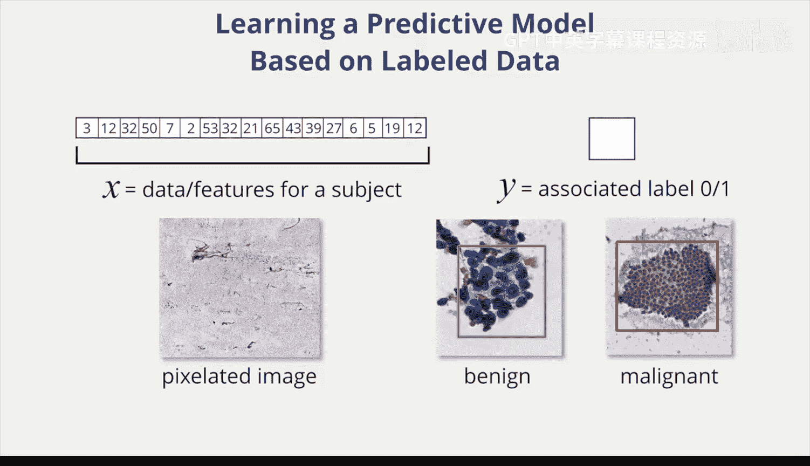
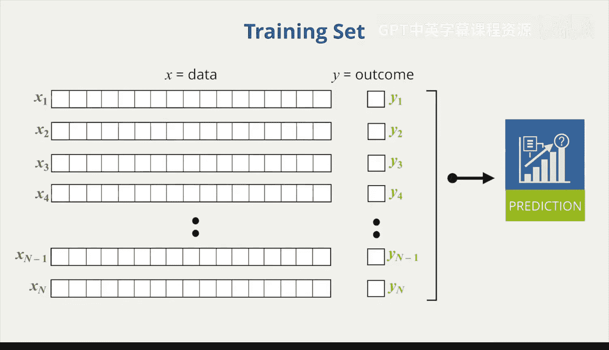
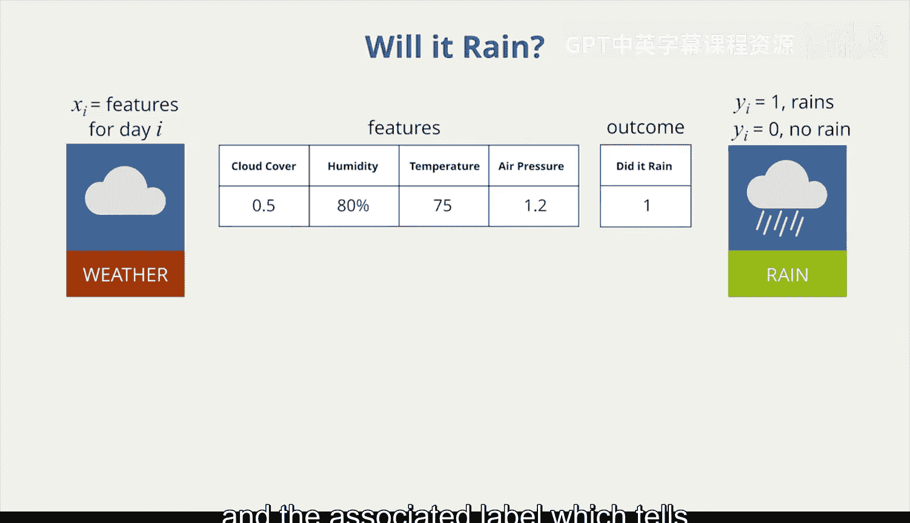
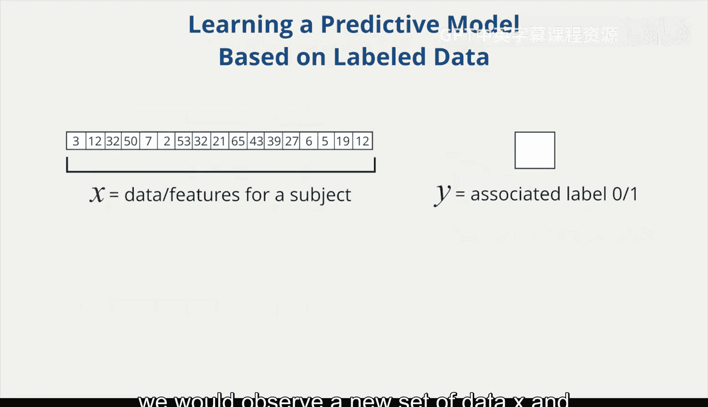

#  002：什么是机器学习 🧠

在本节课中，我们将学习机器学习的基本概念。我们将了解机器学习如何通过数据示例来“教导”算法进行预测，并探讨其核心组成部分。

---

## 概述

机器学习的目标是让机器（即算法）从数据中学习。我们通过提供包含数据样本及其对应标签的示例来训练机器。训练完成后，我们希望机器不仅能准确复现训练数据中的模式，还能对新的、未见过的数据做出准确预测。

## 核心概念解析

上一节我们概述了机器学习的目标，本节中我们来看看其核心组成部分。

### 数据与标签

在机器学习中，每个示例都由两部分组成：
*   **数据**：通常表示为一个数字向量，记作 **X**。
*   **标签**：我们希望为数据分配的结果或类别，记作 **y**。为简化起见，我们常使用二元标签，例如 **y = 0** 或 **y = 1**。

例如，在医疗图像分析中：
*   **X** 可能对应一张像素化的图像。
*   **y** 则用于分类该图像是否显示恶性肿瘤（例如，1 表示恶性，0 表示良性）。

### 训练数据

我们通过提供多个示例来教导算法。这些示例的集合称为**训练数据**。

假设我们有 **n** 个训练示例，可以表示为：
`{(X₁, y₁), (X₂, y₂), ..., (Xₙ, yₙ)}`

### 预测模型与参数

我们的目标是构建一个**预测模型**（或称“机器”）。这个模型本质上是一个数学函数，它接收数据 **X** 作为输入，并输出预测的标签 **ŷ**。

模型内部包含一些**参数**（通常用 **θ** 或 **w** 表示），这些参数最初是未知的。学习的过程就是根据训练数据来调整这些参数，使得模型的预测 **ŷ** 尽可能接近真实的标签 **y**。

## 一个具体示例：预测是否会下雨 ☔️

为了让概念更具体，我们来看一个简单的例子：预测某一天是否会下雨。

以下是构建预测模型的步骤：

1.  **收集数据**：每天早晨，我们测量一些环境特征，例如云量、湿度、温度和气压。这些测量值构成我们的数据向量 **X**。
2.  **记录标签**：当天结束时，我们记录是否下雨。定义 **y = 1** 表示下雨，**y = 0** 表示未下雨。
3.  **形成训练集**：收集多天的（**X**, **y**）配对，就构成了我们的训练数据。
4.  **训练模型**：我们使用这个历史训练数据来调整模型的参数。目标是让模型学会根据早晨的测量数据 **X** 来准确预测当天是否会下雨（即输出 **y**）。
5.  **进行预测**：训练完成后，当新的一天早晨，我们获得新的测量数据 **X_new** 时，就可以将这个数据输入训练好的模型，模型会输出预测 **ŷ**，告诉我们它认为今天是否会下雨。

## 核心任务与目标

上一节我们通过例子了解了流程，本节中我们来明确机器学习的核心任务。

机器学习的关键任务可以概括为以下两步：

1.  **学习/训练**：利用训练数据 `{(Xᵢ, yᵢ)}` 来学习模型的最佳参数，使模型在训练数据上表现准确。
2.  **预测/测试**：将学习好的模型应用于新的、未见过的数据 **X_new**，以预测其对应的标签 **y_new**。模型在新数据上的表现（即**泛化能力**）是衡量其成功与否的最终标准。

## 总结

本节课中，我们一起学习了机器学习的基本框架：
*   机器学习通过**数据（X）**和**标签（y）** 组成的示例来训练算法。
*   训练过程的目标是找到一个**模型**及其**参数**，使其能够从数据中捕捉到预测标签的规律。
*   最终目标是让训练好的模型能够对**新的数据**做出准确的预测。

接下来，我们将深入探讨这些概念的更多细节，以更清晰地理解机器学习的各个方面。