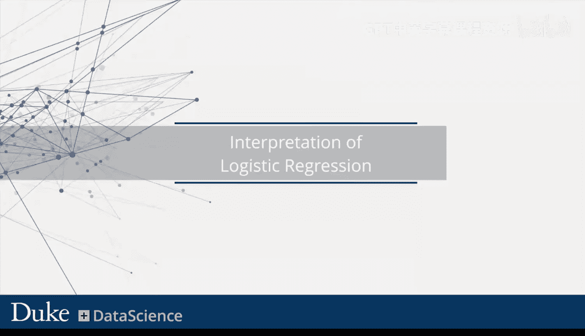
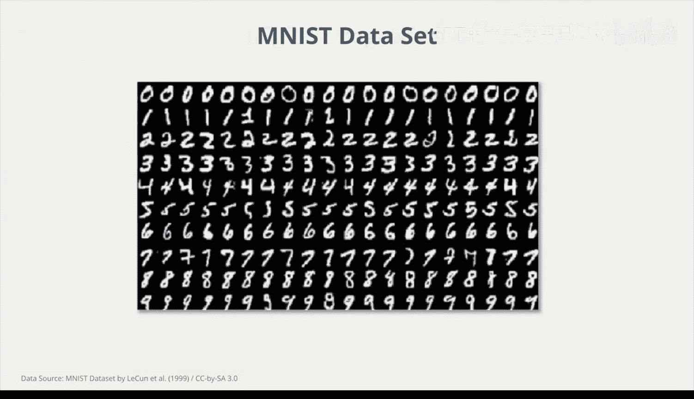
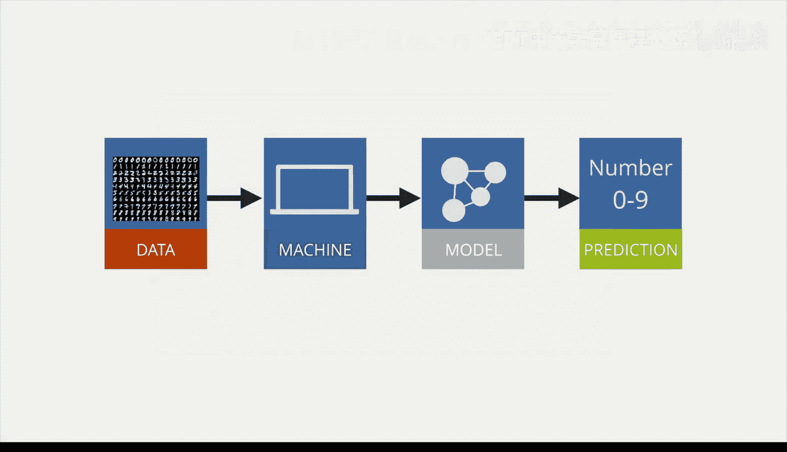
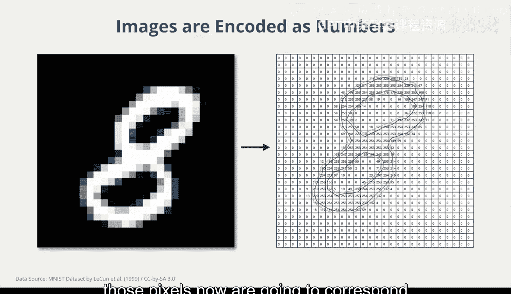
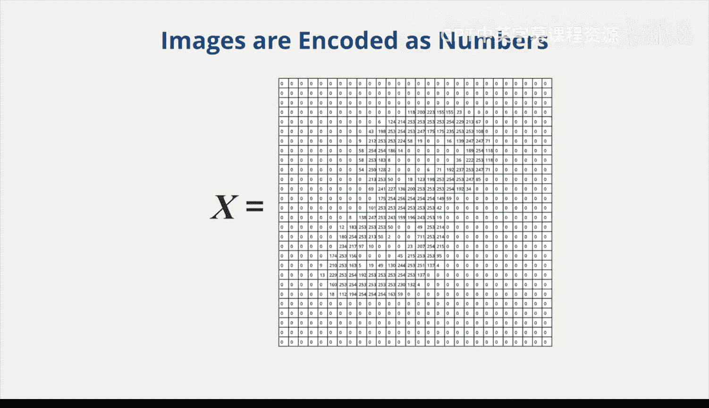
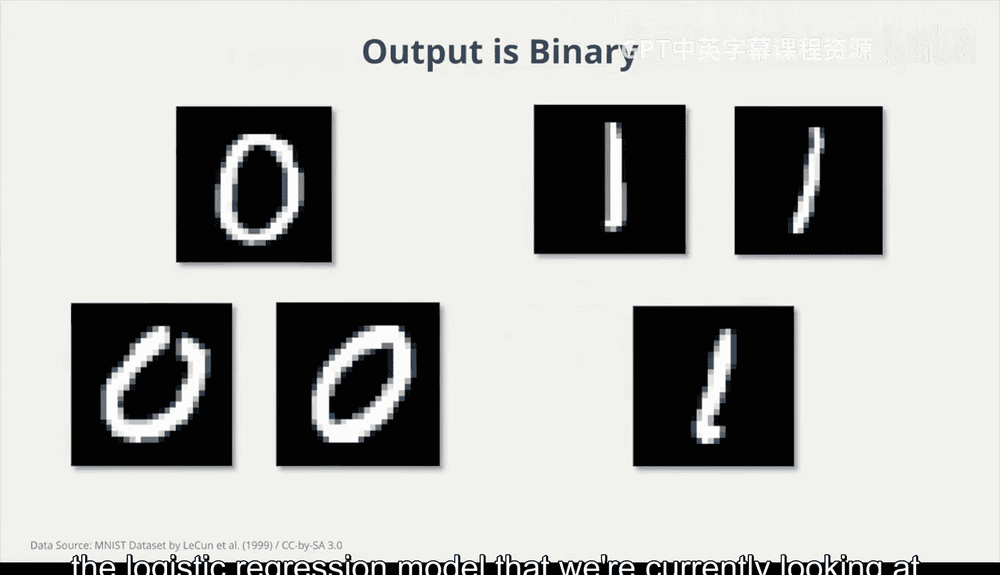
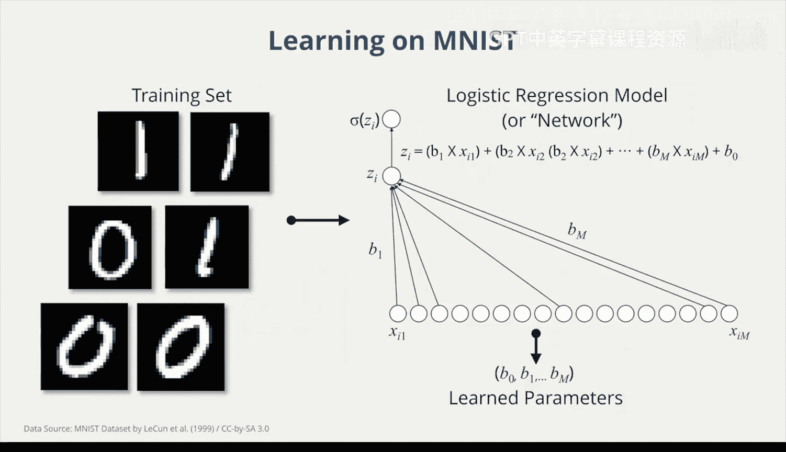
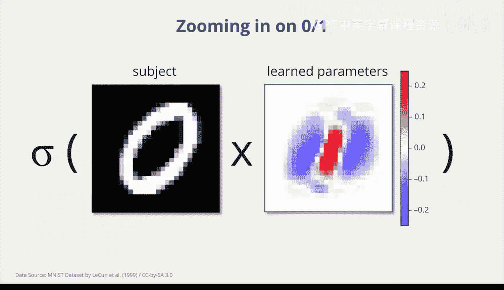
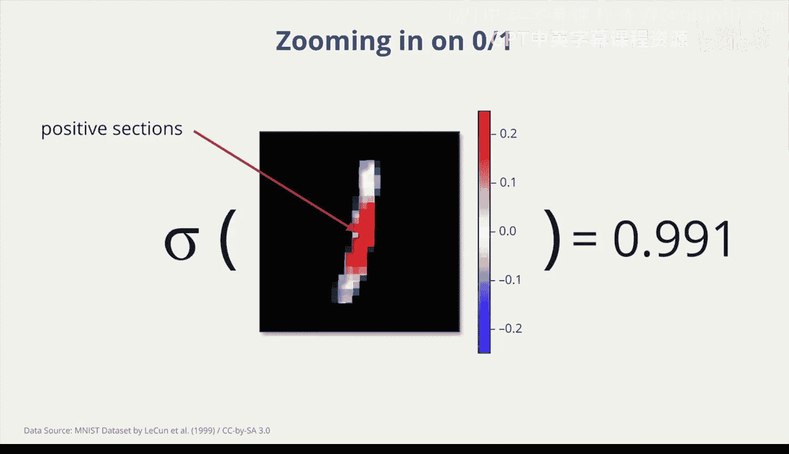
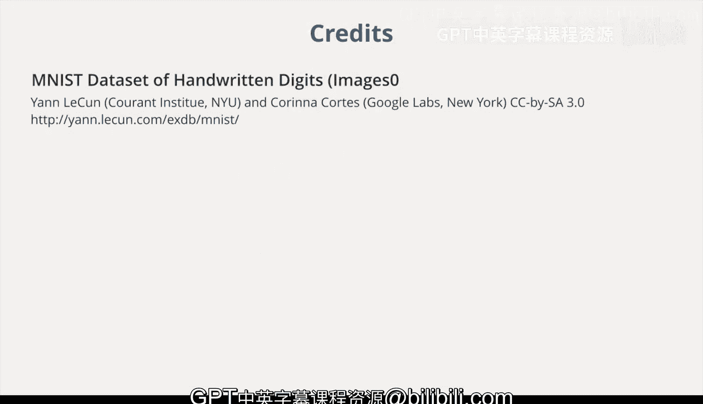

#  004：逻辑回归的解读 🧠

在本节课中，我们将深入学习逻辑回归算法。逻辑回归是机器学习中最简单但应用广泛的算法之一，它为我们理解机器学习的工作原理提供了一个绝佳的模型。我们将通过一个手写数字识别的具体问题，来详细解读逻辑回归是如何工作的。

---

## 问题定义：手写数字识别 ✍️

上一节我们介绍了逻辑回归的基本概念，本节中我们来看看如何将其应用于一个实际问题。这里展示的是从0到9的手写数字示例，这是一个非常经典的数据集，称为MNIST数据集。我们的目标是构建一个预测模型，使其能够观察这些图像中的一张图片，并将其映射到0到9之间的一个数字。可以想象，这对于分析人类笔迹非常有用。当然，使用0到9只是一个例子，我们可以将这个基本结构用于分析任何手写语言。

那么，问题是我们如何做到这一点？如何利用我们手头的工具，特别是逻辑回归，来实现这个目标？

## 从图像到数据：像素化处理 🖼️

我们的目标是处理一张图片。例如，左边是一张数字8的图片。我们希望机器观察这张图片并预测它是数字8。我们实现这一点的方式是将图像像素化处理成数字。正如你在右边看到的，每个像素代表了图像在该空间点的强度。

然后，我们获取这些像素，它们将对应于我们之前讨论过的向量 **X**。为了使这一点更具体，请记住我们目前掌握的工具是逻辑回归，它假设我们模型的输出是二元的。

## 构建二元分类任务：识别0和1 🔢

因此，我们将考虑一个二元问题：具体来说，我们将考虑一个数字是0还是1的问题。我们希望机器能自动观察图像并正确判断它是0还是1。这是一个非常简单的二元任务。当然，我们可以将其推广到更多类别，但选择二元是因为它符合我们当前正在研究的逻辑回归模型的假设。

回想一下，我们的做法是提供一组训练数据。在左边，你可以看到一些0和1的示例。因此，训练数据表现为图像和真实标签。我们拥有逻辑回归模型：在这里，图像的像素将对应于数据 **X**，我们通过乘以参数 **B₁** 到 **Bₘ** 来加权每个像素值，然后将它们求和。

## 模型计算过程：从加权求和到概率预测 ⚙️

得到参数 **Z** 后，**Z** 被送入Sigmoid函数。然后，我们可以以一定的概率说我们正在看的是数字1或数字0。因此，我们所说的“学习”是指推断出参数 **B₀** 到 **Bₘ** 的集合。

为了举例说明这个模型在做什么，这是在那些1和0上训练逻辑回归模型所学到的东西。为了更深入地理解这一点，让我们再次看看这个对应于0的图片示例，以及我们模型的参数（在右侧用蓝色和红色显示）。

## 参数解读：作为“过滤器”的模型参数 🔍

如果我们进行逐点乘法——对于左边的每个像素，我们将其乘以右边对应的像素。

我们逐个像素地进行这种乘法，然后将所有结果求和。请注意，只有图片的白色部分与我们的“过滤器”的蓝色部分相交时，我们才会得到强烈的贡献。图片的白色与过滤器的蓝色相交，这会产生一个非常负的值，在通过Sigmoid函数后，会产生一个非常低的概率，表明这对应于数字1。

相比之下，当我们看数字对应于1的情况时，黑白图像对应于1。如果我们看下面的例子，如果我们取数字1的图片并将其乘以参数集 **B**（同样由蓝色和红色的图像表示），如果我们取图像的每个像素并将其乘以参数集 **B** 的对应像素，那么只有在参数 **B** 的正分量与图片的正分量重叠的地方，才会有强烈的贡献。然后我们得到一个强正值，该值随后通过Sigmoid函数，从而产生一个高概率，表明这是数字1。

## 核心概念：内积与Sigmoid函数 🎯

我想提供一些符号表示，这在以后会很有用。为了提供更多细节，请记住我们正在做的是：取对应于我们数据的向量 **Xᵢ**（一组数字），并将 **X** 的每个分量乘以我们称为向量的对应分量，这个向量由我们模型的参数 **B₁, B₂, ..., Bₘ** 表征。

因此，我们可以将其可视化为：数据是一个向量 **Xᵢ**，由一组像素表征；我们模型的参数是一个向量 **B**，代表参数 **B₁** 到 **Bₘ**；我们将 **X** 的每个像素与 **B** 的对应像素相乘，然后将它们全部求和。这实现了顶部的方程。

这个表达式被称为**内积**。它是向量 **Xᵢ** 和向量 **B** 之间的内积。这个简洁的符号 **Xᵢ · B** 被称为内积。当我们研究更复杂的模型时，这种紧凑的符号表示以后会很有用。

## 模型工作原理总结：学习一个匹配过滤器 📊

因此，在这个模型中，我们正在做的是：观察图像，展示真实标签 **Yᵢ = 0** 和 **Yᵢ = 1** 的案例，过滤器显示在右侧。我们正在做的是取数据 **Xᵢ** 与 **B** 的内积，然后得到我们的 **Z**，接着将其送入逻辑函数（Sigmoid函数）。

所以，我们可以这样思考：我们模型的参数 **B** 就像一个过滤器。你可以看到这个过滤器看起来很像数字1。因此，逻辑回归模型所做的是：学习一个参数过滤器 **B**，然后将该过滤器参数与数据相乘。如果过滤器与数据之间有很强的匹配，那么我们就说结果 **Yᵢ = 1** 的概率很高。如果过滤器与数据之间的匹配度很低，我们就说过滤器与数据匹配的概率很低。

同样，这最终会通过逻辑函数（Sigmoid函数）发送，然后将其转换为概率。

**数据与过滤器进行内积，然后送入逻辑函数（Sigmoid函数）** 这一概念是逻辑回归的核心。随着我们继续前进，我们将利用逻辑回归中的这一概念，转向深度学习中将遇到的更复杂的模型。

---

## 本节课总结 📝

本节课中，我们一起学习了逻辑回归如何应用于手写数字识别这一具体问题。我们了解到：

1.  **问题转化**：将图像识别任务转化为二元分类问题（识别0和1）。
2.  **数据处理**：图像被像素化，转化为特征向量 **X**。
3.  **模型核心**：逻辑回归模型通过参数向量 **B**（可视为一个“过滤器”）与数据向量 **X** 进行**内积**运算，得到加权和 **Z**。
4.  **概率输出**：**Z** 通过 **Sigmoid函数** 转换为预测概率。公式表示为：`P(Y=1) = σ(X · B + B₀)`，其中 `σ` 是Sigmoid函数。
5.  **学习本质**：“学习”的过程就是找到最优的参数 **B**，使得这个“过滤器”能最好地区分不同类别的数据。

逻辑回归通过这种“内积+非线性变换”的简洁方式，实现了从原始数据到概率预测的映射，为理解更复杂的神经网络模型奠定了重要基础。