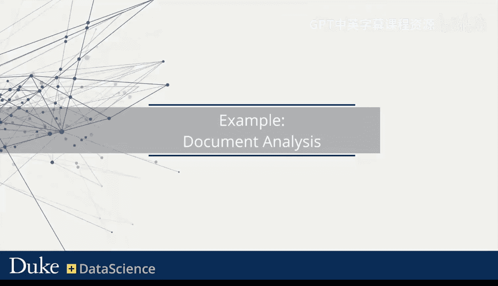
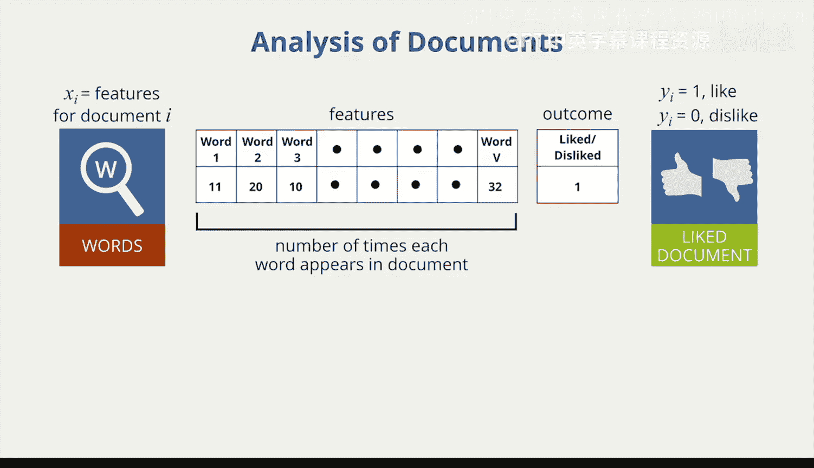
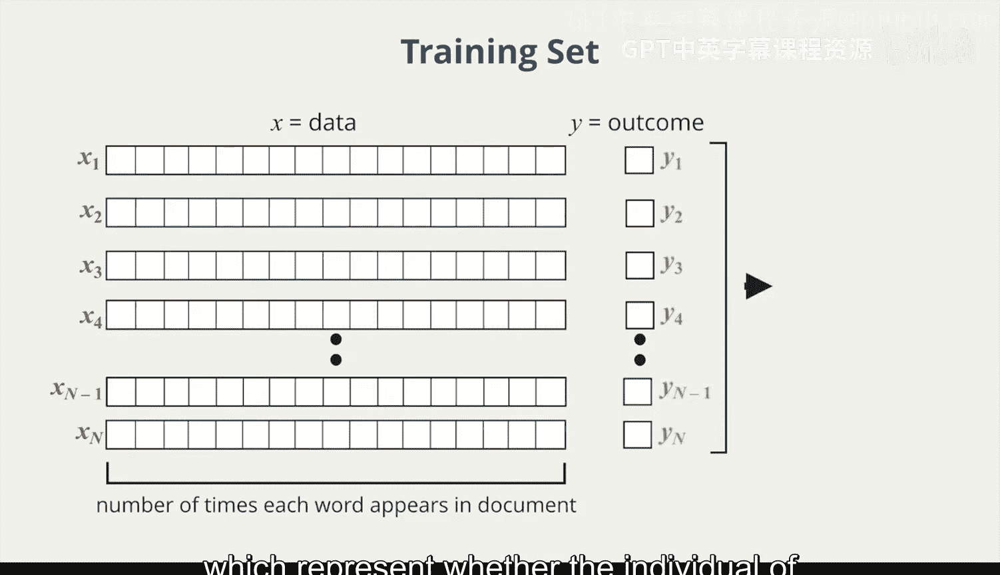

#  009：文档分析示例 📄

在本节课中，我们将通过一个具体的文档分析示例，深入探讨多层感知机（MLP）的工作原理。我们将尝试理解“潜在特征”和“潜在过程”这些概念的实际含义，并直观地感受神经网络模型如何运作。

在上一节中，我们介绍了多层感知机的基本概念。它在许多方面是神经网络最基础、最核心的模型。虽然它是一个相对复杂且功能强大的模型，但初学者可能对其工作原理和优势感到困惑。

因此，本节我们将花一些时间，通过一个相对简单但重要的例子，来阐述这些潜在特征和过程意味着什么，并建立对模型运作的直观理解。

## 问题设定：文档分类 📊

让我们假设我们的任务是分析文档。在这里，一个文档就是一组词语的集合。

请记住，`X_i` 是一个向量，它代表了我们感兴趣的第 `i` 个数据点的特征集合。在这个例子中，`X_i` 代表第 `i` 个文档的特征。

在文档分析的背景下，最简单的方法可能就是统计词语出现的次数。

以下是构建特征向量的具体步骤：

1.  假设我们有一个由 `V` 个单词组成的词汇表，即词汇表大小为 `V`。
2.  为了表征一个给定的文档（例如文档 `i`），我们只需统计每个单词在该文档中出现的次数。
3.  然后，我们将基于这个特征向量进行预测。

为了简化问题，我们仍然将自己限制在二元分类的情况下。我们的目标是：给定一个文档及其包含的词语，预测某个特定的人是否会喜欢或觉得这个文档有趣。

在二元分类中，我们规定：如果喜欢，标签 `y` 为 1；如果不喜欢，标签 `y` 为 0。

## 训练数据与学习目标 🎯

当我们进行机器学习时，首先必须假设我们拥有用于学习的数据。这些数据用于“教导”模型或算法。我们所说的“学习”，指的是学习模型的参数。

在本例中，我们假设拥有 `n` 个文档，由 `X1, X2, ..., Xn` 表示。这些特征向量简单地代表了每个文档中 `V` 个单词各自出现的次数。

同时，我们还拥有对应的标签 `Y1, Y2, ..., Yn`，它们代表了目标个体是否喜欢该文档。

我们的目标是构建一个模型，使得当我们获得一个全新的、该人从未见过的文档的特征向量 `X` 时，能够预测他是否会喜欢这个文档。

## 总结 📝

本节课中，我们一起学习了如何将文档分析问题形式化为一个机器学习任务。我们定义了文档的特征表示（词频向量）、二元分类的标签，并明确了模型的学习目标：利用带标签的文档数据训练模型，使其能够预测新文档的受欢迎程度。这个示例为我们后续理解更复杂的模型（如多层感知机）如何处理此类特征并做出决策奠定了基础。