#  013：神经网络早期历史 📜

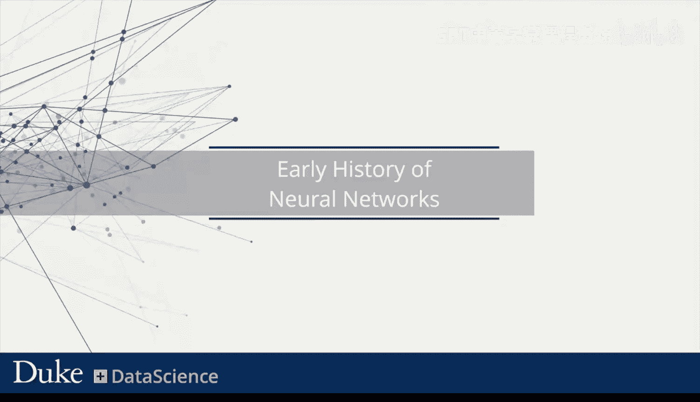


在本节课中，我们将回顾多层感知器（神经网络）的发展历史。这段历史不仅有趣，更是一个警示故事，它告诉我们技术发展并非一帆风顺，理解历史有助于我们明智地选择和应用模型。

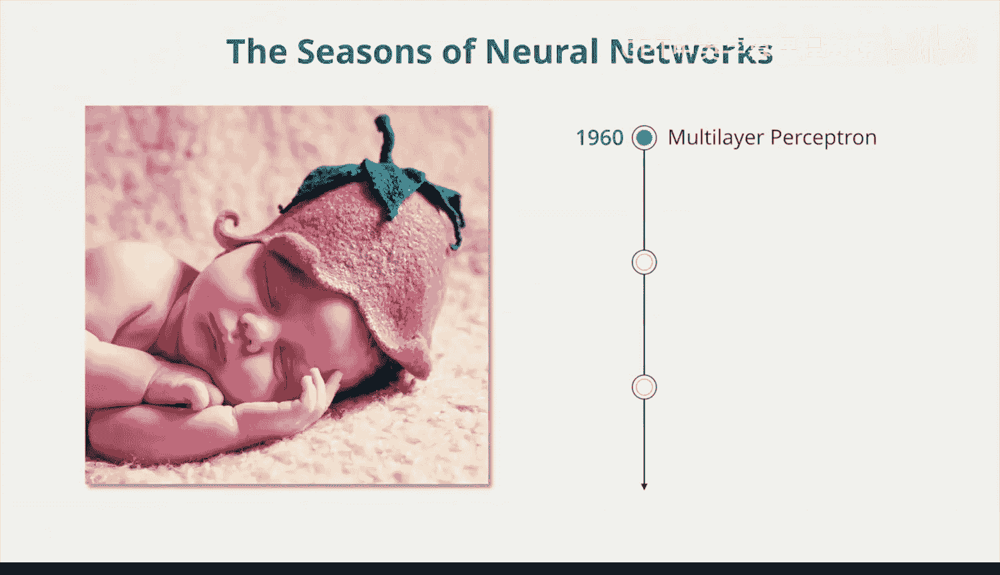

## 起源：多层感知器的诞生 👶

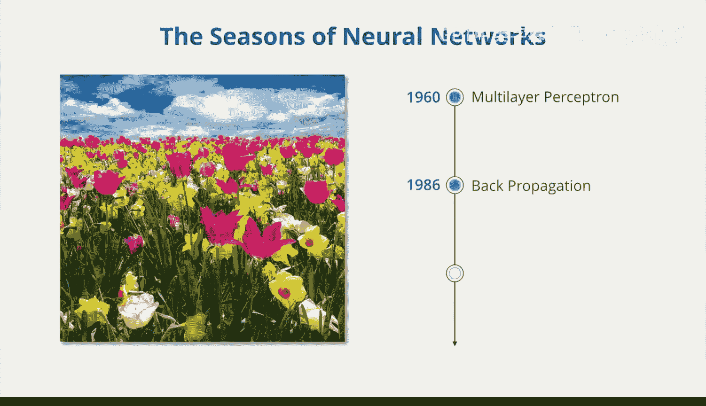

上一节我们介绍了多层感知器的基本概念。本节中，我们来看看它的起源。多层感知器是深度学习的核心，因此它看起来像是一项非常新的技术。然而，它实际上诞生于大约**1960年**。当时，计算能力远不如今天，可用的数据量也少得多，这限制了它的实际应用。

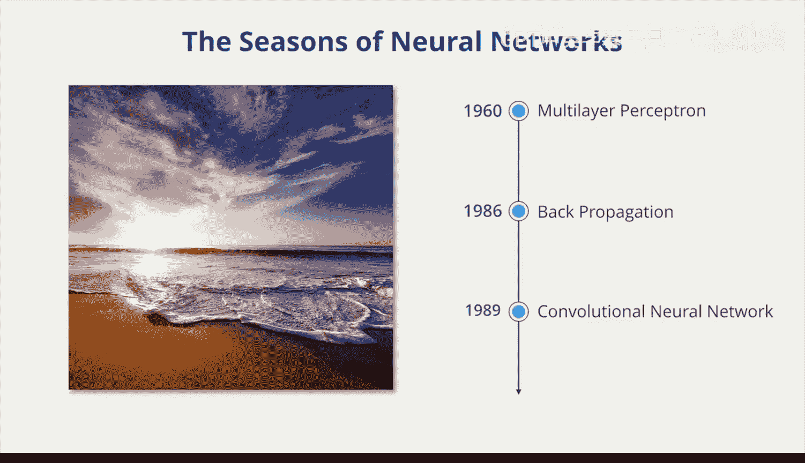

## 发展：反向传播与卷积神经网络的出现 🌱

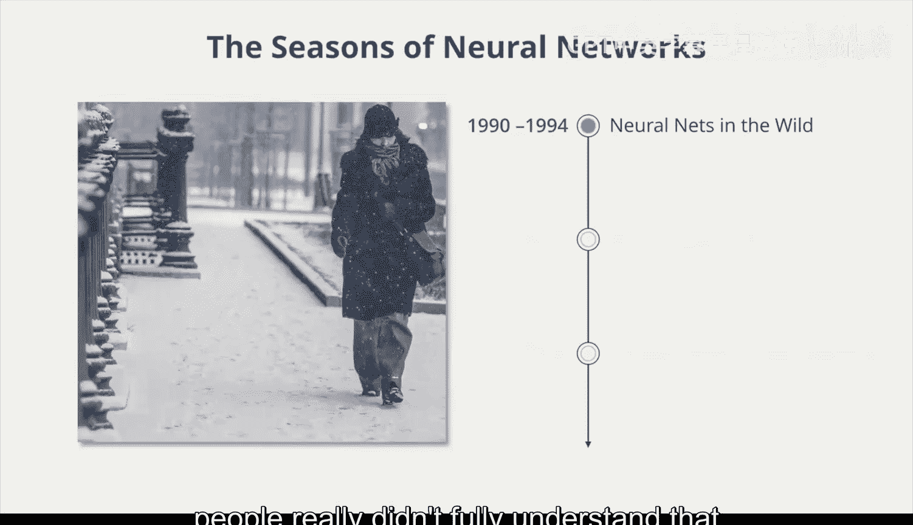

从1960年的诞生开始，神经网络进入了下一个重要发展阶段。**1986年**，一项关键技术——**反向传播**被提出。反向传播是一种高效学习模型参数的方法，其核心公式可以简化为权重更新规则：`w_new = w_old - η * ∇L`，其中 `η` 是学习率，`∇L` 是损失函数的梯度。这使得模型在计算上变得可行。与此同时，计算能力和数据访问量开始增长，前景似乎一片光明。

紧接着在**1989年**，**卷积神经网络**被开发出来。这种网络架构特别擅长分析图像数据，其核心操作是卷积计算。我们可以用以下伪代码表示其核心思想：
```python
# 简化的卷积操作概念
for each filter in filters:
    output_feature_map = convolve(input_image, filter)
```
这一时期是神经网络的“夏季”，充满了希望与热情。

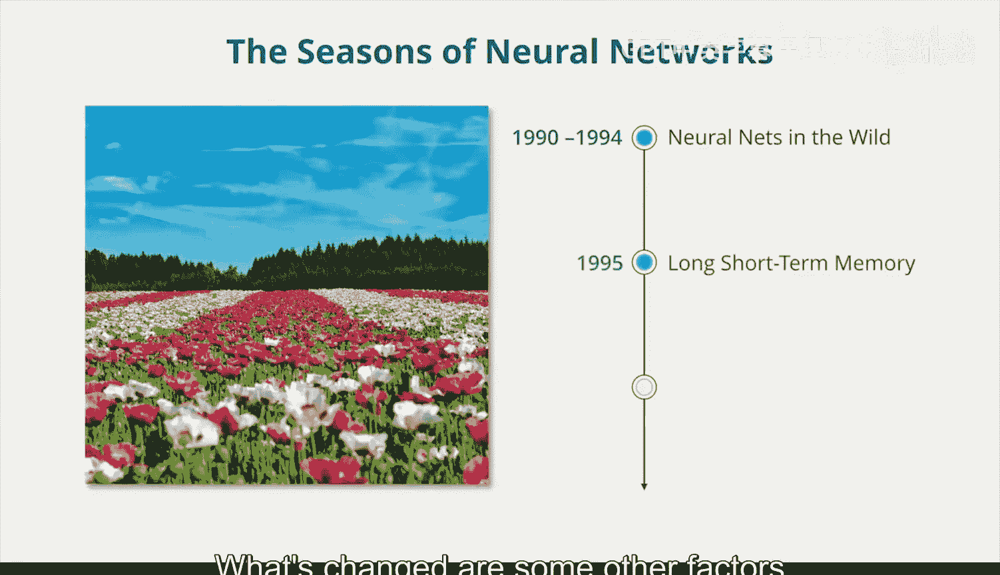

## 挫折：现实应用的寒冬 ❄️

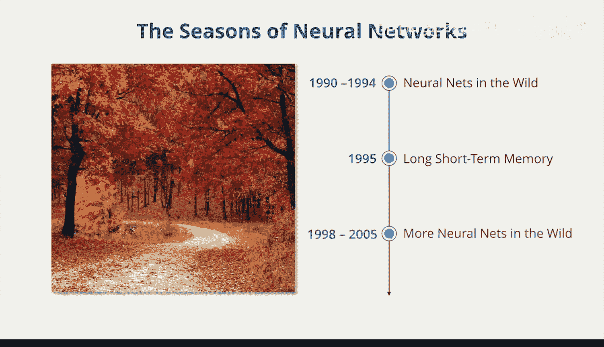

由于对神经网络抱有热情，人们在**20世纪90年代初**开始将其应用于现实世界的数据集。然而，结果并不理想，神经网络的表现往往不如预期。这主要是因为神经网络比逻辑回归等模型复杂得多，需要大量数据才能训练好，而当时人们并未完全理解这一点。于是，神经网络的“冬季”来临了。

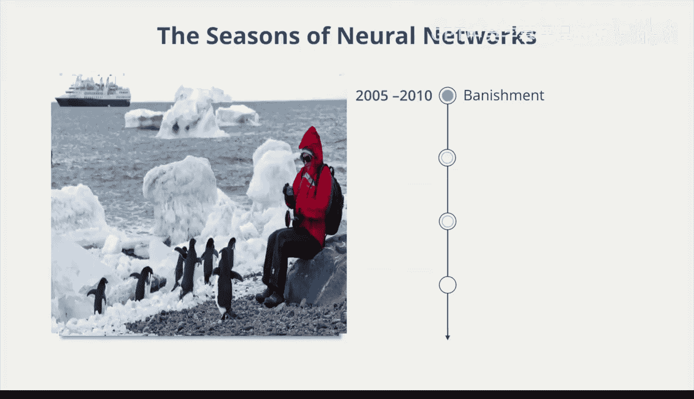

## 复苏：长短期记忆网络与沉寂期 🍂

在**1995年**左右，一项名为**长短期记忆网络**的关键技术被提出。LSTM非常适合分析随时间变化的数据，例如音频或视频。其核心在于引入了“门”机制来控制信息的流动，基本单元结构包含输入门、遗忘门和输出门。

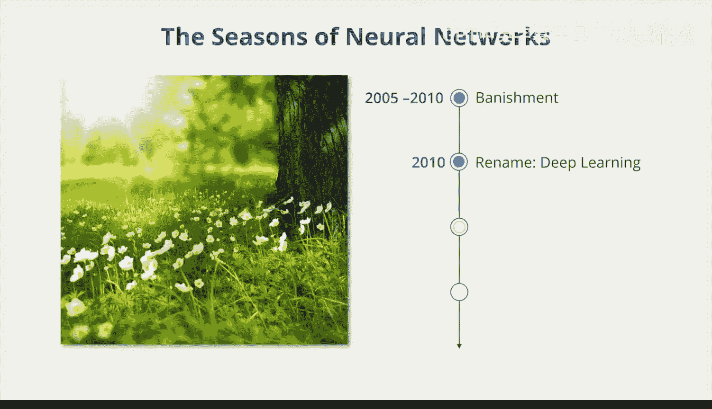

尽管有这些技术进步，当人们再次尝试在现实世界中应用神经网络时，其表现仍然不尽如人意。从大约**2005年到2010年**，在机器学习的主流圈子里，神经网络甚至一度成为“禁忌”词汇，因为更简单、更容易理解的模型往往效果更好。

## 复兴：“深度学习”的重生与爆发 🌸

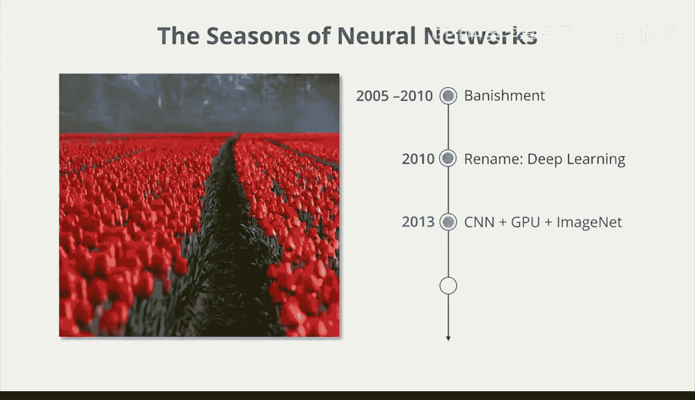

由于“神经网络”一词因历史表现而带有负面色彩，大约在**2010年**，人们决定为这项技术重新命名，于是“**深度学习**”诞生了。这本质上是对多层感知器等已有技术的重新包装，但新名字让人们愿意再次审视它。

真正的转折点发生在**2013年**。诞生于1989年的卷积神经网络，与两项当时不存在的新事物结合：强大的**图形处理器**和海量的**ImageNet数据集**（包含超过一百万张标注图像）。这种结合带来了性能的质的飞跃。

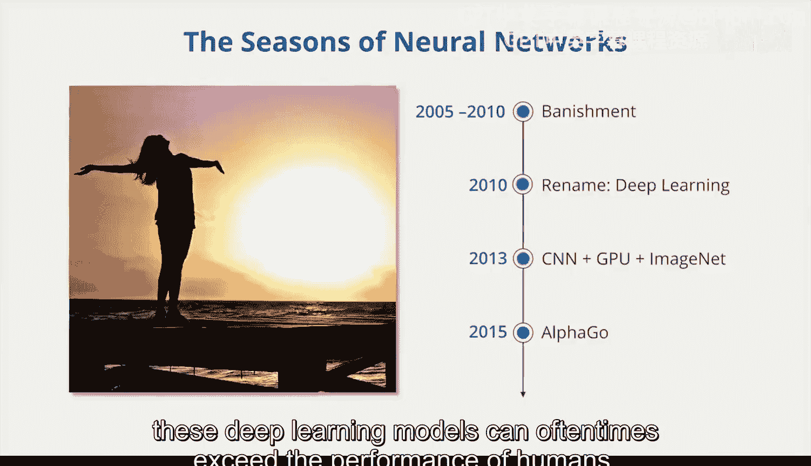

随后在**2015年**，基于卷积神经网络和强化学习的**AlphaGo**在围棋比赛中击败了人类顶尖选手。在图像分析等领域，深度学习模型的性能也超越了人类。

## 总结与启示 🤔

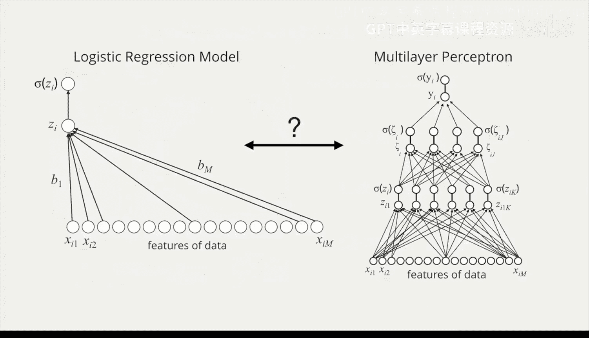


本节课中我们一起学习了神经网络的起伏历史。这段历史告诉我们几个关键点：
1.  **核心技术很“古老”**：深度学习（神经网络）的核心架构——多层感知器、CNN、LSTM——早在几十年前就已提出。
2.  **成功的催化剂**：近年来的爆发性成功主要归功于**强大的计算能力**和**海量的数据**，而非基础理论的颠覆。
3.  **保持谦逊与务实**：历史上有过多次从乐观到失望的循环。在选择模型时，应遵循**奥卡姆剃刀原则**：如果简单模型（如逻辑回归）和复杂模型（如深度神经网络）表现相当，应优先选择简单模型。我们必须理解深度学习的有效应用场景，同时也要知道在何处更简单的模型可能更合适。

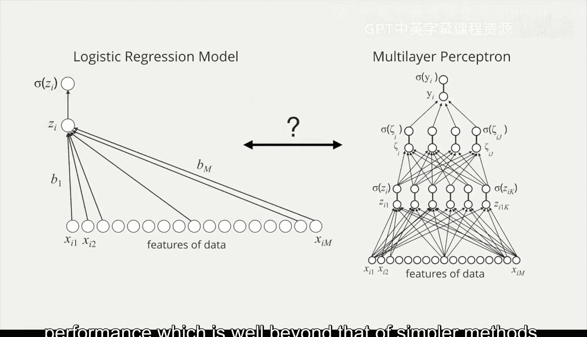

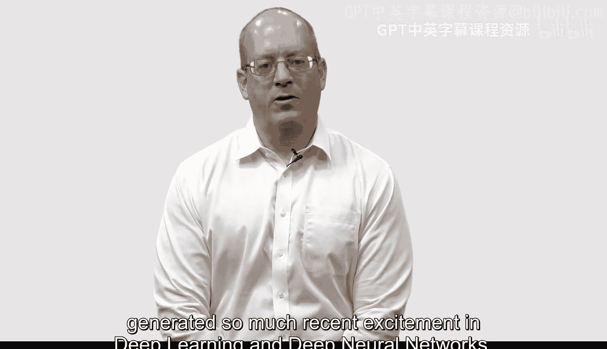

通过理解这段历史，我们可以避免盲目追逐技术潮流，从而更明智地运用机器学习工具来解决实际问题。