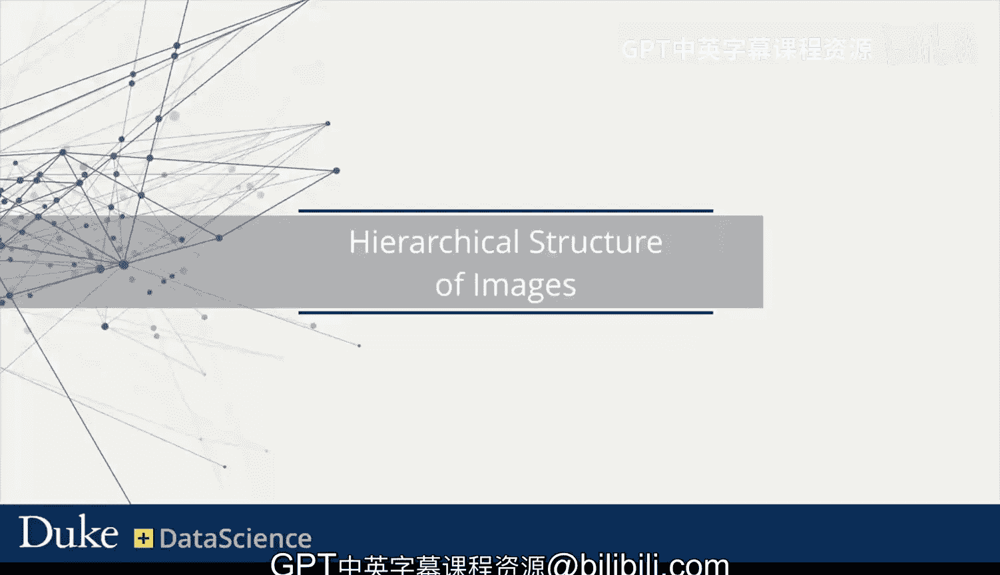
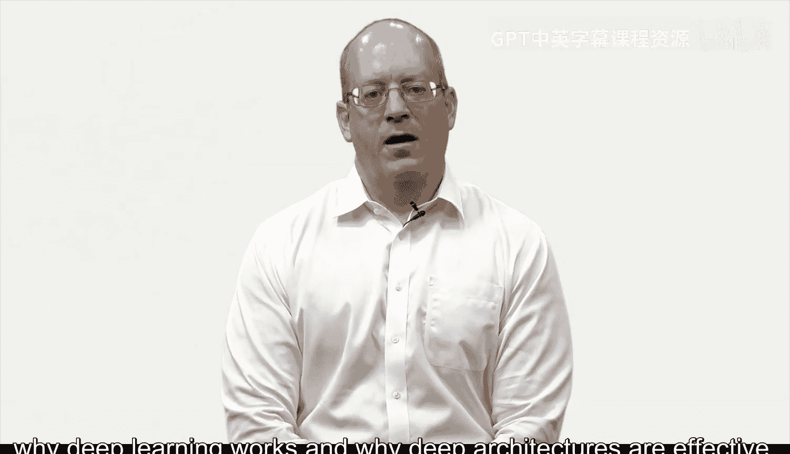
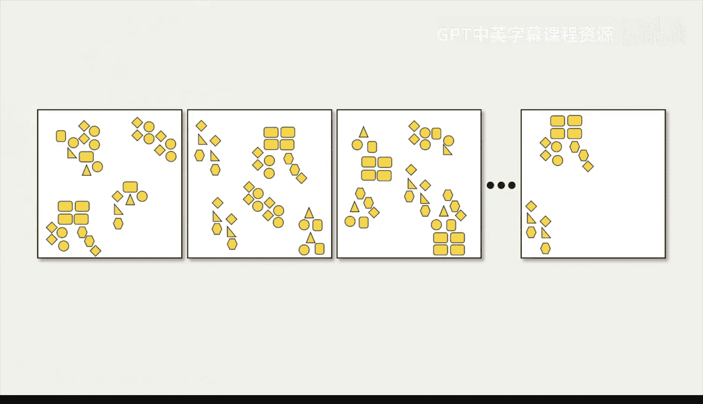
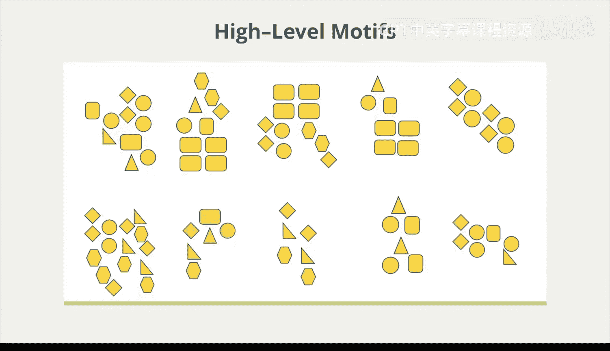
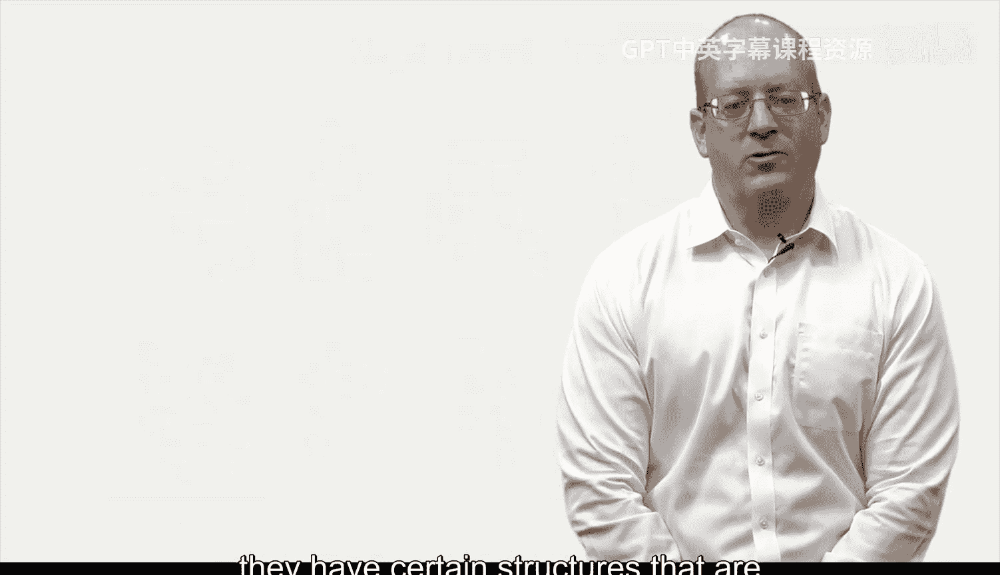
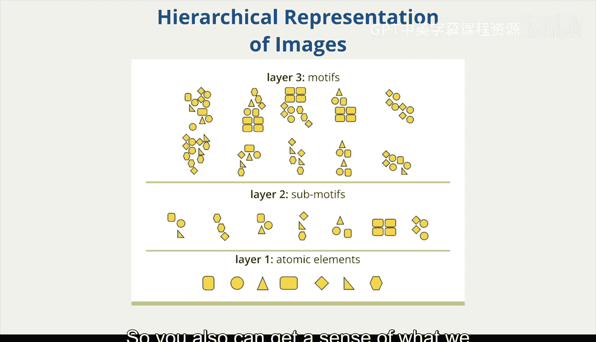
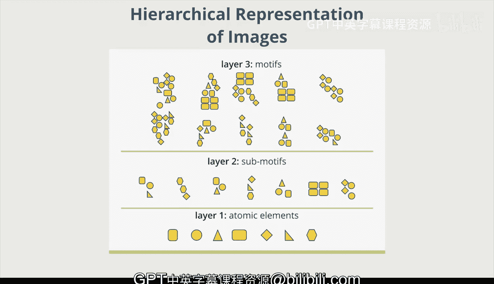

#  014：图像的层次结构 🏞️

在本节课中，我们将学习卷积神经网络（CNN）如何分析图像，以及为什么这种深度架构在处理图像数据时特别有效。我们将通过简单的示例图像来直观理解图像数据的内在层次结构，并探讨如何利用这种结构构建强大的学习模型。

## 图像的构成与层次结构

上一节我们介绍了多层感知机，本节中我们来看看为什么它并不适用于所有类型的数据，特别是图像数据。卷积神经网络是分析图像等数据的关键技术，其性能甚至在某些任务上超越了人类。

为了直观理解其工作原理，我们将分析一些“玩具图像”。这些图像并非真实照片，而是用于阐明概念的简化图示。我们的数据样本就是这些图像。

以下是三幅示例图像及其局部放大图，每个方块代表一幅图像，其中的形状是构成图像的基本构件。

关于这些图像，需要注意的关键点是：每幅图像都由一组**高级图案**构成，这些图案在图像内的位置各不相同。并非每幅图像都包含所有图案，但每幅图像的特征都由其包含的图案子集及其位置来定义。

现实世界中的图像也具有类似特性，它们包含重复的结构，例如边缘、角落、纹理和形状。

卷积神经网络正是要利用自然图像的这种特性。让我们更仔细地观察这些图案。

我们发现，每个高级图案本身又由重复的**子图案**构成。以下图示强调了在某些高级图案内部，我们可以看到重复的子结构。

因此，我们可以这样理解数据的层次结构：
*   从顶层开始，每幅图像由一组**高级图案**构成，我们称之为模型的**第3层**。
*   第3层的每个高级图案，又由一组位置发生偏移的**子图案**构成。
*   每个子图案则由基本的**原子元素**（即这些基础形状）构成。

本张幻灯片的关键要点是：**数据可以用一种层次结构来表示**。这让我们对“深度”或“多层”结构有了直观感受。我们的目标是构建一个能够捕捉这种图像层次化表示结构的模型。

那么，问题就变成了：我们如何构建一个模型，来捕捉这种形式的层次结构所体现的图像构成直觉？

## 总结

本节课中，我们一起学习了图像的层次化特性。我们看到，复杂的图像可以由简单的基础元素（原子）组合成子图案，子图案再以不同位置组合成高级图案，最终形成完整的图像。这种从局部到整体、从简单到复杂的层次结构，是卷积神经网络设计灵感的核心来源，也是其能高效处理图像数据的原因。下一节，我们将探讨卷积神经网络如何具体实现对这种层次结构的建模。