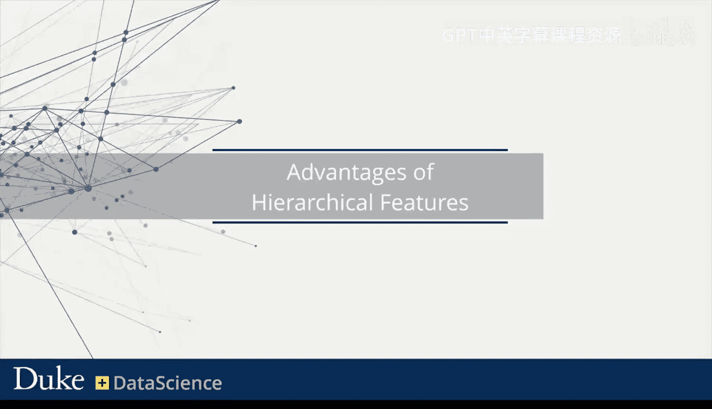
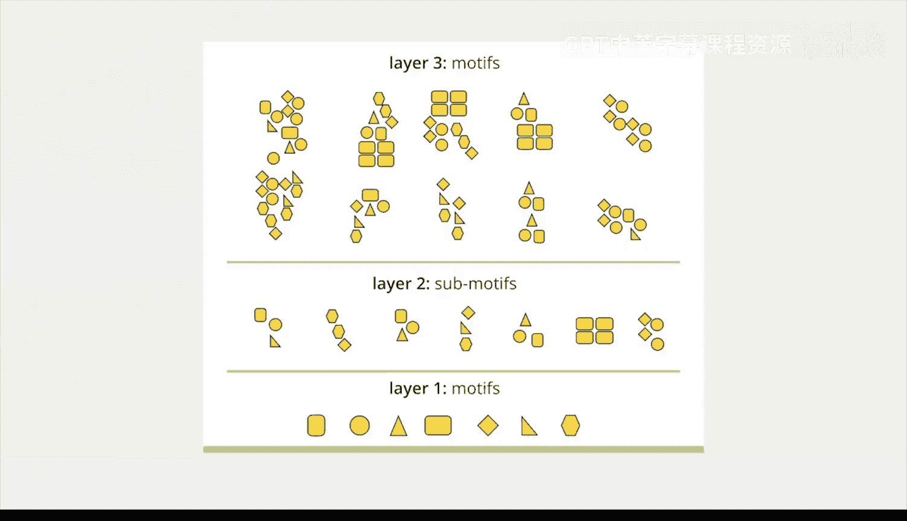
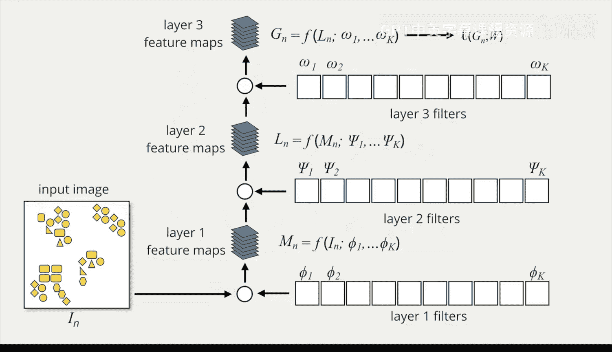
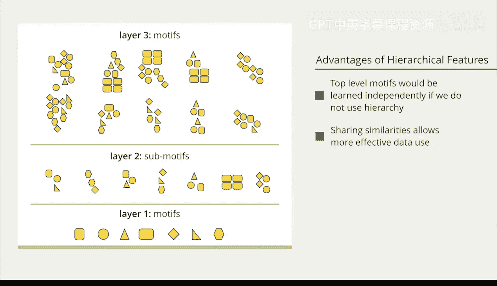
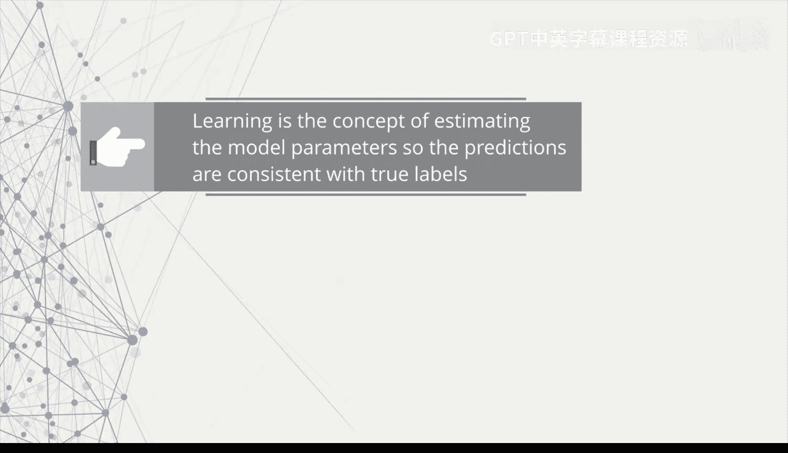

#  019：层次特征的优势 🏗️

在本节课中，我们将探讨深度架构的核心优势，即通过层次化的特征共享结构，更有效地利用数据并提升模型的学习能力。

## 深度架构的优势

上一节我们介绍了深度卷积神经网络的基本结构。本节中，我们来看看这种层次化架构的核心优势是什么。

我们回到最初的动机。在那些玩具示例中，我们有由基本形状组成的原子元素。在第一层，我们有最简单的原子元素，即基本形状。在第二层，我们拥有所谓的“子模式”，它们是那些基本形状的基础组合。最后在第三层，我们拥有“模式”，它们是子模式的组合。

## 为何需要层次结构？

有人可能会问：在这个模型中，最终在架构顶层的学习是基于顶层的特征，这些特征最终被用于做出分类决策。

那么，为什么我们不能直接基于顶层的模式构建模型，而无需关心第二层的子模式和第一层的原子元素呢？这种深度架构的优势究竟在哪里？

如果我们构建一个仅基于第三层过滤器的架构，那么每个第三层的过滤器都将被独立学习。在学习这些过滤器的过程中，模型不会理解它们共享了某些结构。我通过展示第三层和第二层中重复结构的例子来提醒大家，正是这种分层结构构成了深度架构的动机。

## 共享结构与知识传递

因此，任何时候，当一个特定的子模式出现在第三层的任何模式中时，学习该模式的过程会通过共享的信息，为其他模式提供信息。

其核心思想是：通过在各个层的过滤器元素之间共享结构（这种共享体现在它们都是由更基础的构建块的平移版本组成的），并通过这种深度架构，我们可以更有效地利用数据，并在各个模式之间共享知识。这样一来，对一个模式的知识可以通过它们所拥有的共享子结构，来改进对另一个模式的知识。

## 本章小结与展望

现在，我们对机器学习如何实现有了一些了解。我们了解了如何在这里构建一个机器——深度卷积神经网络。我们也初步体验了学习是如何发生的：学习通常通过获取大量数据（通常是有标签的数据，即我们同时拥有数据和关联的标签）来体现。我们看到了“学习”的含义：学习是尝试估计模型参数的概念，目的是使我们模型的预测与数据的真实标签保持一致。

我们也获得了一些理解，至少是直觉上的认识：当参数数量很大时，学习可能具有相当的挑战性。

随着我们结束这个机器学习入门模块，在接下来的课程中，将提供一些现代机器学习如何改变世界各地人们生活的例子。这些关于该技术如何在许多领域提供突破的例子，将激励我们更深入地挖掘并尝试学习更多关于现代机器学习的知识。

本节课中我们一起学习了深度层次化架构的核心优势，即通过共享基础构建块的结构，实现知识在不同层级特征间的有效传递与复用，从而提升数据利用效率和模型整体性能。