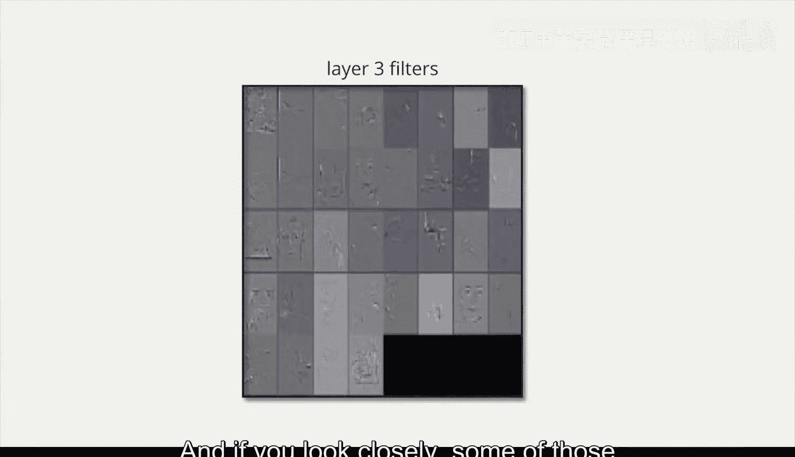

#  020：真实图像上的CNN

在本节课中，我们将深入了解卷积神经网络在真实图像数据上的工作原理。我们将观察网络在不同层次学习到的滤波器，并与生物视觉系统的发现进行对比，从而获得对模型学习过程的直观理解。

上一节我们介绍了如何基于数据学习滤波器。现在，我们将从简单的原子元素示例转向分析真实数据。当我们分析真实图像时，这些学习到的滤波器会是什么样子？不同层的滤波器又有什么不同？

为了提供直观的示例和启发，我们将观察一个特定数据集（包含人脸、汽车、摩托车等图像）上学习到的滤波器。

以下是该模型第一层（即最底层）学习到的每个滤波器的可视化。每个小方块代表卷积神经网络学习到的一个滤波器。

在这些顶部的小图像中，您会注意到深色和亮色（白色）区域。深色对应像素的负值，白色对应像素的正值。如果仔细观察这些子图像，您会发现它们的特点是：一个基本形状经过不同角度的旋转。这个基本形状表现为一组相邻且对齐的深色像素和亮色像素。

这类似于正弦波的一个周期，其中一半波谷向下，另一半波峰向上。这个正弦波单周期以二维形状呈现，并且对于每一个第一层滤波器，这个单周期被旋转到不同的角度。因此，每个第一层滤波器大体上都是由一个旋转了不同角度的正弦波单周期构成的。

这些形状在数学中已被广泛研究，具有非常基础的数学特性，被称为**Gabor函数**。

更有趣的是，人们对兔子、老鼠等哺乳动物进行了研究。他们将光照射到哺乳动物的视网膜上，并探究一个问题：应以何种形状的光照射哺乳动物的视网膜，才能激活其视觉皮层中的单个神经元？

如果能激活哺乳动物视觉皮层中的单个神经元，这 arguably 表明该形状是视觉皮层能够识别的最基本形状。因此，研究尝试了用各种非常基础的形状照射哺乳动物的视网膜，目的是找出哪种形状能触发单个神经元的反应，从而反映这是视觉皮层能识别的最基本形状。

研究已经确定，这些形状与卷积神经网络在该模型第一层学习到的“原子”几乎一模一样。因此，图中顶部每个小方块所代表的、由卷积神经网络学习到的基本原子元素，与生物学研究表明的哺乳动物视觉系统能识别的最基本元素高度吻合。

这并不是对卷积神经网络的要求。但许多人认为非常有趣的是，这个计算引擎——卷积神经网络——至少在其架构的第一层，其行为方式与哺乳动物的视觉系统是一致的。

现在，我们来看深度架构的第二层，这对应左下角的图像。

在左下角，每个方块代表我们深度架构第二层的一个滤波器。请记住，我之前称这些为“子基元”。如果仔细观察，您会注意到它们每一个都对应一个比第一层原子元素更复杂的基本形状或结构。

仔细观察这些第二层的图像或滤波器，您会注意到像眼球这样的东西。请记住，我们分析的是包含人脸等的图像。

接着，我们看右下角，这些对应架构第三层（即顶层）的滤波器。

如果仔细观察，其中一些滤波器对应人脸的轮廓草图。

这些完全基于数据学习到的滤波器的有趣之处在于：
*   在第一层（最基本的一层），滤波器对应的构建块与激发哺乳动物视觉系统神经架构的基本方式是一致的。
*   在第二层（左下角），我们看到了更复杂的结构。仔细观察，您会看到像眼球这样的东西。这些是图像中子结构的体现。
*   最后，在更高层（我们看到更复杂结构的地方），我们实际上可以看到人脸的轮廓草图。

这让我们进一步直观地理解了，当给定真实图像时，模型多个层级的滤波器实际在学习什么。

本节课中，我们一起学习了卷积神经网络在真实图像上学习到的滤波器可视化。我们看到，第一层滤波器学习到的是类似Gabor函数的基元，这与生物视觉系统的基础识别单元惊人地相似。随着网络层数加深，滤波器逐渐组合成更复杂的结构（如眼睛）乃至整体对象轮廓（如人脸）。这揭示了CNN如何通过分层抽象从像素中提取有意义的特征。