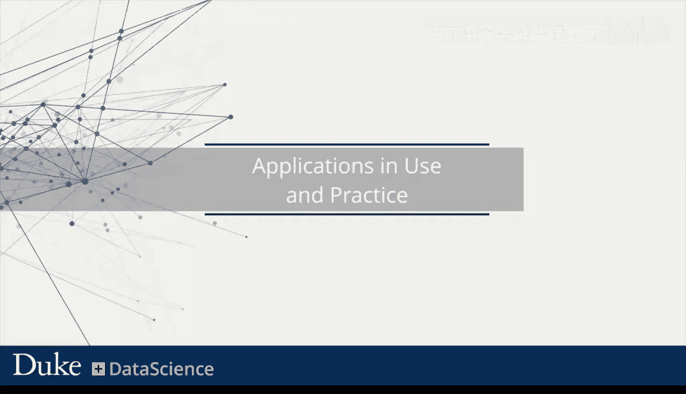
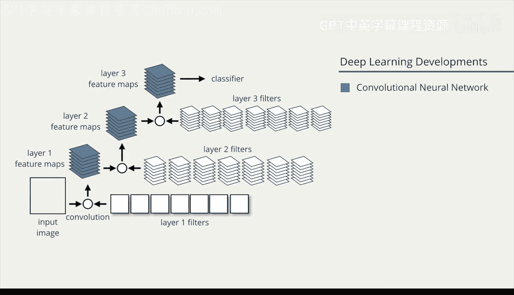
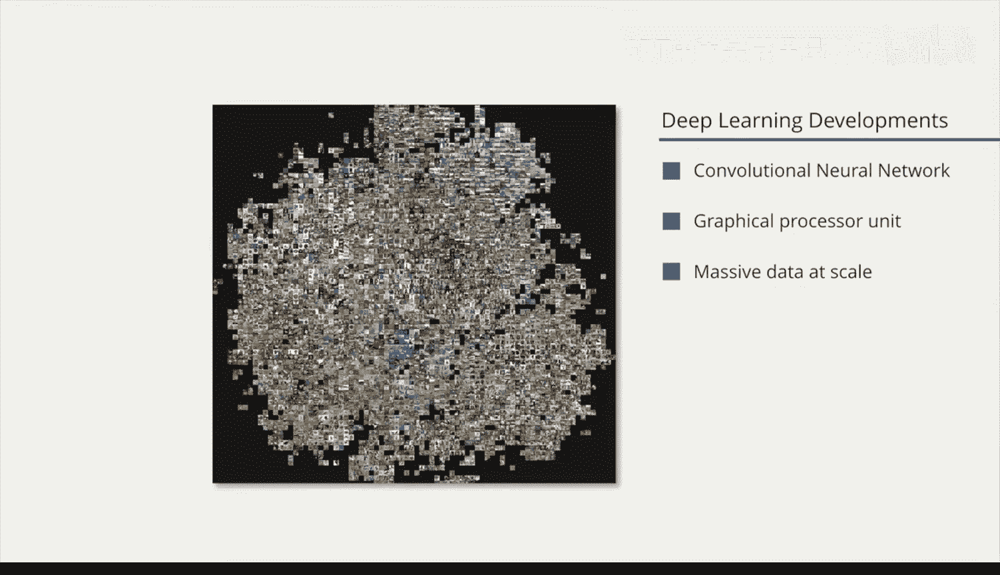
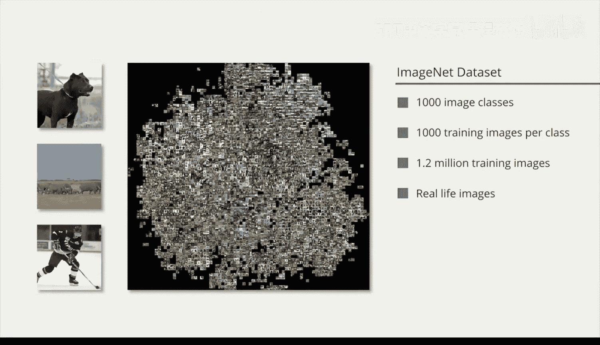
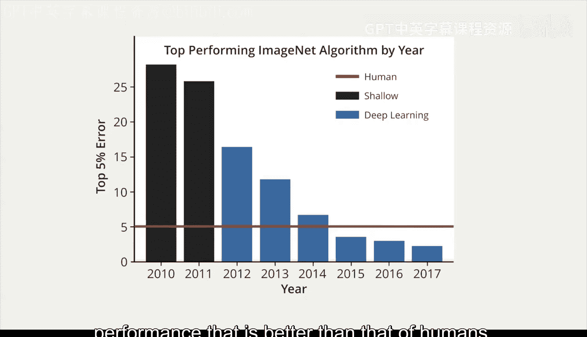
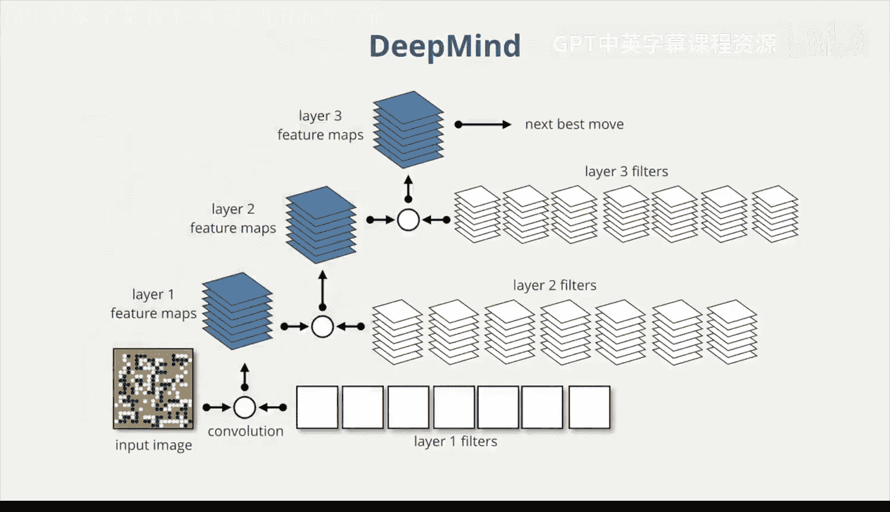
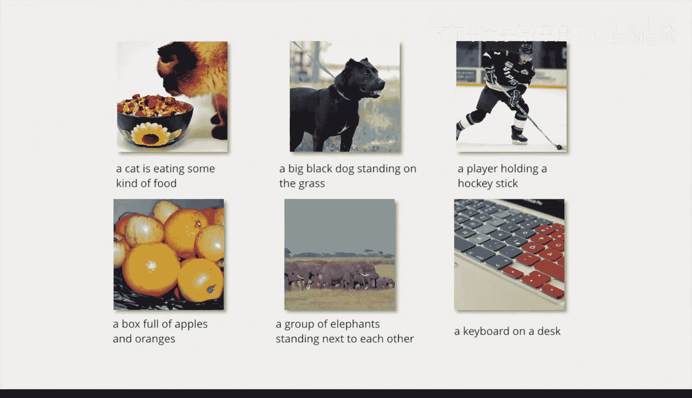
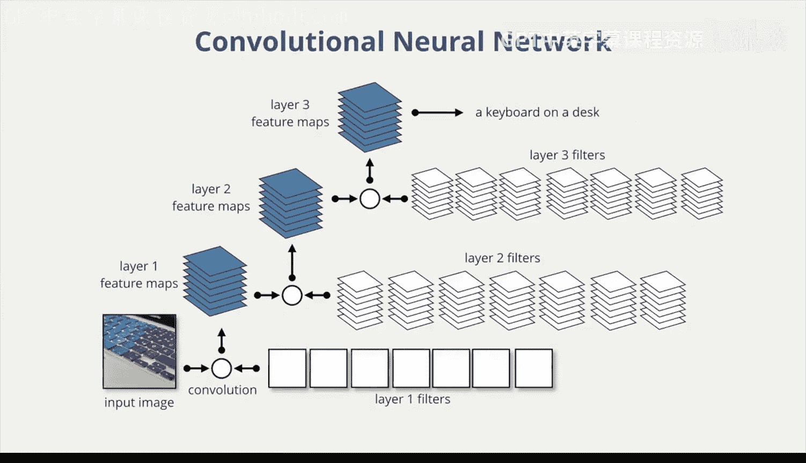
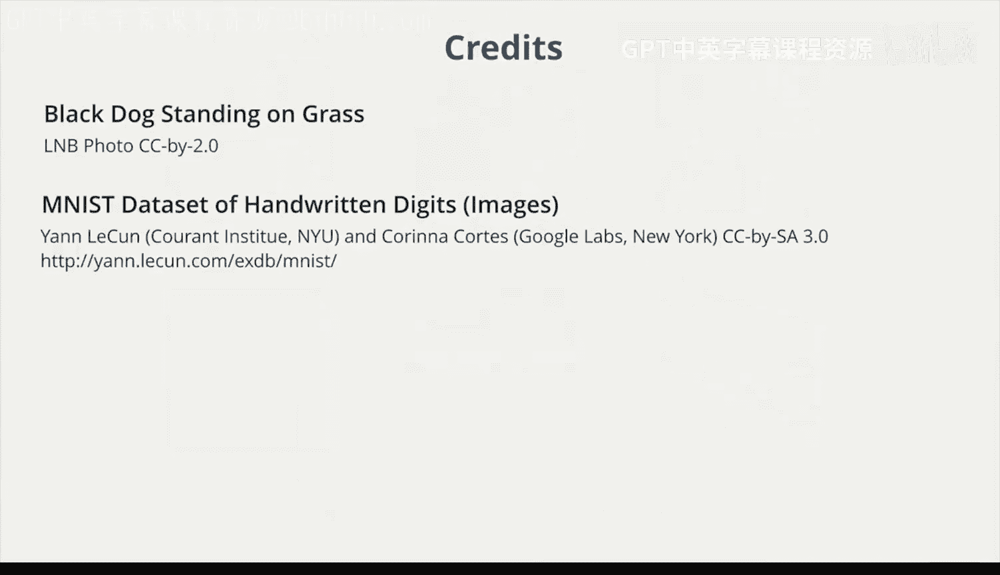

#  021：应用与实践 🚀

在本节课中，我们将基于之前建立的直觉，探讨深度学习技术在真实、大规模数据上的表现。我们将回顾其关键发展节点，并通过具体案例展示卷积神经网络在图像分类、复杂游戏及图像描述生成等领域的卓越能力。

---

## 深度学习的关键发展：2013年

上一节我们介绍了神经网络的基本概念，本节中我们来看看推动其取得突破性进展的关键因素。深度学习在2013年左右取得显著发展，这主要归功于三者的结合：

1.  **核心模型**：卷积神经网络。该模型架构实际上在1989年左右就已提出。
2.  **计算能力**：图形处理器单元。
3.  **数据规模**：海量数据。

这种结合使得处理极其复杂的任务成为可能。

---

## 大规模图像分类：ImageNet数据集

为了理解其性能，我们首先需要了解它处理的数据规模。以下是ImageNet数据集的介绍：

*   **任务**：对图像进行1000个不同类别的分类。这远超出我们之前为简化而讨论的二元标签（+1， -1）。
*   **数据量**：大约每个类别有1000张训练图像，总计约120万张训练图像。
*   **图像复杂性**：如下图所示，这些是真实且复杂的图像，我们的目标就是使用深度卷积神经网络对其进行准确分类。

右侧的图像旨在直观展示所使用的海量数据规模。

---

## 技术性能：超越人类水平

那么，这项技术的实际表现如何呢？下图展示了2010年至2017年间，在ImageNet数据集上最佳算法的性能变化：

*   **纵轴**：分类准确率。
*   **横轴**：时间。
*   **水平线**：代表人类在此任务上的表现（约5%的错误率）。

可以观察到，在2012-2013年卷积神经网络成为主流后，性能出现了显著提升。到2017年，深度卷积神经网络的性能已经超越了人类水平。

---

## 实际分类示例

为了更具体地感受模型的分类能力，请看以下八个示例：

对于每张测试图像，模型会输出其属于1000个类别的概率分布。图中在每个测试图像下方，列出了模型认为最可能的五个标签及其对应的概率（条形图表示）。

从这些具有高度真实性和复杂性的图像中可以看出，模型的分类表现非常出色，其能力已优于人类进行此类标注的水平。

---

## 超越图像分类：AlphaGo的突破

深度学习的另一个里程碑体现在围棋领域。围棋是一种比国际象棋更为复杂的游戏。

DeepMind公司开发的核心算法基于我们讨论的深度卷积神经网络技术。该算法能够分析棋盘图像，并推荐最佳的下一步走法。最终，这项机器学习技术击败了世界顶级的职业围棋选手，完成了一项此前被认为不可能的任务，标志着深度学习技术的成熟。

---

## 图像描述生成：多模态融合

该技术还能完成更复杂的任务，例如为图像生成描述性文字。以下是六个示例：

其工作流程如下：

1.  **图像输入**：图像被送入一个深度卷积神经网络。
2.  **特征提取**：网络顶层的特征被提取出来。
3.  **文本合成**：这些特征被输入到另一个神经网络（基于长短期记忆架构）中，用于合成描述文本。

生成的文本质量很高，语法正确，并且准确地描述了图像内容。这展示了现代机器学习如何整合图像分析与文本合成，从而产生令人兴奋的应用。

---

## 总结

本节课中我们一起学习了深度学习，特别是卷积神经网络在大规模真实数据上的强大应用。我们看到，自2013年关键要素结合后，该技术在图像分类任务上已超越人类水平。通过AlphaGo的案例，我们了解到它能解决极其复杂的策略性问题。最后，通过图像描述生成的例子，我们看到了多模态模型融合所能实现的更高级、更智能的功能。这些成就共同证明了深度学习已成为解决复杂现实问题的成熟且强大的工具。