#  022：深度学习与迁移学习 🧠

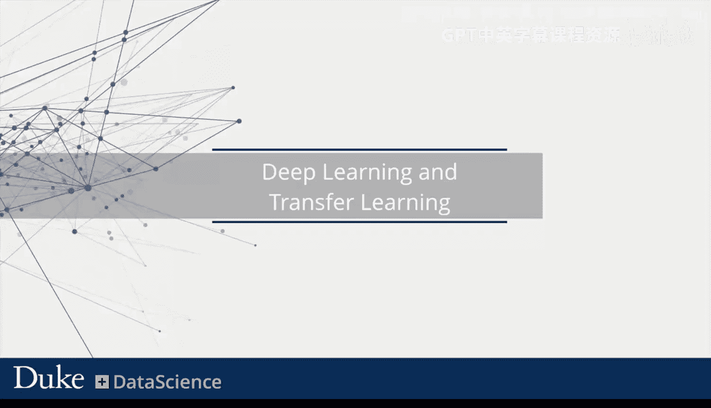


在本节课中，我们将探讨深度学习在医学影像分析等关键领域的应用，并重点介绍**迁移学习**这一强大概念。我们将了解如何利用在自然图像上训练好的模型，来帮助解决医学图像分析中数据稀缺的挑战。


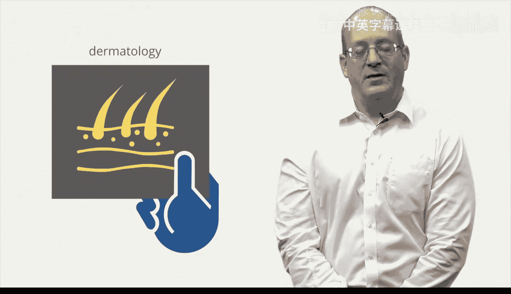

## 深度学习在医学影像中的应用 🏥

上一节我们介绍了深度学习在围棋和图像描述等领域的应用。本节中我们来看看深度学习在医学影像分析中的价值。

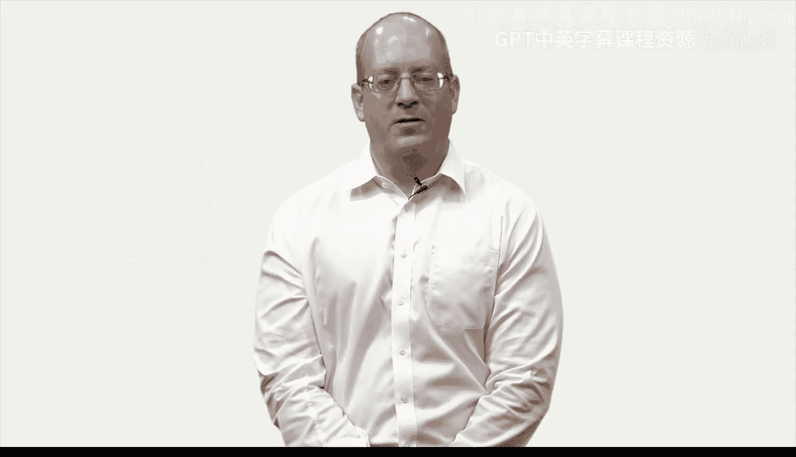

医学影像分析在放射学、眼科学和皮肤病学等领域至关重要。医生们需要花费大量时间查看影像，而非与患者沟通。深度学习为此提供了显著的机会。

以下是深度学习已展现出巨大潜力的几个医学领域：
*   **眼科学**：例如在糖尿病视网膜病变的诊断中，卷积神经网络的表现已与眼科医生相当，甚至更优。
*   **皮肤病学**：深度学习模型在皮肤病图像分析中表现出相似的高性能。
*   **放射学**：该领域也是深度学习应用的重要方向。

## 迁移学习：解决医学数据稀缺的关键 🔄

然而，在医学领域应用深度学习面临一个主要挑战：获取海量标注数据非常困难。例如，要构建一个皮肤病诊断模型，需要数百万张由医生标注的皮肤病图像，这个过程既昂贵又耗时。

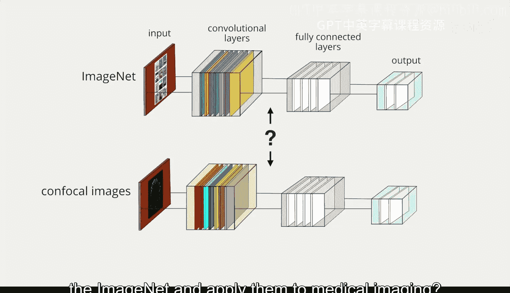

这就引出了一个关键问题：我们能否将基于自然图像（如ImageNet）训练出的模型架构和参数，迁移到医学影像分析中？

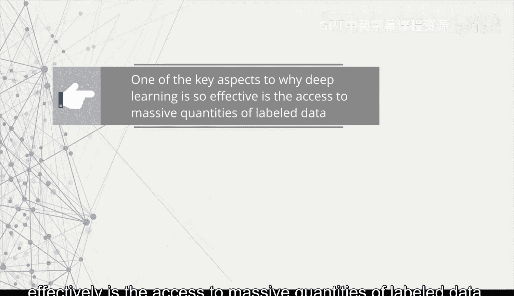

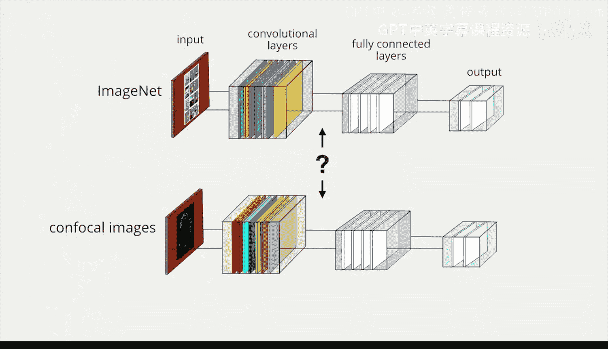

如果答案是肯定的，那么我们就能利用世界上已有的海量自然图像数据，极大地推动深度学习技术在其他领域的应用。

## 迁移学习的实践方法 💡

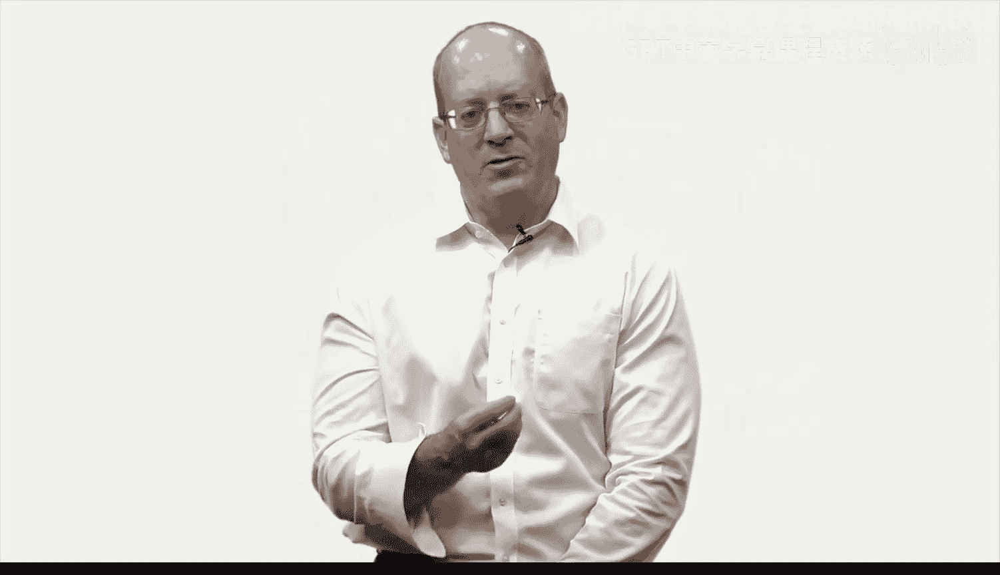

研究发现，这是可行的。我们可以采用为ImageNet设计的深度神经网络架构及其参数，几乎完整地迁移到其他应用上。

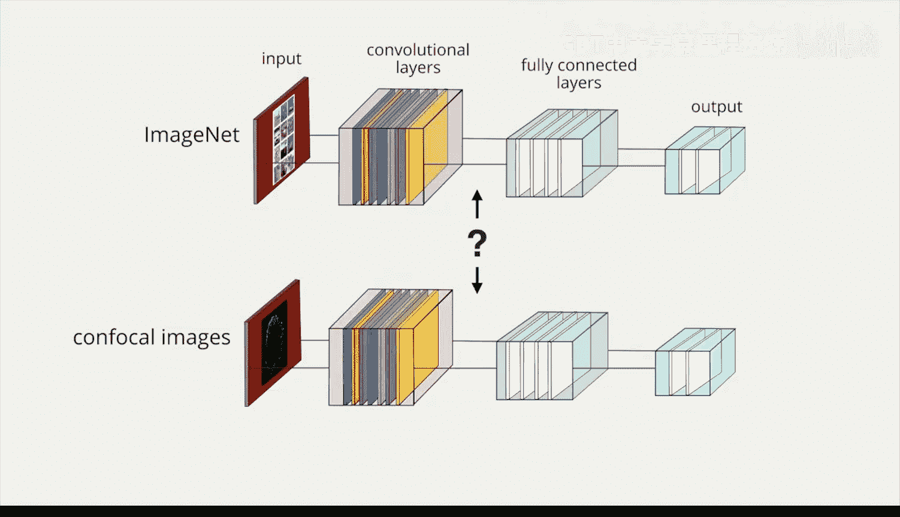

具体过程可以用以下伪代码表示：
```python
# 1. 加载在ImageNet上预训练的模型（如ResNet, VGG）
pretrained_model = load_pretrained_model('imagenet')

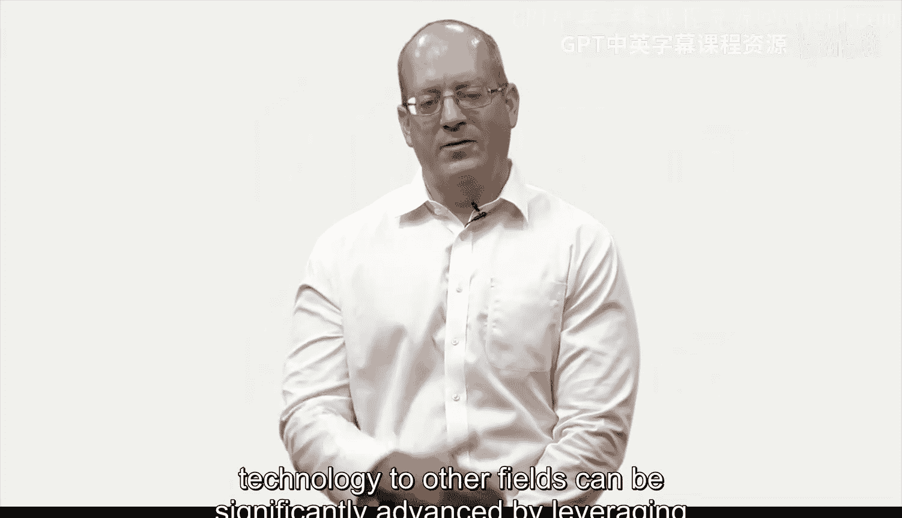

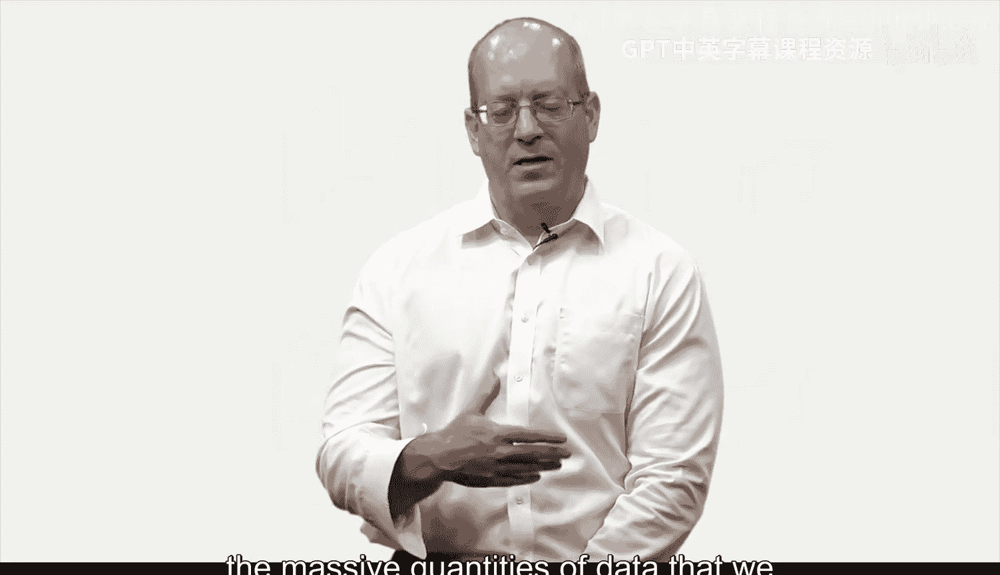

# 2. 冻结大部分底层参数，保留其学到的通用特征
for param in pretrained_model.early_layers.parameters():
    param.requires_grad = False

# 3. 替换并重新训练顶层的分类器，以适应新任务（如医学影像分类）
pretrained_model.classifier = new_classifier(output_classes=num_medical_classes)

# 4. 使用医学影像数据训练新的顶层分类器
train_model(pretrained_model, medical_dataset)
```

图中的方框意在说明：我们可以将基于ImageNet学习到的模型权重，迁移到看起来截然不同的图像上（例如这里的共聚焦图像）。然后，我们只学习网络顶层的、直接适用于新图像类别的参数。因此，我们需要学习的参数量大大减少，因为我们无需从头学习所有参数，只需为医学图像学习网络顶层的新参数，而底层参数则从ImageNet模型迁移而来。

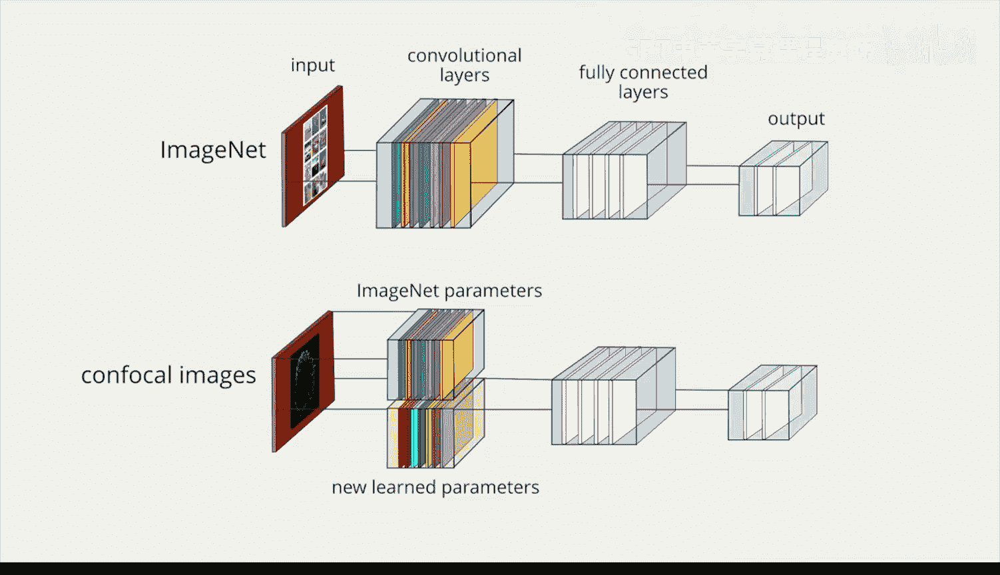

## 迁移学习的广泛应用 🌟

这种将模型参数从ImageNet迁移到不同图像（如医学图像）的概念，是深度神经网络一个显著的积极方面。它已被证明在将技术应用于缺乏足够标注数据的新领域（如医学影像）时极具价值。

以下是迁移学习发挥重要作用的其他领域示例：
*   **数字病理学**：用于癌症诊断的细胞图像分析。
*   **其他医学影像模态**：如X光、CT、MRI等。

## 总结 📝

本节课中我们一起学习了深度学习在医学影像等关键领域的应用，并深入理解了**迁移学习**的核心概念。

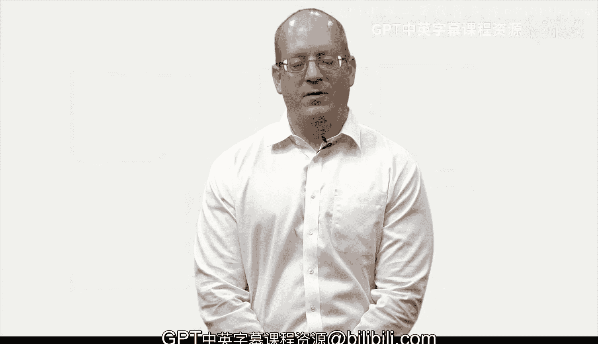

关键要点在于，这种深度学习架构——卷积神经网络——正被广泛应用于各种不同类型的任务和图像中，其性能常常超越人类。更重要的是，通过迁移学习，许多在不同（甚至差异很大）应用中的参数几乎可以直接迁移。这种迁移的概念非常强大，随着深度学习被应用到图像分析的其他领域，它将扮演越来越重要的角色。