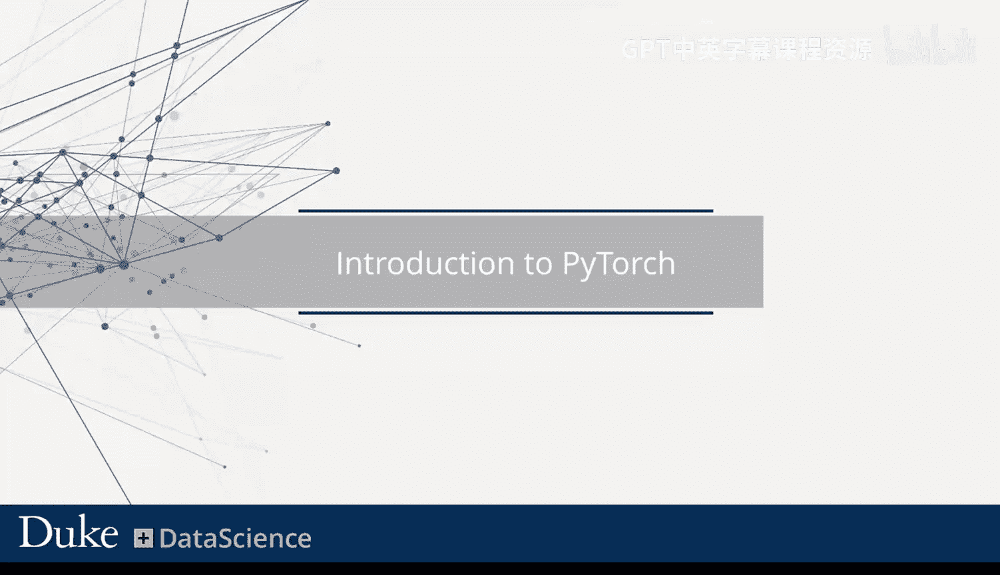
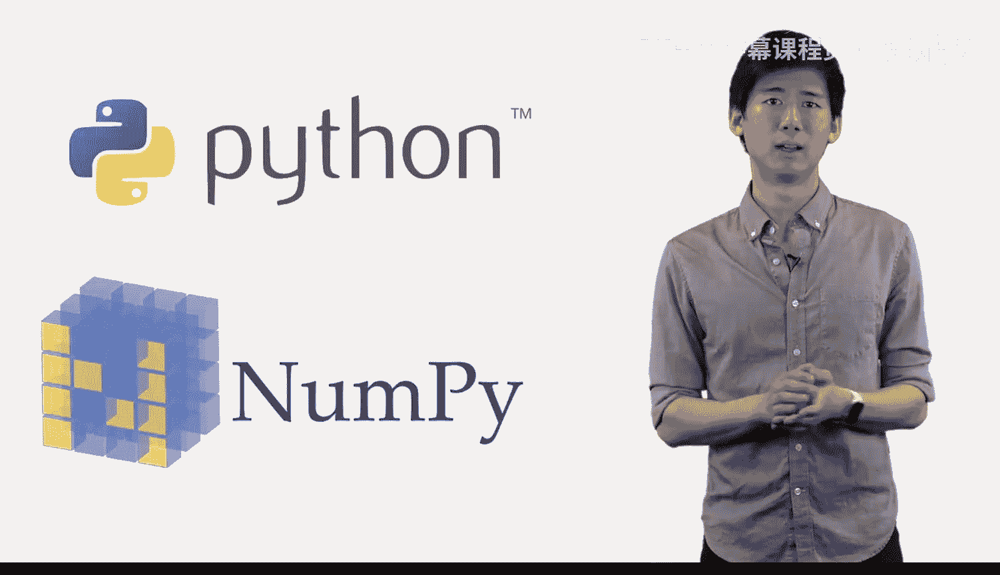
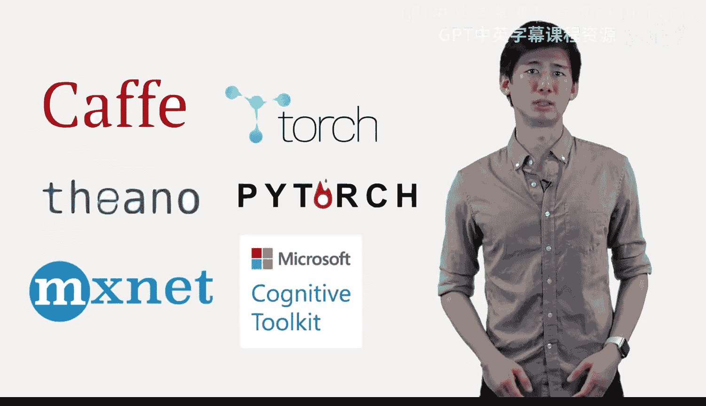
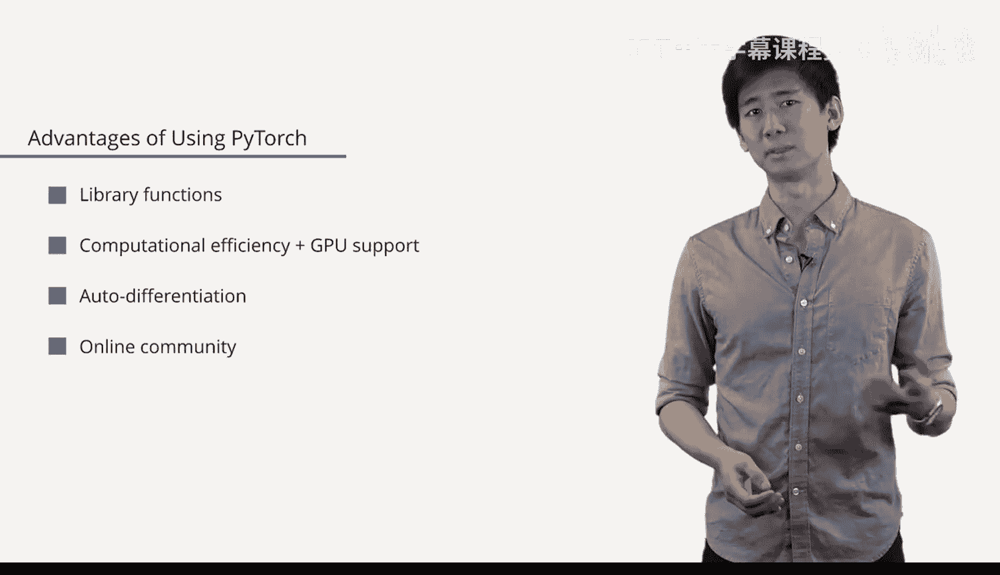
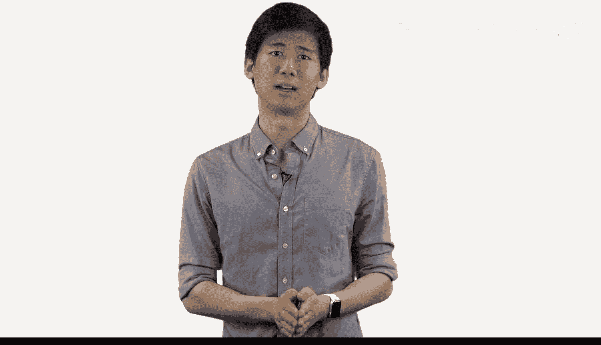
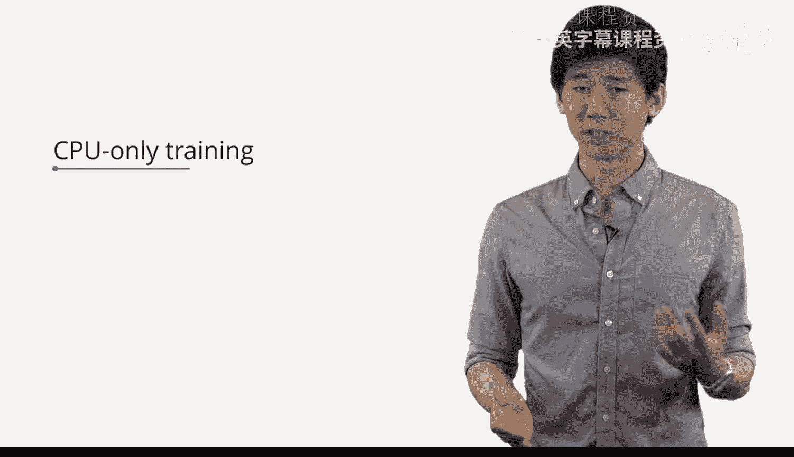

#  023：PyTorch简介 🚀

在本节课中，我们将学习PyTorch这一深度学习框架的基本概念、优势以及如何为后续实践部分设置编程环境。

大家好，欢迎来到课程的实践部分。我是Kevin Li Aang，是杜克大学Lawrence Karen教授指导的博士生，我将担任这些部分的讲师。在这些部分中，我们将逐步讲解如何使用Python构建先前视频讲座中学习的神经网络基本组件。这些部分被视为可选内容，但我们坚信，像其他数学或计算机科学课程一样，完成这些练习是深入理解的最佳方式。

## 为何选择PyTorch？🤔

上一节我们介绍了实践部分的目标，本节中我们来看看为何选择PyTorch作为我们的工具。

我们确实可以使用纯Python或Python的数值计算包NumPy来构建神经网络。然而，我们会发现这些实现方式在编写和运行上都较慢。

尽管如果你想完全掌握实践，这是一个很好的练习，但在实际中，我们通常使用众多机器学习库中的一个来构建深度学习模型。

对于本课程，我们将使用PyTorch，这是一个主要由Facebook AI Research构建的框架。

使用像PyTorch这样的库有许多优势。首先，许多深度学习模型具有某些共同的操作。使用PyTorch意味着我们不必自己编写所有这些函数。

然而，一个关键区别在于，这些库的实现方式与我们可能自己实现的方式不同，它们被编写为计算高效，并且能够利用图形处理单元（GPU）。深度学习模型的训练可能需要很长时间，而GPU实现可以使模型训练时间从几天或几周缩短到几小时。

此外，正如我们将在下一个模块中看到的，几乎所有神经网络都是通过反向传播学习的，这需要计算网络参数的梯度。这些梯度可以手动推导，实际上，如果你使用Python和NumPy，你可能需要自己完成。另一方面，PyTorch的自动梯度引擎可以自动为我们进行这种微分，这使得构建模型变得更加容易。

最后，现在是一个进入机器学习领域的激动人心的时刻，拥有一个庞大的社区，包括研究人员、专业人士和学生。PyTorch拥有增长最快的用户社区之一，很容易找到最先进模型的开源实现、带有代码示例的逐步教程以及充满调试建议或最新趋势的活跃论坛。

## 实践材料与预备知识 📚

上一节我们了解了PyTorch的优势，本节中我们来看看实践材料的形式和所需的预备知识。

实践部分的大部分材料都组织在Jupyter IPython笔记本中，文本解释和图表嵌入在代码单元格之间。

在引导您进入第一个关于设置环境的笔记本之前，有几点简要说明。

首先，我们假设您对Python和NumPy有基本的了解。请查看“Python预备知识”笔记本，并确保您理解大部分示例代码。如果您有些生疏或从未接触过Python，我们建议在尝试本课程的实践部分之前先进行复习。

其次，虽然GPU极大地加速了训练过程，但并非每个人都有能力处理深度学习模型计算的GPU。因此，我们将坚持使用仅需CPU即可运行的更简单问题。您会发现，为CPU计算编写代码与为GPU编写代码非常相似。

## 总结与下一步 🎯

本节课中我们一起学习了PyTorch框架的基本介绍、其核心优势以及实践课程的设置要求。我们了解到，PyTorch通过提供高效的GPU计算支持和自动微分功能，简化了深度学习模型的构建过程。实践材料以Jupyter笔记本形式提供，学习前需要具备Python和NumPy的基础知识。

好的，我们的介绍到此结束。现在让我们开始设置编码环境。