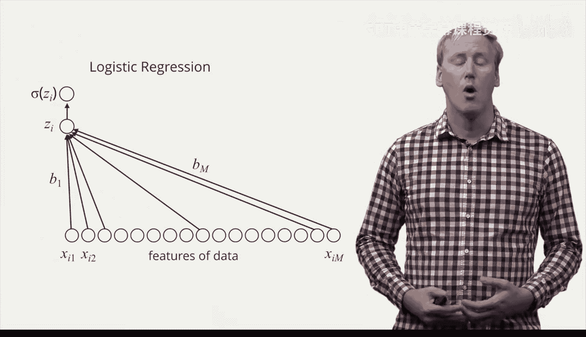
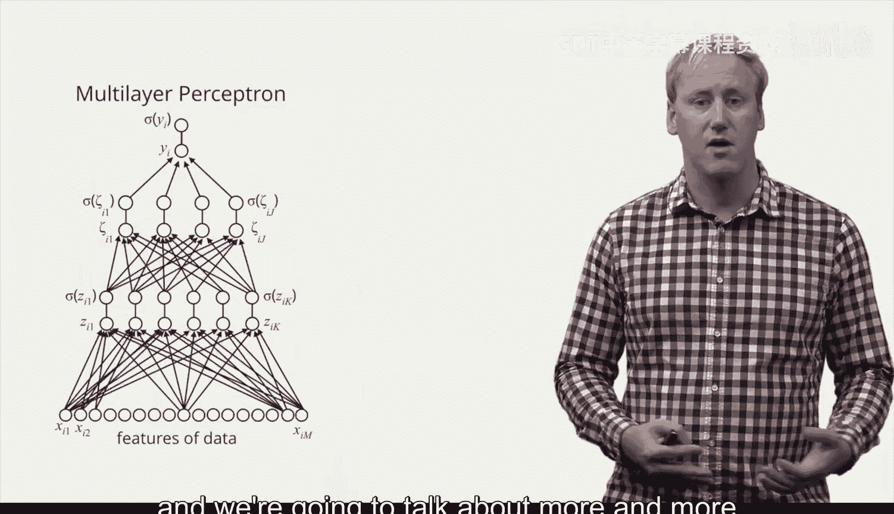
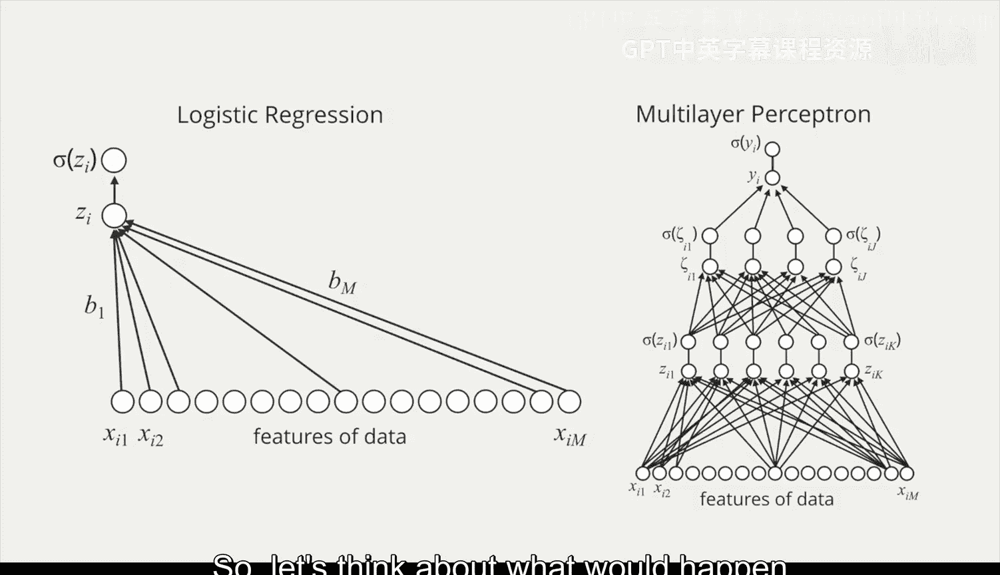
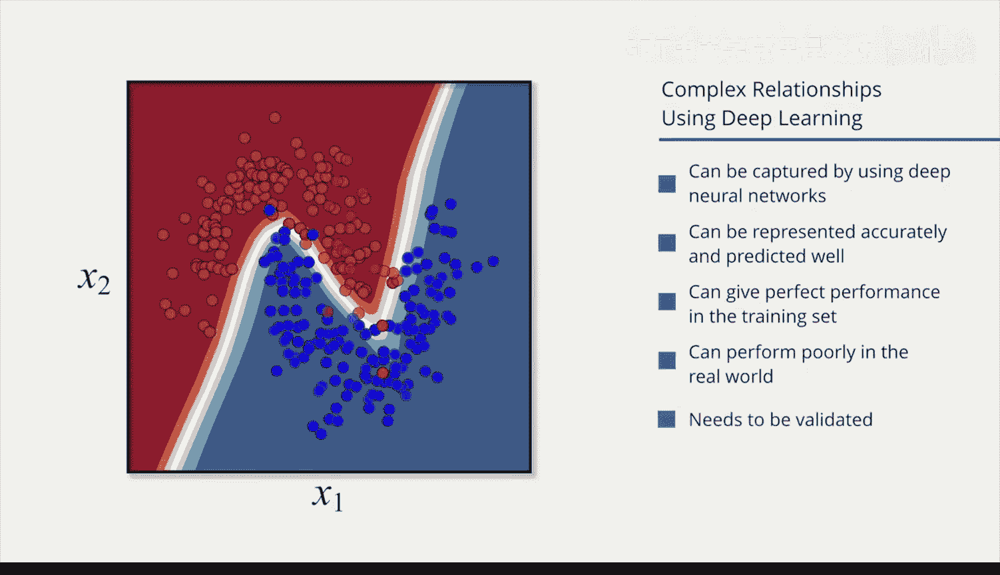
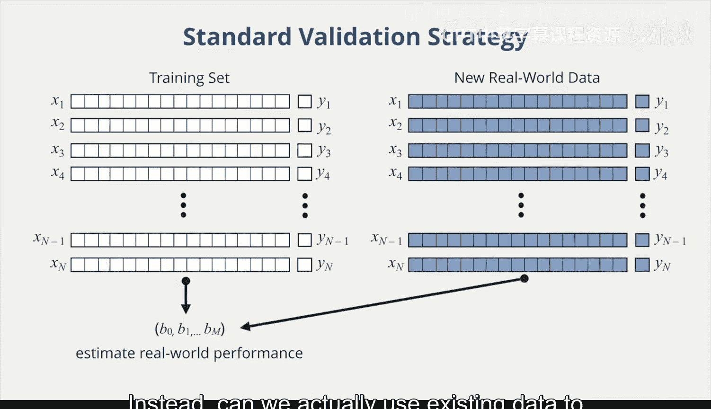
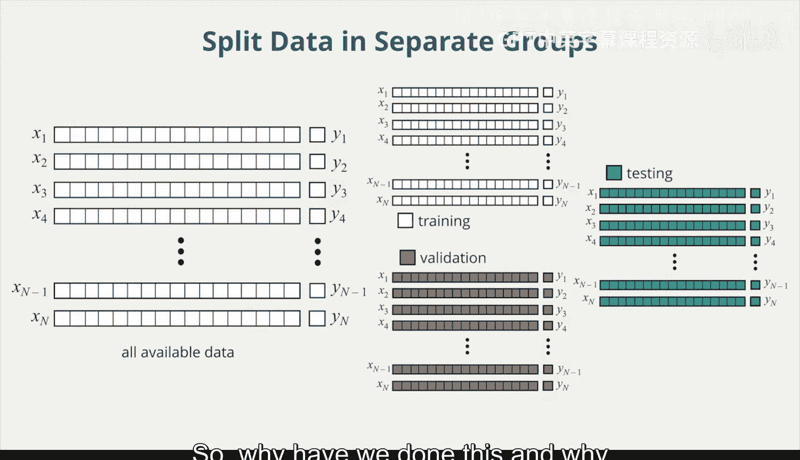
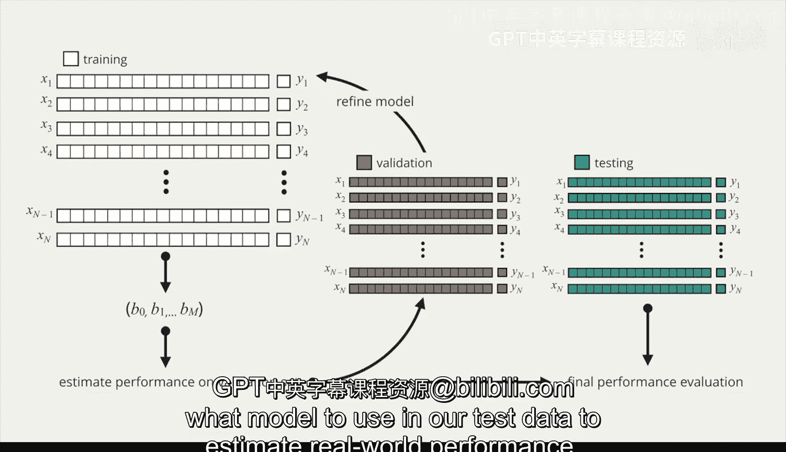

#  025：如何评估神经网络 📊

在本节课中，我们将学习如何评估神经网络模型的性能。我们将探讨模型复杂性与性能之间的关系，理解过拟合的概念，并介绍一种标准的验证策略，即通过划分数据集来客观地评估模型在真实世界中的表现。

---

## 模型复杂性与性能权衡 ⚖️

上一节我们介绍了定义神经网络的各种选项。本节中我们来看看如何评估这些网络的实际效果。

我们可以构建非常浅的网络，例如使用逻辑回归这种相对简单的模型，也可以使用深度神经网络。随着课程的深入，我们将讨论越来越复杂的网络。但一个根本性的问题是：我们如何实际评估这些网络的工作效果？

逻辑回归模型相对简单，其背后有数十年的统计学理论支持，解释了它的工作原理和适用场景。其核心是将特征线性组合后，通过一个函数（如Sigmoid）转换为概率：

**公式：** `P(y=1|x) = σ(w·x + b)`

而在右侧，我们展示的是多层感知机，这是一种深度神经网络。这种网络比逻辑回归能捕捉更多、更复杂的特性。现在的问题是：我们是否总是需要如此复杂的模型？

---

## 过拟合：复杂性的双刃剑 ⚔️

首先，创建深度模型确实有助于学习复杂关系。例如，著名的“双月”数据集，逻辑回归无法有效分离这两个类别，因为模型能捕捉的模式非常有限。而深度神经网络可以学习并准确预测这种复杂的非线性关系。

然而，在很多情况下，这种复杂性可能是不必要的。深度模型可能在训练数据集上达到完美性能，但在真实世界中却可能完全失败。因此，我们必须验证神经网络的性能是否如我们所想的那样好。

在深入探讨如何进行验证之前，让我们更深入地思考一下过拟合的概念。

过拟合发生在我们的学习模型为了过度拟合已观测的训练数据而增加复杂性时。它会在训练集上预测得极好，但在面对真实数据时却表现不佳。

为什么会发生这种情况？让我们从一个简单的例子开始。假设我们有一些观测数据点，想找到一个函数来预测给定x值时的观测结果。

一种经典的策略是增加多项式的阶数。左侧展示了一个简单的线性回归拟合（一阶）。它表现不错，很多人会对此满意。但问题是：我们能否增加一点复杂性来获得更好的预测？

当我们使用三阶（三次）拟合时，可以看到在绘制的范围内，它似乎对数据点的拟合更好一些。然而，我们可以继续增加复杂性。图中展示的是对相同数据点的八阶拟合。这看起来非常不合理，它完美地拟合了训练数据，但如果我们试图预测未来的点，效果会很差。

在神经网络中，增加深度意味着增加模型中的参数数量。逻辑回归的参数数量是有限的，而每次在多层感知机中添加一个层，我们都会获得更多参数。但请记住，我们必须估计这些参数。如果我们需要估计的参数更多，每个参数的估计误差会累积起来。

另一方面，我们确实喜欢更复杂的模型或网络，因为它们可以学习更复杂的关系。但问题是，这些关系对于现实情况来说是否过于复杂了？我们可以学习任何想要的复杂关系，但这种复杂关系在现实中真的存在吗？

发生过拟合时，意味着模型无法“泛化”。我们希望模型和分析能够泛化，这意味着当我们将其应用于真实世界并做出预测时，这些预测能够成立。因此，我们想知道：我们的网络和模型在实际中到底能工作得多好？

---

## 标准验证策略：数据划分 📈

现在，我想介绍一种非常标准的验证策略。

如果我们的最终目标是了解这个网络在真实世界中的表现，那么一个优秀且堪称“黄金标准”的方法就是直接在真实世界中尝试。我们可以用训练数据集估计参数，然后获取新的真实世界数据，用我们的网络进行预测，并以此评估真实世界的性能。

这确实是黄金标准。然而，这种做法成本极高。当我们只是想验证模型是否有效时，我们并不想这样做。相反，我们能否利用现有数据来估计性能？

答案是肯定的。我们将尝试智能地使用现有数据，基于我们已经收集到的可用数据，创建方法来验证我们认为模型在真实世界中的表现。

我们拥有所有可用数据，接下来要做的就是将这些数据分成不同的组。

我们将定义三组数据：训练数据集、验证数据集和测试数据集。我们将随机将数据分配到这些不同的组中，并按不同比例分配。

训练数据的用途我们已经讨论了很多，它用于获取模型参数。验证数据和测试数据是另外两个独立的数据集。我们为什么要这样做？这样做有什么好处？

首先，测试集是机器学习中的标准实践。我们希望在开始任何分析之前就创建测试集，并且在创建测试集之前完全不使用这部分数据。测试集永远不会用于学习或拟合任何参数。在学习网络之后，我们可以在测试集上评估其性能。这意味着这部分数据没有包含在训练或拟合过程中，因此在这个新测试集上尝试模型，类似于进行一次新的实验。关键的一点是，测试集理想情况下只应使用一次。如果重复使用测试集，会导致偏差，这意味着我们的性能估计会过于乐观，即我们认为在真实世界中的性能会比实际更高。

为了解决测试集只能使用一次的问题，我们创建了验证集。验证集的想法是，我们希望能够比较哪种方法最好。如果我们只使用一次测试集，就无法做到这一点。验证集同样不用于学习参数，但可以用于反复估计模型的性能。这样，如果我们想尝试许多不同的网络结构（如逻辑回归模型、多层感知机等），我们可以在验证集上学习所有模型并评估它们的性能。一旦我们选定了要使用的模型，就可以在测试数据上进行最终评估，并且只使用测试数据一次。

为了可视化这个过程：我们从所有可用数据中划分出训练数据，并从中学习参数。然后，使用验证数据来估计性能，并利用这个性能估计来优化我们的模型或网络架构（例如，增加或减少复杂性）。我们将持续这个过程，直到我们认为找到了最适合数据的模型。之后，我们跳出这个循环，结合模型，并使用测试数据一次性估计最终性能。

这就是我们在使用机器学习时希望采用的结构：使用验证数据帮助我们确定使用哪种模型，使用测试数据来估计真实世界的性能。

---

## 总结 📝

本节课中，我们一起学习了如何评估神经网络。我们探讨了模型复杂性带来的好处与过拟合的风险。最重要的是，我们介绍了一种通过将数据划分为训练集、验证集和测试集来系统评估模型性能的标准方法。这种方法能帮助我们更客观地选择模型，并对其在未知数据上的表现做出更可靠的估计。